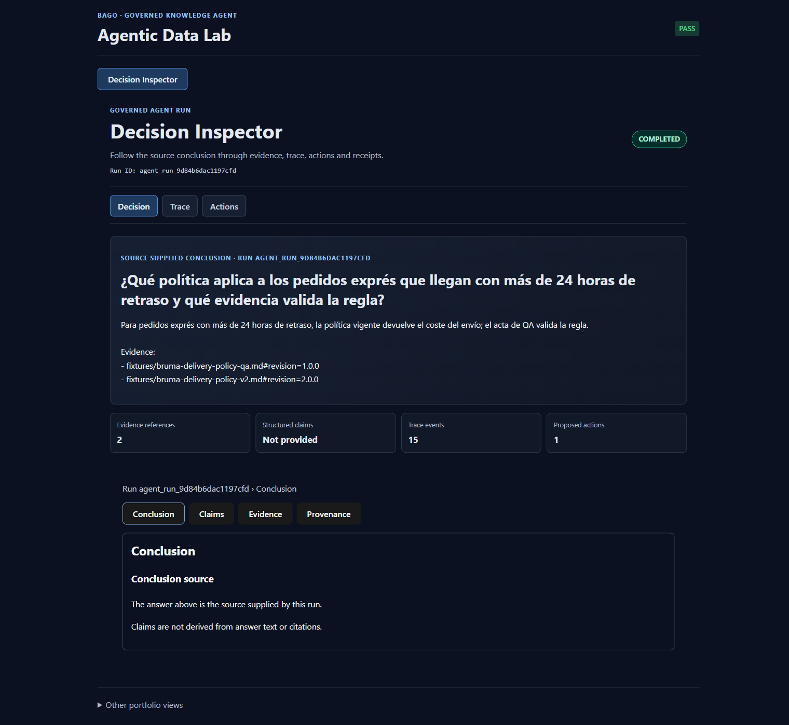
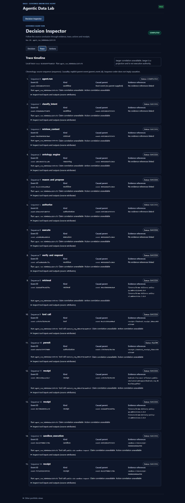
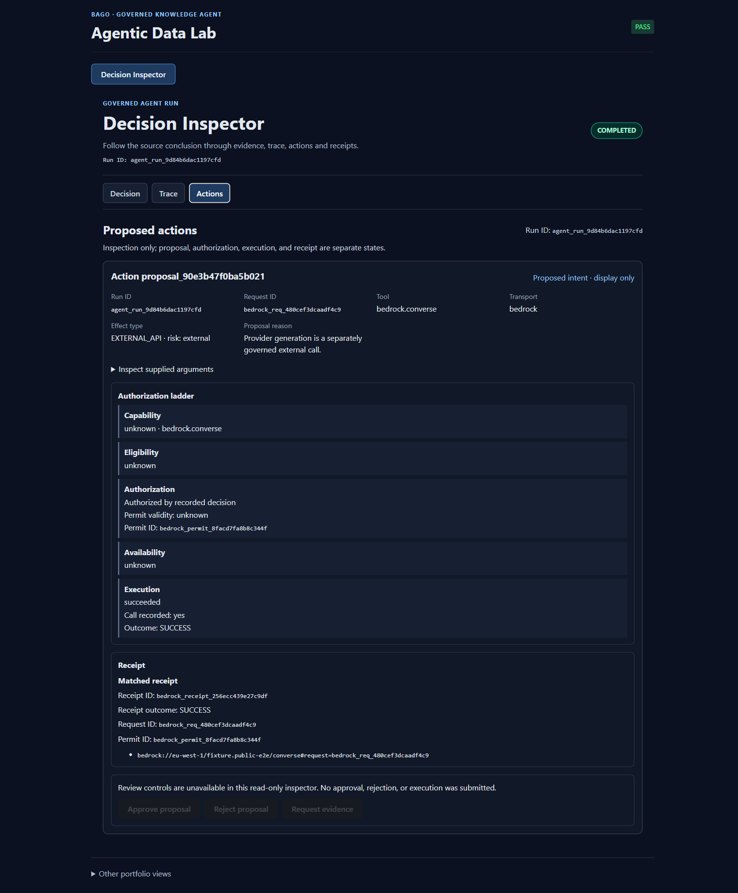
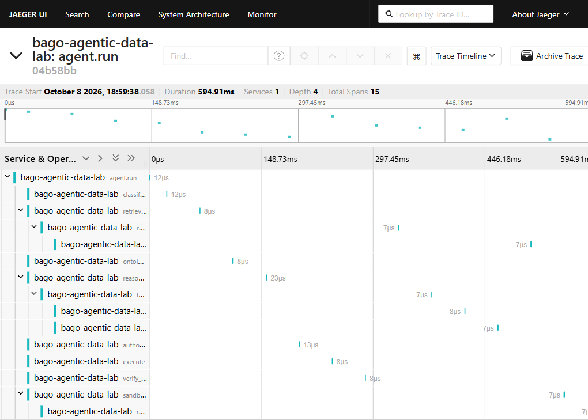

# Manual para leer una ejecución en BAGO Agentic Data Lab

Manual 01 · edición 1.3 · actualizado el 15 de octubre de 2026

Esta guía explica cómo inspeccionar una ejecución del laboratorio, seguir su LocalTrace y revisar propuestas y recibos. La interfaz de inspección es de solo lectura: no autoriza ni ejecuta acciones.

## 1. Iniciar la aplicacion

Desde la raíz del repositorio, ejecuta en PowerShell:

```powershell
scripts\run-local-ui.ps1
```

El launcher compila la interfaz, inicia la API local y abre la aplicación. Usa `http://127.0.0.1` y selecciona un puerto libre entre 8080 y 9000; abre la dirección que lanza el propio script. Si faltan paquetes, sigue `docs/agent-chat-control/LOCAL_SETUP.md`. El launcher no configura credenciales ni realiza una llamada a un modelo.

Para abrir el inspector, selecciona **Inspect** en la barra lateral y luego **Decision Inspector**. Se abre una capa de inspección sobre el espacio de trabajo. Si el paquete de evidencias no está disponible, la interfaz lo indica; no inventa una ejecución.

> Esta aplicacion tambien ofrece Chat, Capabilities, Agent Builder, Agent Runs y Agent Evaluation Lab. Ver una entrada en el catalogo, conversar con un agente o abrir una ejecucion no demuestra por si solo que un trabajo se completara. Para leer el alcance de la demo gobernada, consulta `portfolio/README.md`.

## 2. Leer decisión, claims y evidencia

Anota el `run_id` mostrado en Decision Inspector. Comprueba la pregunta, la respuesta fuente y el estado de la ejecucion.

Los contadores resumen referencias de evidencia, claims estructurados, eventos de traza y acciones propuestas. Una referencia recuperada indica que un documento o fragmento fue consultado; no demuestra por sí sola una frase de la respuesta. La interfaz no extrae claims del texto ni deduce relaciones claim-evidencia. Cuando la fuente no aporta esos datos, se muestran como no disponibles.

Las vistas **Conclusion**, **Claims**, **Evidence** y **Provenance** separan el texto fuente de las relaciones que la fuente registró. `Freshness not established` significa que no hay datos suficientes para comparar la revisión o snapshot.



*Captura del recorrido validado el 8 de octubre de 2026. Sirve para localizar elementos; puede no coincidir con el aspecto de la interfaz actual.*

## 3. Seguir LocalTrace

En el inspector, abre **Trace**. Revisa el `trace_id`, el `run_id`, la secuencia de eventos y las referencias disponibles. Una secuencia indica orden. Solo un `parent_event_id` registrado por la fuente expresa la relacion padre-hijo; no infieras causalidad adicional.

No confundas estos identificadores:

| Identificador | Que identifica |
| --- | --- |
| `run_id` | La ejecucion del agente. |
| LocalTrace `trace_id` | El registro local de eventos. |
| Jaeger trace ID | La traza que un Jaeger local consulto. Puede tener un valor diferente. |

La interfaz no enlaza automaticamente el identificador de Jaeger al trace local. Si no aparece un dato, registralo como no proporcionado.



*Captura de referencia del 8 de octubre de 2026; la secuencia y los IDs cambian en cada ejecucion.*

## 4. Revisar acciones y recibos

En **Actions**, lee cada propuesta y distingue sus estados:

1. **Propuesta:** describe una intencion.
2. **Decision de autorizacion:** indica si se permitio o denego una solicitud.
3. **Ejecucion:** requiere evidencia de que el efecto o llamada ocurrio.
4. **Recibo:** registra el resultado y debe poder asociarse a la misma ejecucion.

Un permiso `ALLOW` no prueba que algo se ejecutara. Un estado `SUCCESS` sin recibo asociado no basta para verificar el resultado. El inspector asocia recibos solo cuando el `run_id` explicito coincide; un recibo sin identidad o de otro run queda sin verificar. Esa coincidencia es una comprobacion de identidad declarada por la fuente, no una firma criptografica.



*Captura de referencia del 8 de octubre de 2026. Consulta los IDs y estados de la ejecucion que tengas abierta.*

## 5. Consultar Jaeger (opcional)

Jaeger es una proyeccion local de observabilidad; LocalTrace sigue siendo la fuente de evidencia de trazas del proyecto. Para reproducir la validacion local documentada, se necesita Docker disponible:

```powershell
docker compose -p bago-otel -f infra/observability/docker-compose.yml up -d
python scripts/run_l15_otel_live_validation.py --check
```

Abre `http://localhost:16686` y consulta el Trace ID que imprima la ejecución actual. No reutilices un ID de una captura anterior para una nueva ejecución. Al terminar, puedes parar el servicio:

```powershell
docker compose -p bago-otel -f infra/observability/docker-compose.yml down
```

La validación versionada del 8 de octubre observó 15 spans en Jaeger para aquella traza. Es evidencia histórica de esa ejecución, no una comprobación del estado actual de Docker, AWS o colectores remotos. El recorrido local no acredita envío remoto.



*Captura historica. El grafo y los identificadores variaran al reproducir el flujo.*

## Practica de lectura

Con una ejecución disponible, anota:

- `run_id` y estado de la ejecucion.
- Numero de referencias y si hay claims estructurados.
- `trace_id`, numero de eventos y cualquier evento padre informado.
- Propuestas, decisiones de autorizacion, efectos observados y recibos.
- Si el `run_id` del recibo coincide con el del agente.
- Si consultaste Jaeger: su Trace ID y el numero de spans observados.

Escribe conclusiones limitadas a lo observado. Por ejemplo: “El recibo declara el mismo `run_id` que esta ejecución y muestra resultado SUCCESS”. Evita afirmar que una fuente apoya una claim si el vínculo no está registrado, o que Jaeger recibió la traza si no repetiste la consulta.

## Si algo no aparece

- **La interfaz no abre:** usa la URL que abrió `scripts/run-local-ui.ps1`; el puerto puede variar. Revisa `docs/agent-chat-control/LOCAL_SETUP.md` y los logs locales del launcher.
- **No hay paquete de evidencias:** el inspector lo indicará y ofrecerá abrir **Agent Runs**. La ausencia del paquete no demuestra que haya ocurrido una ejecución.
- **No aparecen claims, revision o soporte:** la fuente no proporciono esos datos; no los infieras de una cita o del texto de respuesta.
- **Jaeger no abre:** verifica que Docker esté activo y ejecuta el comando de Compose anterior. Si no se reproduce, deja el resultado como no verificado.

## Glosario y limites

- **Claim:** afirmacion estructurada, aportada por la fuente.
- **Evidencia:** referencia a documento o fragmento consultado.
- **LocalTrace:** registro local de eventos de una ejecucion.
- **Span:** operacion representada en una traza de Jaeger.
- **Recibo:** registro del resultado declarado por una operacion.

Las capturas se tomaron el 8 de octubre de 2026 y se conservan para orientar la lectura; no se pudieron refrescar porque la aplicación y Jaeger no estaban activos al preparar esta edición. Esta guía actualiza rutas de acceso, comandos y límites con el código y la documentación del repositorio a 15 de octubre de 2026. No certifica una nueva ejecución, un nuevo recibo ni disponibilidad remota.
