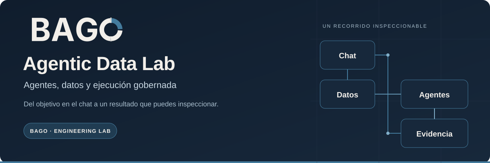

# BAGO Agentic Data Lab

[](https://github.com/MarcValls/BAGO_AGENTIC_DATA_LAB/actions/workflows/ci.yml)
[](https://github.com/MarcValls/BAGO_AGENTIC_DATA_LAB/actions/workflows/readme-consistency.yml)
[](LICENSE)

> **Tu espacio de trabajo, desde el chat.** Expresa la intención, revisa la propuesta y consulta el resultado con su evidencia.

Aplicación y laboratorio de agentes, datos y ejecución gobernada: trabajar desde la interfaz e inspeccionar propuestas, autorizaciones y evidencia.

**Entrada principal: Chat.** Workspace, Agent Builder, Inspect y Settings amplían la conversación para preparar datos, configurar perfiles, revisar autorizaciones y profundizar en resultados. La cobertura conversacional actual se describe abajo; los pasos que necesitan una vista específica siguen indicados.

[Conocer el producto](#el-laboratorio) · [Ver la aplicación](#la-aplicación-en-pantalla) · [Instalar y arrancar](#instalación-y-operación) · [Revisar tests](#tests-y-verificación)

---

**EN ESTA PÁGINA**

| Producto | Plataforma | Operación |
|---|---|---|
| [01 · El laboratorio](#el-laboratorio) | [05 · Agentes y tareas](#agentes-tareas-y-evaluación) | [10 · Tests y verificación](#tests-y-verificación) |
| [02 · Chat y frontend](#la-aplicación-frontend) | [06 · Proveedores y modelos](#proveedores-y-modelos) | [11 · Instalación](#instalación-y-operación) |
| [03 · Capturas actuales](#la-aplicación-en-pantalla) | [07 · Ejecución gobernada](#bago-ber-y-ejecución-gobernada) | [12 · Observabilidad](#observabilidad-e-inspección) |
| [04 · Datos y conocimiento](#datos-y-conocimiento) | [08 · Arquitectura](#arquitectura-de-un-vistazo) | [13 · Estado y roadmap](#estado-y-roadmap) |
| [Guía del frontend](docs/readme_frontend.md) | [09 · Casos y demos](#casos-y-demos) | [14 · Documentación](#documentación-y-aprendizaje) |

### Explorar el laboratorio

| | | |
|:---:|:---:|:---:|
| [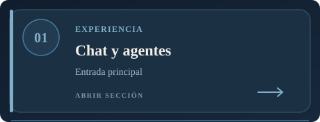](#la-aplicación-frontend) | [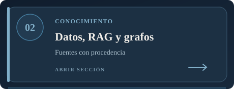](#datos-y-conocimiento) | [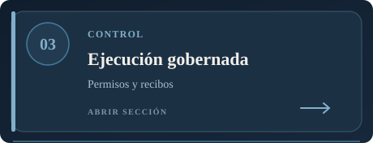](#bago-ber-y-ejecución-gobernada) |
| [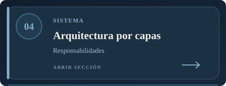](#arquitectura-de-un-vistazo) | [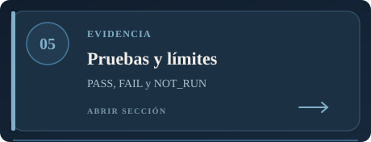](#tests-y-verificación) | [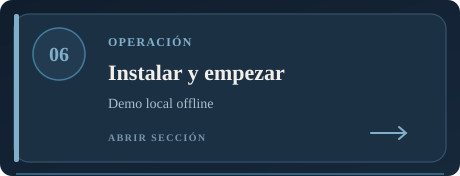](#instalación-y-operación) |

## El laboratorio

[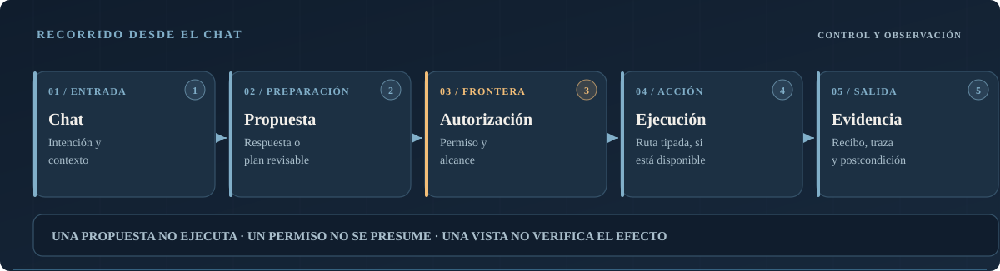](docs/readme_frontend.md)

**Vista conceptual:** cada etapa de ejecución necesita su propia autoridad y observación; la navegación no implica efecto.

BAGO Agentic Data Lab reúne una aplicación de trabajo y un laboratorio de AI Engineering. Permite conversar con el asistente, preparar agentes y datos, y recorrer controles de ejecución, recuperación, trazabilidad y evaluación con contratos explícitos.

El producto organiza la experiencia alrededor de una intención del usuario. La evidencia permite distinguir una respuesta del modelo, una propuesta, una autorización y un efecto comprobado. Cada integración conserva su entorno y sus límites de validación.

| Necesidad | Recorrido | Resultado que se puede inspeccionar |
|---|---|---|
| Orientarse y pedir ayuda | Chat del asistente y accesos a vistas | Conversación persistida, propuesta de navegación y contexto |
| Preparar un agente | Borrador conversacional y Agent Builder | Perfil guardado con modelo y configuración explícitos |
| Consultar conocimiento | Ingesta, recuperación gobernada y ontología | Fuentes, citas, relaciones y decisiones de metadata |
| Revisar una operación | Perfil de ejecución aplicable y autorización | Solicitud, decisión, permiso y recibo, cuando existen |
| Evaluar y diagnosticar | Evaluation Lab, Inspect y trazas | Comprobaciones declaradas, historial y evidencia enlazada |

**Profundizar:** [contrato del laboratorio](.bago/canon/LAB_CONTRACT.md) · [arquitectura de referencia](.bago/canon/ARCHITECTURE.md).

## La aplicación frontend

La interfaz **React + TypeScript + Vite** sitúa Chat como entrada principal. El asistente puede ayudar, listar agentes/capacidades, preparar un borrador de agente y proponer navegación. Agent Builder puede aparecer dentro de la conversación; el cambio a otra pantalla requiere la decisión visible del usuario.

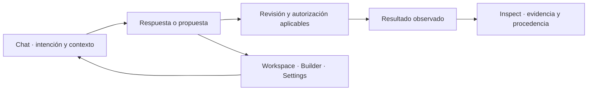

| Desde el chat | Apoyo de las vistas | Cobertura actual |
|---|---|---|
| Conversar, pedir ayuda y listar agentes | Settings configura proveedor/modelo y cognición | Depende del proveedor efectivo; una selección guardada no prueba inferencia |
| Pedir un borrador de agente | Builder integrado o pantalla completa | El perfil se revisa y guarda; guardarlo no ejecuta sus herramientas |
| Solicitar navegación | Workspace, Agent Runs, Inspect y otras vistas existentes | La navegación propuesta se confirma; no implica completar la operación de destino |
| Autorizar lecturas acotadas de proyecto y revisar resultados compatibles | Controles de lectura y revisión del workspace | Rutas explícitas y autorización propia; disponer de contexto no concede acceso general |
| Consultar historial y resultados disponibles | Inspect, tareas y evaluación | Algunos recorridos requieren pasos manuales en su vista; no se afirma cobertura total desde Chat |

| Área del producto | Función |
|---|---|
| Interacción | Chat, Workspace, Capabilities, Agent Builder, Agent Runs y Agent Evaluation Lab. |
| Datos y tareas | Tareas guardadas de agentes; ingesta y consulta con citas; revisión de ontología, calidad de catálogo y conexiones/MCP. Cada recorrido conserva sus límites de disponibilidad. |
| Inspect | Decision Inspector, BER Effect Record, historial y paneles de recuperación, autorización, traza y evaluación. |
| Settings | Configuración cognitiva y de proveedores/modelos, selección de modelos y comprobaciones de disponibilidad. |

**Profundizar:** [guía del frontend y alcance conversacional](docs/readme_frontend.md) · [entrada de la app](frontend/src/App.tsx) · [API FastAPI](src/api/server.py).

## La aplicación en pantalla

**Capturas del recorrido documentado el 2026-10-25 · aplicación local en Brave visible.** Las imágenes se capturaron desde el navegador visible; las observaciones y su procedencia están descritas en la guía enlazada.

El carrusel cambia de captura automáticamente. Puedes abrir el [visor HTML con controles de anterior, siguiente y pausa](docs/assets/readme-20261025/carousel.html) o desplegar una imagen original para leerla a tamaño completo.

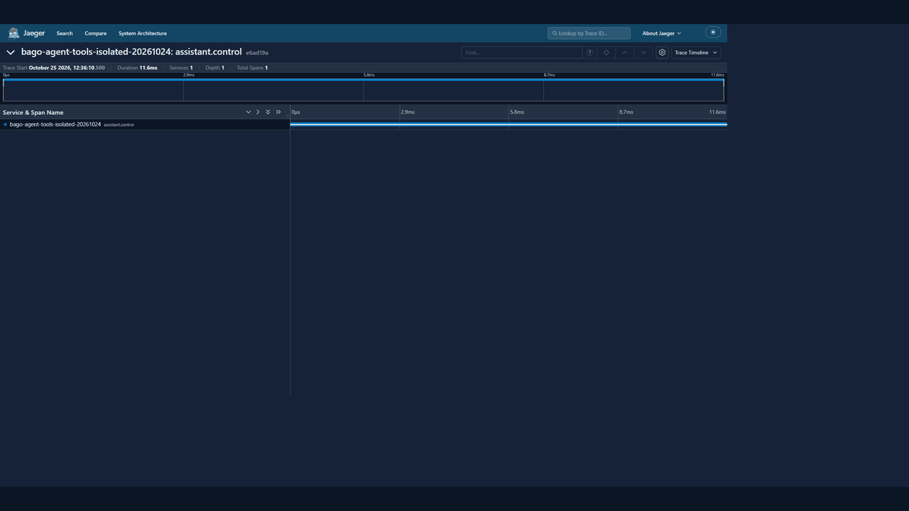

<details>
<summary>Captura 01 · Traza e6ad19aa91275f3a7f069df126b86474: assistant.control, 11,6 ms, un span; registra la presentación/selección de capacidad, no el escaneo.</summary>

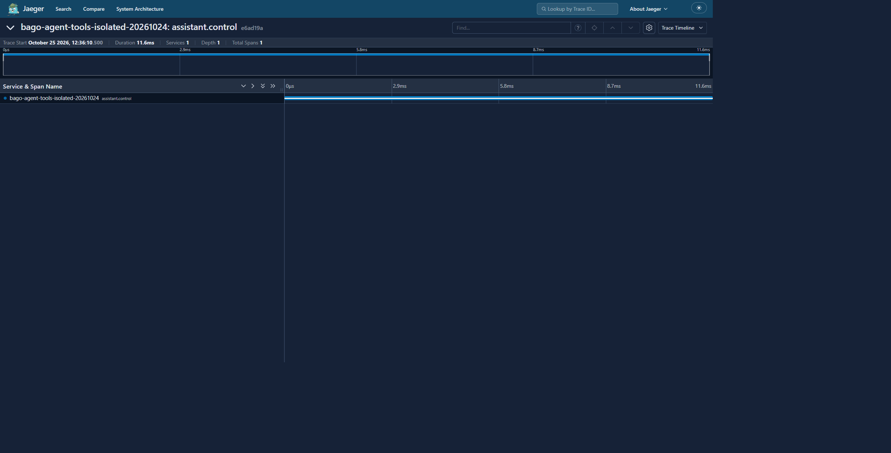

**Traza e6ad19aa91275f3a7f069df126b86474: assistant.control, 11,6 ms, un span; registra la presentación/selección de capacidad, no el escaneo.**

</details>

<details>
<summary>Captura 02 · Traza 52ecd0539027d9ef6139ede1def3b8f9: raíz 4,116 s, dos spans. development_read fue denegada por development_root_mismatch; el hijo de 15 μs está marcado como projection, no como tiempo medido.</summary>

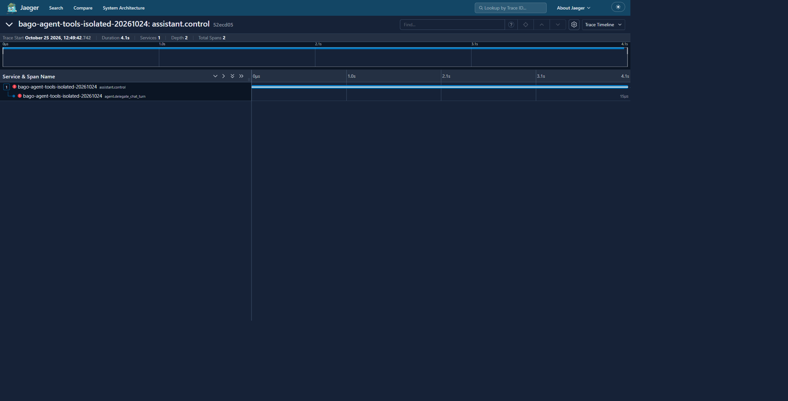

**Traza 52ecd0539027d9ef6139ede1def3b8f9: raíz 4,116 s, dos spans. development_read fue denegada por development_root_mismatch; el hijo de 15 μs está marcado como projection, no como tiempo medido.**

</details>

<details>
<summary>Captura 03 · Traza histórica ef52b03816307abf57decaa751282173: 22,318 s, 12 spans y 11 hijos. El chat terminó correctamente, pero la respuesta guardada declaró regression NOT_RUN y ninguna herramienta ejecutada.</summary>

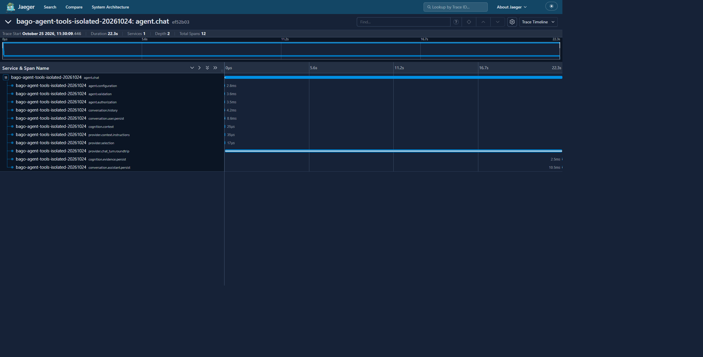

**Traza histórica ef52b03816307abf57decaa751282173: 22,318 s, 12 spans y 11 hijos. El chat terminó correctamente, pero la respuesta guardada declaró regression NOT_RUN y ninguna herramienta ejecutada.**

</details>

<details>
<summary>Captura 04 · Lectura puntual autorizada de workspace en AgentChat: ALLOW y 14 spans. La captura muestra la lectura entre dos rondas del proveedor; no demuestra una misión documental completa ni el cierre de la suite.</summary>


**Lectura puntual autorizada de workspace en AgentChat: ALLOW y 14 spans. La captura muestra la lectura entre dos rondas del proveedor; no demuestra una misión documental completa ni el cierre de la suite.**

</details>

<details>
<summary>Captura 05 · ANTES de la corrección del Historial de trabajos: el registro legacy estaba vacío. Esto no demuestra ausencia de conversaciones, TaskRuns ni otras ejecuciones; no representa el estado posterior a la reparación.</summary>

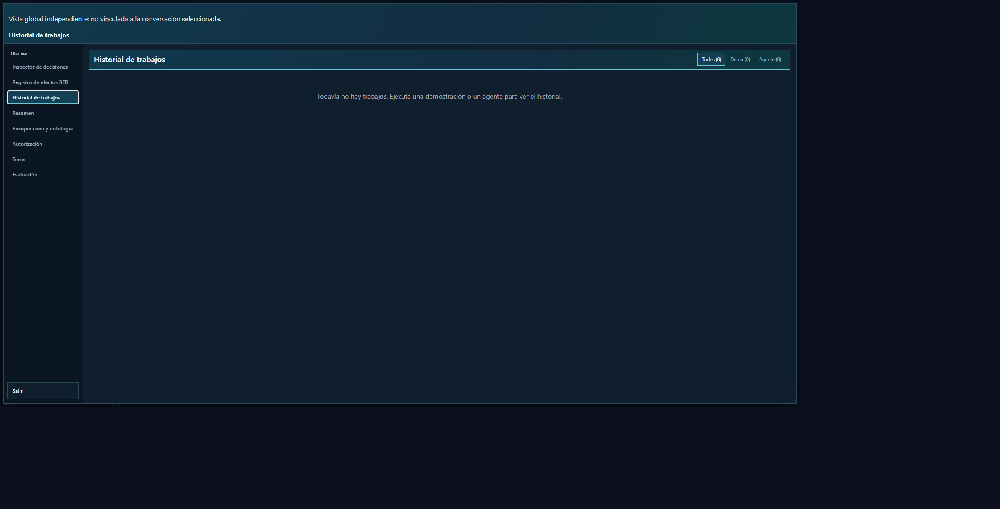

**ANTES de la corrección del Historial de trabajos: el registro legacy estaba vacío. Esto no demuestra ausencia de conversaciones, TaskRuns ni otras ejecuciones; no representa el estado posterior a la reparación.**

</details>

<details>
<summary>Captura 06 · DESPUÉS de la reparación del Historial: cinco fuentes disponibles y filtro Trabajo legacy explícito. El vacío corresponde sólo a esa fuente; no demuestra ausencia de tareas ni que una misión haya terminado.</summary>

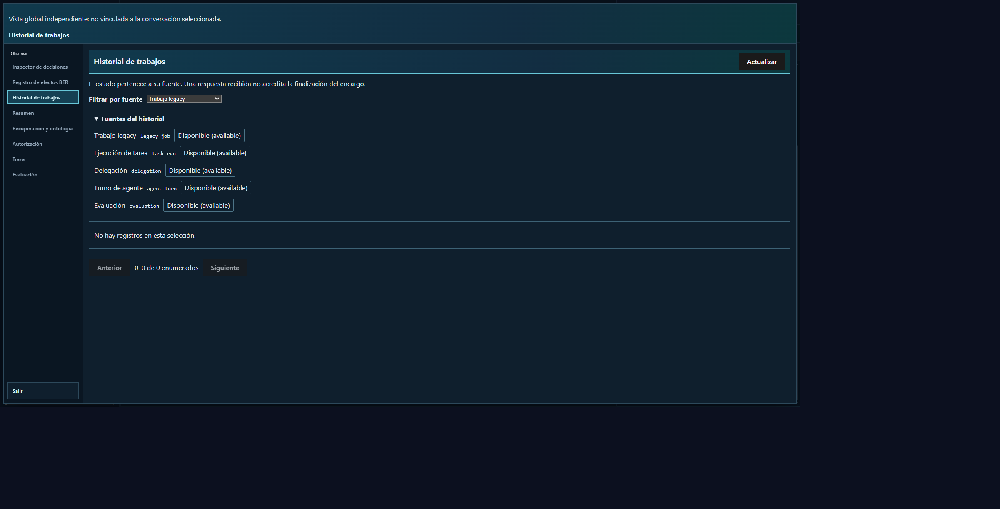

**DESPUÉS de la reparación del Historial: cinco fuentes disponibles y filtro Trabajo legacy explícito. El vacío corresponde sólo a esa fuente; no demuestra ausencia de tareas ni que una misión haya terminado.**

</details>

**Profundizar:** [cómo se tomaron, identidad del servidor, observaciones y hashes](docs/verification/readme-captures-20261025.md) · [guía del frontend](docs/readme_frontend.md).

## Datos y conocimiento

[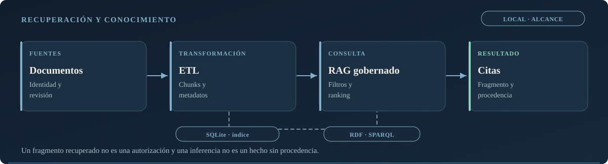](docs/governed_rag.md)

**Alcance:** componentes descritos por el repositorio, con verificaciones locales fechadas; una cita no otorga permiso de acción.

El contexto del workspace, los documentos recuperados y las relaciones de una ontología aportan información a la tarea. Los recorridos gobernados mantienen la identidad y la elegibilidad de las fuentes para que una cita o una relación pueda revisarse después.

| Capacidad | Aportación | Qué revisar |
|---|---|---|
| Ingesta y consulta | Preparar conocimiento y recuperar fragmentos con citas | Fuente, metadata permitida y evidencia devuelta |
| RAG híbrido y vectores locales | Recuperación léxica/semántica con SQLite persistente | Backend utilizado, fingerprint del índice y gate de metadata |
| Ontology Engine | RDF/Turtle, SPARQL acotado, inferencias y constraints | Relaciones derivadas, evidencia y contradicciones |
| Calidad de catálogo | Revisión de activos y metadata | Alcance local o remoto de cada comprobación |
| Conexiones y MCP | Adaptadores y registro de capacidades | Disponibilidad, autorización y recibos de cada invocación |

**Profundizar:** [Governed RAG](docs/governed_rag.md) · [vector store local](docs/local_vector_store.md) · [ontología](docs/ontology_engine.md) · [catálogo](docs/openmetadata_catalog.md) · [MCP gobernado](docs/mcp_governance.md).

## Agentes, tareas y evaluación

Un agente guardado es un perfil reutilizable. Las tareas conservan su petición y estado; las ejecuciones y evaluaciones aportan resultados solo cuando se recorre su contrato efectivo. El modelo asignado al asistente y el del agente se resuelven por separado.

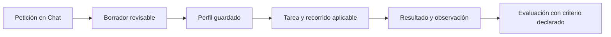

| Espacio | Trabajo principal | Límite de la afirmación |
|---|---|---|
| Agent Builder | Preparar nombre, prompt, modelo y herramientas declaradas | Una herramienta seleccionada no queda autorizada por el perfil |
| Tareas de agentes | Guardar y revisar tareas asociadas a perfiles | Una tarea guardada no equivale a una ejecución completa |
| Agent Runs | Acceder al recorrido de ejecución disponible | Runtime, proveedor, permisos y perfil determinan la disponibilidad |
| Agent Evaluation Lab | Suites versionadas y snapshots de runs en SQLite | Sus checks de texto deterministas no miden calidad general del modelo |
| Job History e Inspect | Consultar historial, estados y artefactos disponibles | Se necesita evidencia del efecto, además del estado mostrado |

**Profundizar:** [guía frontend: agentes y tareas](docs/readme_frontend.md#agentes-tareas-y-resultados) · [Agent Builder](docs/agent_builder_ui.md) · [contrato de Evaluation Lab](docs/agent_evaluation_lab.md).

## Proveedores y modelos

Settings separa configuración, catálogo de modelos y selección. El registro del adaptador, una credencial reconocida, la pertenencia al catálogo y una respuesta real son comprobaciones diferentes. La app muestra y aplica los estados que devuelve el backend.

| Modalidad | Configuración y uso | Evidencia necesaria para declararla operativa |
|---|---|---|
| Ollama y adaptadores locales | Servicio/modelo local y disponibilidad reportada | Dispatch y respuesta real del modelo seleccionado |
| OpenAI Platform y otros proveedores por API | Credencial y adaptador propios del servicio | Autenticación, modelo elegible y respuesta del proveedor |
| Codex CLI / sesión del host | Integración de sesión y protocolo del host correspondiente | Respuesta efectiva en ese recorrido; no se deduce de una API key de Platform |
| GitHub Copilot | Integración y elegibilidad propias | Estado del servicio y respuesta en su adaptador |
| AWS Bedrock | Adaptador gobernado, región y modelo explícitos | Recibo de la llamada y alcance/fecha; cuota y facturación tienen evidencia separada |

En la demostración nueva se verificó la selección de Codex gpt-6-luna en Settings y se obtuvo una respuesta real del agente con ese modelo. El primer guardado había fallado con `model_registration_mismatch`; el error quedó visible. Esa observación pertenece a esta sesión y no declara operativos todos los proveedores de la tabla.

**Profundizar:** [proveedores y modelos en el frontend](docs/readme_frontend.md#proveedores-y-modelos) · [pantalla de configuración](docs/provider-models-screen.md) · [setup Bedrock](docs/aws_bedrock_setup.md).

## BAGO, BER y ejecución gobernada

[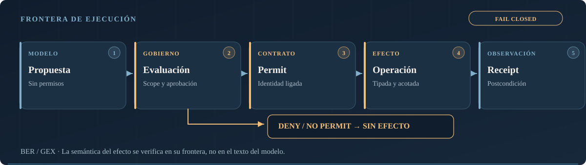](docs/governed-execution/GEX_V1_NORMATIVE_CONTRACT.md)

**Frontera:** denegación sin efecto y recibo verificable; perfiles de fixture y runtime real no son equivalentes.

BAGO aporta contratos y control de ejecución. El modelo produce propuestas; la autorización y la comprobación del efecto pertenecen al recorrido de ejecución. ADL presenta la revisión humana y la evidencia disponible en la interfaz.

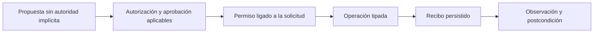

| Recorrido | Alcance | Condición de lectura |
|---|---|---|
| Laboratorio local histórico | Graph, ExecutionGateway y SandboxManager con fixtures y controles acotados | Mantiene su evidencia de fase; no representa el kernel de un sistema nuevo |
| Perfil GEX RUNTIME_FIXTURE | Lectura de un fixture sintético, solicitud exacta, aprobación y recuperación durable | Su contrato mantiene las rutas genéricas no habilitadas en ese perfil como `UNAVAILABLE / FAIL_CLOSED` |
| Agent Runner sobre BER | Adaptación al runtime fijado, workspace ligado y efectos tipados registrados | Requiere disponibilidad efectiva del host/proveedor; el gateway heredado no es fallback |
| BER Effect Record | Inspección del registro y del efecto declarado | Una vista del registro requiere su propia evidencia para acreditar el efecto |

**Profundizar:** [contrato normativo GEX](docs/governed-execution/GEX_V1_NORMATIVE_CONTRACT.md) · [perfil de lectura sintética](docs/governed-execution/RUNTIME_FIXTURE_PROFILE.md) · [alcance BER Agent Runner](docs/ber/AGENT_RUNNER_SCOPE.md) · [BER Effect Inspector](docs/ber/BER_EFFECT_INSPECTOR.md).

## Arquitectura de un vistazo

[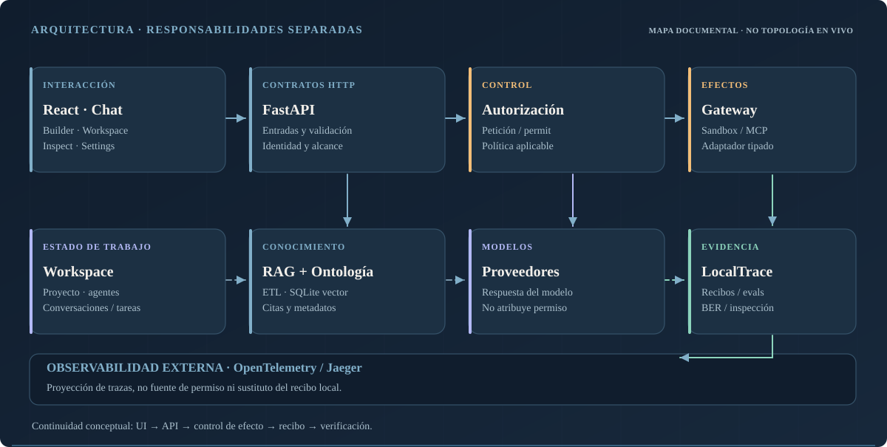](.bago/canon/ARCHITECTURE.md)

**Lectura:** mapa de responsabilidades extraídas de la documentación; no es una topología desplegada ni un PASS global.

La aplicación conecta experiencia de usuario, API y servicios especializados. El control de efectos conserva sus fronteras; LocalTrace enlaza eventos y artefactos, mientras que la proyección OpenTelemetry facilita su observación externa.

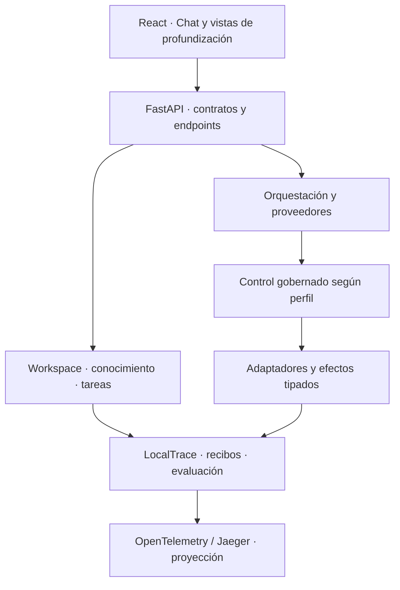

| Capa | Responsabilidad | Fuente de profundización |
|---|---|---|
| Frontend | Conversación, configuración y revisión | [App React](frontend/src/App.tsx) |
| API | Identidad de recursos, validación y conexión de recorridos | [Servidor](src/api/server.py) |
| Datos | Metadata, recuperación, ontología y persistencia | [Arquitectura canónica](.bago/canon/ARCHITECTURE.md) |
| Gobierno | Propuesta, elegibilidad, aprobación y límites de efecto | [GEX normativo](docs/governed-execution/GEX_V1_NORMATIVE_CONTRACT.md) |
| Evidencia | Recibos, traza local y evaluación | [Observabilidad](docs/observability_evals.md) |

**Profundizar:** [arquitectura completa](.bago/canon/ARCHITECTURE.md) · [pipeline del laboratorio](docs/one_command_demo_walkthrough.md) · [frontera de sandbox local](docs/sandbox_manager.md).

## Casos y demos

[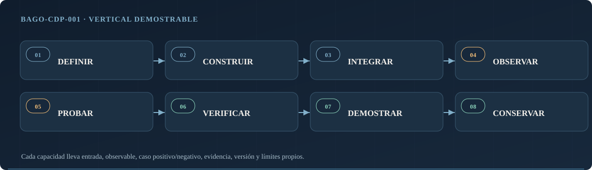](docs/one_command_demo_walkthrough.md)

**BAGO-CDP-001:** cada capacidad requiere recorrido reproducible, positivo/negativo, evidencia y conservación independiente.

Cada demo tiene entradas y alcance propios. Las fixtures permiten repetir controles sin credenciales. Los tutoriales con datos ficticios ayudan a entender el producto y conservan los recibos que realmente produjeron.

| Recorrido | Entrada | Resultado y artefactos | Alcance |
|---|---|---|---|
| Chat real · 22 de octubre | Agente nuevo, workspace nuevo y lectura explícita de `DEMO.md` | Respuesta con citas y LocalTrace `trace-496fac766f384348` | Una lectura autorizada y dos pedidos ficticios; Inspect no quedó vinculado automáticamente |
| Demo de una orden | `python demo.py` | `summary.json`, `agent_run.json`, `receipts.json`, `trace.json`, `evaluation.json` | Determinista y local; sin servicio externo |
| Lectura GEX | Workspace sintético, operador y agente autorizados | Solicitud, decisión, permiso, recibo y verificación persistidos | Solo fixture registrado de ese perfil |
| Bruma Market | Pedidos y política ficticios | Extracción JSON, decisiones, trazas y recibos de lectura | Tutorial histórico; ningún reembolso ejecutado |

### Demostración nueva desde Chat

El **2026-10-22**, en Brave visible sobre la app local del puerto 8080, se creó a las **18:40:34 UTC** el agente **BAGO Demo Chat 20261022** desde un borrador inline: Preview y Save Agent. Tras el error inicial `model_registration_mismatch`, Settings guardó y verificó Codex `gpt-6-luna`; el segundo guardado funcionó. Se abrió una conversación nueva y se autorizó expresamente la lectura del fixture `DEMO.md` del workspace nuevo; la respuesta se registró a las **18:44:10 UTC**.

| Caso ficticio | Dato observado | Respuesta del agente |
|---|---|---|
| DEMO-001 | 30 h de retraso | 6 EUR de tarifa de envío elegible, con citas a líneas 7 y 12 |
| DEMO-002 | 12 h de retraso | Sin reembolso de envío, con citas a líneas 8 y 13 |

**Resultado observado:** traza `trace-496fac766f384348`, decisión `ALLOW`, una lectura, estado `COMPLETED`, modelo `gpt-6-luna`, 14,6 s. Se demostró lectura autorizada y respuesta; no se ejecutó un reembolso ni una herramienta genérica. SHA-256 del archivo completo: `7fdbb3379f3abc59ef1d3c9fa5c9ffb4c7c2abc5de93a9c038e3ca8c25716677`. El hash de la UI corresponde al excerpt numerado de líneas 1–16 y no debe confundirse con el hash del archivo completo.

**Hallazgo abierto:** al abrir Inspect se mostró la traza histórica de Bruma `trace-5b385699ffda0529`, distinta de la traza nueva. La navegación funcionó, pero no se observó vinculación automática de Inspect con esta conversación; ese tramo no se declara PASS. [Captura, pasos, identidad y evidencia de la sesión](docs/assets/readme-20261022/README.md).

### Ejecutar la demo local

```bash
python -m pip install -r requirements.txt
python demo.py
```

La demo compone recuperación con citas, ejecución tipada, recibos, LocalTrace y evaluación estructural. El resultado esperado del fixture es `PASS`; la orden escrita aquí no acredita una ejecución nueva. Los artefactos se escriben en `demo_output/`.

**Profundizar:** [demo y requisitos](docs/one_command_demo.md) · [lectura de sus artefactos](docs/one_command_demo_walkthrough.md) · [GEX fixture](docs/governed-execution/RUNTIME_FIXTURE_PROFILE.md) · [tutorial Bruma](output/playwright/bruma-market-tutorial/README.md).

## Tests y verificación

**Snapshot de CI:** [2026-10-22T17:34:53Z](https://github.com/MarcValls/BAGO_AGENTIC_DATA_LAB/actions/runs/39823019847) · candidata `64a88fbc30bb1b2c0a4cd516281c71be1f65748b`.
**Alcance:** CI de Ubuntu con Python 3.11 y Node 22 para el commit 64a88fbc. Evidencia heredada: no acredita cambios posteriores del README corporativo, Windows ni proveedores reales.
Registro versionado observado el 2026-10-22T18:43:07.574831+00:00: [docs/verification/readme-corporate-status-20261022.json](docs/verification/readme-corporate-status-20261022.json). No es una consulta en vivo ni cubre cambios posteriores a esa candidata.

| Batería | Resultado registrado | Evidencia |
|---|---|---|
| Backend Python | `PASS` · 550 PASS · 0 fallos · 0 omitidos | [`python -m pytest tests -q`](https://github.com/MarcValls/BAGO_AGENTIC_DATA_LAB/actions/runs/39823019847/job/119978943337) |
| Frontend Vitest | `PASS` · 14 archivos · 127 PASS | [`npm test`](https://github.com/MarcValls/BAGO_AGENTIC_DATA_LAB/actions/runs/39823019847/job/119978943337) |
| Frontend UI Node | `PASS` · 8 archivos · 49 PASS | [`npm run test:ui`](https://github.com/MarcValls/BAGO_AGENTIC_DATA_LAB/actions/runs/39823019847/job/119978943337) |
| Contratos TypeScript | `PASS` · 3 módulos · 13 PASS | [`npm run test:contracts`](https://github.com/MarcValls/BAGO_AGENTIC_DATA_LAB/actions/runs/39823019847/job/119978943337) |
| Build frontend | `PASS` · TypeScript + Vite completados | [`npm run build`](https://github.com/MarcValls/BAGO_AGENTIC_DATA_LAB/actions/runs/39823019847/job/119978943337) |

<details>
<summary>Repetir las comprobaciones en tu checkout</summary>

```bash
python -m pytest tests -q
npm test --prefix frontend
npm run test:ui --prefix frontend
npm run test:contracts --prefix frontend
npm run build --prefix frontend
python scripts/generate_dynamic_readme.py --check --skip-tests
```

La colección de pytest no es una ejecución: `--check --skip-tests` informa `NOT_RUN`. El conteo de una ejecución local se imprime en terminal; no sustituye ni modifica el snapshot versionado de CI.

</details>

<details>
<summary>Resultados locales e históricos, con alcance propio</summary>

- [Regresión Windows previa a la corrección Docker](docs/verification/github-update-20261022/README.md) · 2026-10-22 · candidata `f2b34e51ce2e3607490f710f60070f1e4de5759e`: Backend 536 PASS y 1 SKIP por privilegio symlink; frontend 127 / 49 / 13 PASS; build y generación README PASS. Alcance: Python 3.14, Node 24; bytes Windows identificados en el informe. No se suma a la CI y no cubre los dos tests Docker posteriores.

</details>

[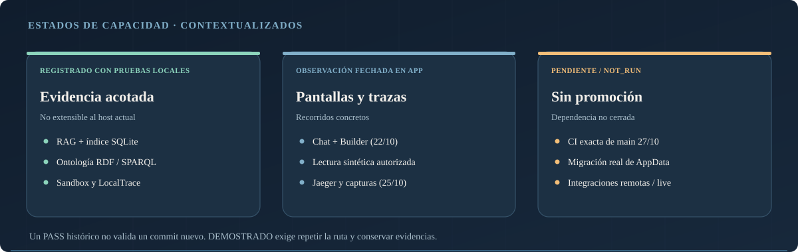](.bago/canon/STATE.md)

**Estado:** no sumar pruebas de commits distintos; un resultado NOT_RUN permanece NOT_RUN hasta ejecutar la prueba pertinente.

**Profundizar:** [registro versionado de resultados](docs/verification/readme-corporate-status-20261022.json) · [contrato de generación y comprobaciones](docs/readme_generation.md) · [integridad teamctl](docs/verification/teamctl-integrity-20261022/README.md).

## Instalación y operación

[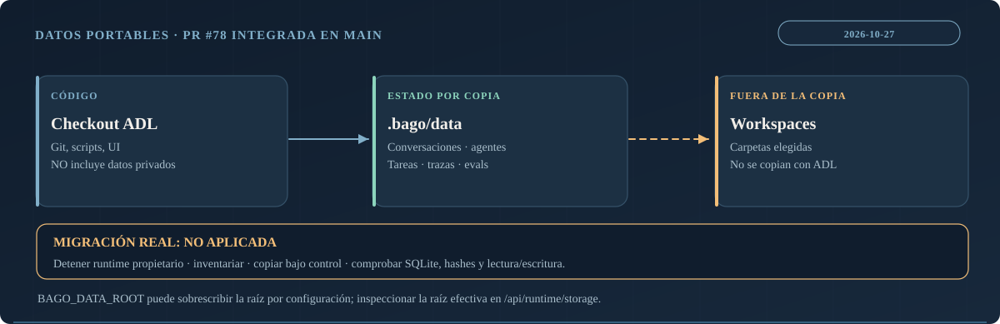](docs/public-web/MANUAL.md)

**Corte 27/10:** PR #78 fusionada; migración efectiva de AppData no realizada; `BAGO_DATA_ROOT` requiere revisar configuración.

La aplicación completa necesita Python 3.11+, Node.js 22 y un entorno Python activado. Desde la raíz del checkout, instala las dependencias declaradas, construye el frontend y arranca la API que sirve `frontend/dist`.

```bash
python -m pip install -r requirements-test.txt
npm ci --prefix frontend
npm run build --prefix frontend
python -m src.api.server
```

Abre <http://127.0.0.1:8080>. Los comandos describen el arranque, no una sesión iniciada por este README. Configura después el proveedor/modelo en Settings; su disponibilidad se comprueba por separado.

| Modo | Entrada | Uso |
|---|---|---|
| App local compilada | `python -m src.api.server` después del build | API y frontend distribuido desde el mismo proceso |
| Desarrollo frontend | `npm run dev --prefix frontend` con API local | Vite y proxy a la API |
| Windows | `INICIAR_APP.cmd` o launcher documentado | Build y puerto libre según el contrato del launcher |
| Demo offline | `python demo.py` | Recorrido determinista sin configurar un proveedor |

**Profundizar:** [instalación local](docs/agent-chat-control/LOCAL_SETUP.md) · [launcher PowerShell](scripts/run-local-ui.ps1) · [guía frontend](docs/readme_frontend.md#arranque-y-comprobaciones) · [demo portable](docs/one_command_demo.md).

## Observabilidad e inspección

Inspect permite revisar el resultado declarado junto a claims, evidencia, procedencia y artefactos disponibles. Job History, Trace y Evaluation complementan esa lectura con identidad, secuencia y comprobaciones del recorrido.

| Recurso | Qué permite revisar | Frontera |
|---|---|---|
| LocalTrace | Pasos, IDs y enlaces de ejecución | Fuente local de evidencia; conservar su identidad y alcance |
| Recibo y observador | Efecto declarado y postcondición | La presencia de un recibo no sustituye su integridad y validación |
| Decision / BER Inspector | Conclusión, evidencia, autorización y registro de efecto | Presentación de los artefactos recibidos; no prueba independiente por sí sola |
| Evaluation Lab | Casos, respuestas acotadas y checks declarados | No establece calidad general, seguridad ni facturación |
| OpenTelemetry / Jaeger | Proyección de la traza y relaciones entre spans | No concede autoridad; requiere exportación/observación efectivas |

**Observación actual del 22 de octubre:** la nueva conversación produjo `trace-496fac766f384348`, pero abrir Inspect mostró `trace-5b385699ffda0529` de Bruma. La continuidad Chat → Inspect necesita enlazar y comprobar la traza exacta de la conversación. El recorrido nuevo de lectura/respuesta y este hallazgo de inspección se conservan por separado.

La evidencia L15 del **2026-10-08** registró 15 spans proyectados y observados y 13 operaciones con `PASS`. Se conserva como ejecución histórica local. Las capturas nuevas de esta página no se presentan como una nueva validación de Jaeger.

**Profundizar:** [observabilidad y evaluación](docs/observability_evals.md) · [OpenTelemetry y Jaeger](docs/otel_jaeger.md) · [informe L15](evidence/l15_otel_jaeger_live.md) · [alcance del frontend](docs/readme_frontend.md#inspeccionar-la-evidencia).

## Estado y roadmap

[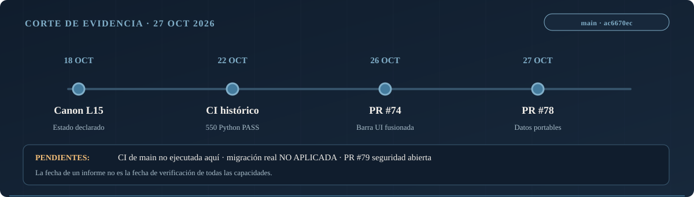](.bago/canon/STATE.md)

**Snapshot documental:** `main@ac6670ec`; CI histórica del 22/10 no valida el nuevo HEAD; PR #79 de seguridad sigue abierta en el corte.

**Estado canónico fechado:** 2026-10-18 · **fase declarada:** L15 · OpenTelemetry + Jaeger Local Live.

El estado de una capacidad pertenece a su evidencia y entorno. Reorganizar esta portada conserva las capacidades documentadas, sin renovar automáticamente su fecha ni promover integraciones externas.

| Capacidad | Estado y alcance documentados | Qué falta para una afirmación más amplia |
|---|---|---|
| Recuperación, ontología, sandbox y trazas locales | Estados de fases L1–L15 con evidencia específica | Repetir puertas afectadas para otra candidata/entorno |
| Frontend de ADL | Fuentes, baterías fechadas y capturas actuales enlazadas | Comprobar cada efecto real y cada integración en su runtime |
| Perfil GEX y BER | Contratos y límites propios enlazados arriba | Gate del perfil, host y proveedor efectivos |
| AWS Bedrock Converse | Éxito histórico acotado; intentos posteriores con cuota agotada | Identidad, cuota y llamada nueva con recibo; coste real separado |
| Bedrock KB, OpenMetadata remoto, commercetools live | `NOT_RUN` en el canon citado | Servicio, credenciales, datos y aceptación específicos |

**Profundizar:** [STATE fechado](.bago/canon/STATE.md) · [roadmap](.bago/canon/ROADMAP.md) · [aprendizaje y evidencia](.bago/canon/LEARNING_LEDGER.md) · [inventario histórico por fase](#apéndices-y-evidencia-histórica).

## Documentación y aprendizaje

La documentación se organiza para pasar de una vista de conjunto al contrato, el procedimiento y la evidencia del recorrido que interesa. Cada sección de esta página tiene su propio acceso de profundización.

| Quiero… | Empezar por… |
|---|---|
| Usar la aplicación desde Chat | [Guía del frontend](docs/readme_frontend.md) |
| Instalar y arrancar | [Local setup](docs/agent-chat-control/LOCAL_SETUP.md) |
| Entender una demo sin credenciales | [One-command demo](docs/one_command_demo.md) |
| Revisar autorización y efectos | [GEX](docs/governed-execution/GEX_V1_NORMATIVE_CONTRACT.md) y [BER](docs/ber/AGENT_RUNNER_SCOPE.md) |
| Desarrollar y revisar contexto | [Índice BAGO](.bago/INDEX.md) y [arquitectura](.bago/canon/ARCHITECTURE.md) |
| Relacionar aprendizaje con evidencias | [Learning ledger](.bago/canon/LEARNING_LEDGER.md) y [skills](.bago/canon/JOB_SKILL_MATRIX.md) |
| Contribuir a esta portada | [Contrato de generación](docs/readme_generation.md) y [manifiesto](docs/readme_manifest.json) |

Las matrices de skills y roles conservan las estimaciones de planificación del proyecto. El catálogo de agentes es de referencia; las definiciones operativas y sus permisos se revisan en su contexto efectivo.

**Profundizar:** [fuentes canónicas](.bago/INDEX.md) · [catálogo de agentes](agents/CATALOG_MANIFEST.json) · [agente de sincronización](docs/bago-sync-agent.md) · [licencia MIT](LICENSE).

## Apéndices y evidencia histórica

El detalle histórico conserva trazabilidad y procedencia. Las imágenes de tutoriales anteriores siguen en sus documentos originales; la galería de esta portada contiene únicamente capturas nuevas.

[Tutorial histórico de primer uso](docs/agent-chat-control/TUTORIAL_PRIMER_USO.md): conserva el recorrido de UI del 2026-10-19 con respuestas API sintéticas y sus referencias a la sesión histórica del 2026-10-10. No es evidencia de una ejecución nueva ni sustituye las capturas actuales del 2026-10-25.

<details>
<summary>Fases L0–L15: estados declarados y archivos de evidencia</summary>

### Roadmap y evidencia por fase

Los patrones resueltos identifican archivos del checkout; su presencia no implica repetir la ejecución.

| Fase | Estado declarado | Objetivo | Área |
|---|---|---|---|
| L0 | COMPLETE | — | Baseline & Lab Contract |
| L1 | VALIDATED (local governed graph evidence) | — | LangGraph Governed Execution |
| L2 | VALIDATED | — | ETL / Data Pipeline |
| L3 | VERIFIED | — | Metadata & Ontology |
| L4 | VERIFIED | Orbitant | Governed RAG |
| L5 | VERIFIED | Orbitant | MCP con gobernanza |
| L6 | VERIFIED (historical live Converse; latest attempts throttled) | Tuio | AWS Bedrock Provider |
| L7 | VERIFIED (offline) | Devoteam | Bedrock Knowledge Base |
| L8 | VERIFIED (local live) | Devoteam | Metadata Catalog |
| L9 | VERIFIED (offline) | commercetools | End-to-End Governed Agent |
| L10 | VERIFIED (local) | BAGO / portfolio | Governed Ontology Engine |
| L11 | VERIFIED (local) | BAGO / secure execution | Governed Sandbox Layer |
| L12 | VERIFIED (local) | BAGO / portfolio | Local Observability & Evals |
| L13 | VERIFIED (local) | BAGO / portfolio | Public E2E Demo & CI |
| L14 | VERIFIED (local) | BAGO / portfolio | Governed Local Vector Store |
| L15 | VERIFIED (local live) | BAGO / portfolio | OpenTelemetry + Jaeger Local Live |

```mermaid
flowchart LR
    L0["L0 Baseline & Lab Contract (COMPLETE)"]
    L1["L1 LangGraph Governed Execution (VALIDATED (local governed graph evidence))"]
    L2["L2 ETL / Data Pipeline (VALIDATED)"]
    L3["L3 Metadata & Ontology (VERIFIED)"]
    L4["L4 Governed RAG (VERIFIED)"]
    L5["L5 MCP con gobernanza (VERIFIED)"]
    L6["L6 AWS Bedrock Provider (VERIFIED (historical live Converse; latest attempts throttled))"]
    L7["L7 Bedrock Knowledge Base (VERIFIED (offline))"]
    L8["L8 Metadata Catalog (VERIFIED (local live))"]
    L9["L9 End-to-End Governed Agent (VERIFIED (offline))"]
    L10["L10 Governed Ontology Engine (VERIFIED (local))"]
    L11["L11 Governed Sandbox Layer (VERIFIED (local))"]
    L12["L12 Local Observability & Evals (VERIFIED (local))"]
    L13["L13 Public E2E Demo & CI (VERIFIED (local))"]
    L14["L14 Governed Local Vector Store (VERIFIED (local))"]
    L15["L15 OpenTelemetry + Jaeger Local Live (VERIFIED (local live))"]
    L0 --> L1
    L1 --> L2
    L2 --> L3
    L3 --> L4
    L4 --> L5
    L5 --> L6
    L6 --> L7
    L7 --> L8
    L8 --> L9
    L9 --> L10
    L10 --> L11
    L11 --> L12
    L12 --> L13
    L13 --> L14
    L14 --> L15
```

### L0 — Baseline & Lab Contract
**Estado:** COMPLETE

**Código localizado:** —
**Tests:** —
**Evidencia:** —
**Patrones sin resolver:** `ninguno`

### L1 — LangGraph Governed Execution
**Estado:** VALIDATED (local governed graph evidence)

**Código localizado:** [`src/orchestration/governed_execution.py`](src/orchestration/governed_execution.py) · [`src/orchestration/state_graph.py`](src/orchestration/state_graph.py)
**Tests:** [`tests/test_l1_governance.py`](tests/test_l1_governance.py) · [`tests/test_l1_integrated_graph.py`](tests/test_l1_integrated_graph.py)
**Evidencia:** [`evidence/l1-governed-execution-completion-20261010/L1_DEMO_RECEIPTS.json`](evidence/l1-governed-execution-completion-20261010/L1_DEMO_RECEIPTS.json) · [`evidence/l1-governed-execution-completion-20261010/L1_DEMO_TRANSCRIPT.md`](evidence/l1-governed-execution-completion-20261010/L1_DEMO_TRANSCRIPT.md) · [`evidence/l1-governed-execution-completion-20261010/L1_VALIDATION.md`](evidence/l1-governed-execution-completion-20261010/L1_VALIDATION.md) · [`evidence/l1_governed_execution_20261010.md`](evidence/l1_governed_execution_20261010.md)
**Patrones sin resolver:** `ninguno`

### L2 — ETL / Data Pipeline
**Estado:** VALIDATED

**Código localizado:** [`src/etl/pipeline.py`](src/etl/pipeline.py)
**Tests:** [`tests/test_l2_etl_pipeline.py`](tests/test_l2_etl_pipeline.py)
**Evidencia:** [`l2_etl_metadata.db`](l2_etl_metadata.db)
**Patrones sin resolver:** `ninguno`

### L3 — Metadata & Ontology
**Estado:** VERIFIED

**Código localizado:** [`src/metadata/ontology.py`](src/metadata/ontology.py) · [`src/metadata/ontology_generator.py`](src/metadata/ontology_generator.py) · [`src/metadata/schema.py`](src/metadata/schema.py)
**Tests:** [`tests/test_l3_evidence.py`](tests/test_l3_evidence.py) · [`tests/test_l3_ontology.py`](tests/test_l3_ontology.py) · [`tests/test_metadata_schema.py`](tests/test_metadata_schema.py) · (+1 archivos)
**Evidencia:** [`docs/ontology_generator.md`](docs/ontology_generator.md) · [`evidence/l3_ontology_graph.md`](evidence/l3_ontology_graph.md)
**Patrones sin resolver:** `ninguno`

### L4 — Governed RAG
**Estado:** VERIFIED

**Código localizado:** [`src/retrieval/governed_rag.py`](src/retrieval/governed_rag.py)
**Tests:** [`tests/test_retrieval_accuracy.py`](tests/test_retrieval_accuracy.py) · [`tests/test_retrieval_benchmark.py`](tests/test_retrieval_benchmark.py)
**Evidencia:** [`docs/governed_rag.md`](docs/governed_rag.md) · [`evidence/retrieval_benchmark_results.md`](evidence/retrieval_benchmark_results.md)
**Patrones sin resolver:** `ninguno`

### L5 — MCP con gobernanza
**Estado:** VERIFIED

**Código localizado:** [`src/adapters/mcp_adapter.py`](src/adapters/mcp_adapter.py)
**Tests:** [`tests/test_mcp_governance.py`](tests/test_mcp_governance.py)
**Evidencia:** [`docs/mcp_governance.md`](docs/mcp_governance.md) · [`evidence/mcp_governed_demo.md`](evidence/mcp_governed_demo.md) · [`evidence/mcp_governed_demo.mp4`](evidence/mcp_governed_demo.mp4)
**Patrones sin resolver:** `ninguno`

### L6 — AWS Bedrock Provider
**Estado:** VERIFIED (historical live Converse; latest attempts throttled)

**Código localizado:** [`scripts/run_l6_aws_free_tier_validation.py`](scripts/run_l6_aws_free_tier_validation.py) · [`src/adapters/bedrock_provider_adapter.py`](src/adapters/bedrock_provider_adapter.py)
**Tests:** [`tests/test_bedrock_integration.py`](tests/test_bedrock_integration.py)
**Evidencia:** [`docs/aws_bedrock_setup.md`](docs/aws_bedrock_setup.md) · [`evidence/bedrock_provider_benchmark.md`](evidence/bedrock_provider_benchmark.md) · [`evidence/l6_aws_free_tier.md`](evidence/l6_aws_free_tier.md) · [`evidence/l6_aws_live.md`](evidence/l6_aws_live.md)
**Patrones sin resolver:** `ninguno`

### L7 — Bedrock Knowledge Base
**Estado:** VERIFIED (offline)

**Código localizado:** [`src/adapters/bedrock_kb_adapter.py`](src/adapters/bedrock_kb_adapter.py)
**Tests:** [`tests/test_bedrock_kb_adapter.py`](tests/test_bedrock_kb_adapter.py)
**Evidencia:** [`docs/bedrock_knowledge_base.md`](docs/bedrock_knowledge_base.md) · [`evidence/bago_etl_vs_bedrock_kb_comparison.md`](evidence/bago_etl_vs_bedrock_kb_comparison.md)
**Patrones sin resolver:** `ninguno`

### L8 — Metadata Catalog
**Estado:** VERIFIED (local live)

**Código localizado:** [`infra/openmetadata/docker-compose.yml`](infra/openmetadata/docker-compose.yml) · [`scripts/run_l8_openmetadata_live_validation.py`](scripts/run_l8_openmetadata_live_validation.py) · [`src/adapters/openmetadata_adapter.py`](src/adapters/openmetadata_adapter.py)
**Tests:** [`tests/test_openmetadata_adapter.py`](tests/test_openmetadata_adapter.py)
**Evidencia:** [`docs/openmetadata_catalog.md`](docs/openmetadata_catalog.md) · [`evidence/l8_openmetadata_catalog.md`](evidence/l8_openmetadata_catalog.md) · [`evidence/l8_openmetadata_live.md`](evidence/l8_openmetadata_live.md)
**Patrones sin resolver:** `ninguno`

### L9 — End-to-End Governed Agent
**Estado:** VERIFIED (offline)

**Código localizado:** [`src/agent/governed_knowledge_agent.py`](src/agent/governed_knowledge_agent.py)
**Tests:** [`tests/test_l9_end_to_end_agent.py`](tests/test_l9_end_to_end_agent.py)
**Evidencia:** [`docs/commercetools_capstone.md`](docs/commercetools_capstone.md) · [`evidence/l9_authorized_actions_20260922.md`](evidence/l9_authorized_actions_20260922.md) · [`evidence/l9_commercetools_agent.md`](evidence/l9_commercetools_agent.md)
**Patrones sin resolver:** `ninguno`

### L10 — Governed Ontology Engine
**Estado:** VERIFIED (local)

**Código localizado:** [`scripts/generate_l10_ontology_evidence.py`](scripts/generate_l10_ontology_evidence.py) · [`src/agent/governed_knowledge_agent.py`](src/agent/governed_knowledge_agent.py) · [`src/metadata/ontology_engine.py`](src/metadata/ontology_engine.py)
**Tests:** [`tests/test_l10_ontology_engine.py`](tests/test_l10_ontology_engine.py)
**Evidencia:** [`docs/ontology_engine.md`](docs/ontology_engine.md) · [`evidence/l10_ontology_engine.md`](evidence/l10_ontology_engine.md)
**Patrones sin resolver:** `ninguno`

### L11 — Governed Sandbox Layer
**Estado:** VERIFIED (local)

**Código localizado:** [`src/execution/gateway.py`](src/execution/gateway.py) · [`src/sandbox/__init__.py`](src/sandbox/__init__.py) · [`src/sandbox/backend.py`](src/sandbox/backend.py) · (+6 archivos)
**Tests:** [`tests/test_sandbox.py`](tests/test_sandbox.py)
**Evidencia:** [`docs/sandbox_manager.md`](docs/sandbox_manager.md) · [`evidence/sandbox_local_restricted.md`](evidence/sandbox_local_restricted.md) · [`scripts/run_sandbox_local_validation.py`](scripts/run_sandbox_local_validation.py)
**Patrones sin resolver:** `ninguno`

### L12 — Local Observability & Evals
**Estado:** VERIFIED (local)

**Código localizado:** [`src/evaluation/__init__.py`](src/evaluation/__init__.py) · [`src/evaluation/agent_lab.py`](src/evaluation/agent_lab.py) · [`src/evaluation/local_evals.py`](src/evaluation/local_evals.py) · (+6 archivos)
**Tests:** [`tests/test_l12_observability.py`](tests/test_l12_observability.py)
**Evidencia:** [`docs/observability_evals.md`](docs/observability_evals.md) · [`evidence/l12_observability_evals.md`](evidence/l12_observability_evals.md) · [`scripts/run_l12_observability_evidence.py`](scripts/run_l12_observability_evidence.py)
**Patrones sin resolver:** `ninguno`

### L13 — Public E2E Demo & CI
**Estado:** VERIFIED (local)

**Código localizado:** [`.github/workflows/ci.yml`](.github/workflows/ci.yml) · [`demo.py`](demo.py) · [`portfolio/README.md`](portfolio/README.md) · (+4 archivos)
**Tests:** [`tests/test_public_e2e_demo.py`](tests/test_public_e2e_demo.py)
**Evidencia:** [`docs/public_e2e_demo.md`](docs/public_e2e_demo.md) · [`evidence/public_e2e_demo.md`](evidence/public_e2e_demo.md)
**Patrones sin resolver:** `ninguno`

### L14 — Governed Local Vector Store
**Estado:** VERIFIED (local)

**Código localizado:** [`scripts/run_l14_vector_store_validation.py`](scripts/run_l14_vector_store_validation.py) · [`src/retrieval/sqlite_vector_store.py`](src/retrieval/sqlite_vector_store.py)
**Tests:** [`tests/test_sqlite_vector_store.py`](tests/test_sqlite_vector_store.py)
**Evidencia:** [`docs/local_vector_store.md`](docs/local_vector_store.md) · [`evidence/l14_vector_store.md`](evidence/l14_vector_store.md)
**Patrones sin resolver:** `ninguno`

### L15 — OpenTelemetry + Jaeger Local Live
**Estado:** VERIFIED (local live)

**Código localizado:** [`infra/observability/docker-compose.yml`](infra/observability/docker-compose.yml) · [`scripts/run_l15_otel_live_validation.py`](scripts/run_l15_otel_live_validation.py) · [`src/observability/otel_bridge.py`](src/observability/otel_bridge.py)
**Tests:** [`tests/test_l15_otel_bridge.py`](tests/test_l15_otel_bridge.py)
**Evidencia:** [`docs/otel_jaeger.md`](docs/otel_jaeger.md) · [`evidence/l15_otel_jaeger_live.md`](evidence/l15_otel_jaeger_live.md)
**Patrones sin resolver:** `ninguno`

</details>

<details>
<summary>Estado canónico y observaciones externas con su fecha</summary>

**Alcance declarado:** VERIFIED for the local RDF/Turtle materialization, bounded SPARQL subset, deterministic inference, contradiction constraints, RAG seed handoff, the real local OpenMetadata 1.12.6 validation, the local restricted sandbox execution boundary, the local trace/evaluation chain, the public fixture E2E demo executed by the same CI contract, the persistent local SQLite vector index consumed by GovernedRAG and the local OpenTelemetry → Jaeger trace projection. A historical bounded AWS Bedrock `Converse` call succeeded through the governed adapter; it does not establish current quota or billing. The latest read-only AWS Free Tier check observed USD 100.00 remaining, while two subsequent bounded `Converse` attempts failed on the daily token quota with no inference tokens reported. Billing/credit consumption for those failed calls is `NOT_PROVEN`. AWS `ConverseStream`, Bedrock Knowledge Base, remote OpenMetadata and commercetools live integrations remain `NOT_RUN`; GitHub issue #14 is separately executed and verified under human authorization, and the local human-reviewed checkpoint is recorded in `evidence/bago_canon_compliance_review.md`.

**Siguiente bloque declarado:** NOT_DECLARED

**Registro histórico de CI conservado en STATE.md:** GitHub Actions run [38665463586](https://github.com/MarcValls/BAGO_AGENTIC_DATA_LAB/actions/runs/38665463586) completed successfully on commit `ff9292fe4340a2bdab9658a2e804579fa4ef8fb0` (2026-10-15). Its complete test-suite step and README check both succeeded. This result does not cover later changes.

Las observaciones históricas de crédito AWS no son un saldo vigente ni una comprobación actual de disponibilidad/facturación.

[Free Tier histórico](evidence/l6_aws_free_tier.md) · [recibo Bedrock](evidence/l6_aws_live.md) · [intento Nova Lite](evidence/aws-live-attempts/20261018_nova_lite_throttled.md) · [intento Nova Micro](evidence/aws-live-attempts/20261018_nova_micro_throttled.md).

</details>

<details>
<summary>Bruma Market: decisiones ficticias y recibos históricos</summary>

### Recorrido comercial de la app: Bruma Market

Este tutorial usa pedidos y políticas totalmente ficticios. Documenta dos conversaciones de agentes ejecutadas en la app: un extractor produce JSON y un revisor aplica la política con evidencia autorizada. No son pedidos ni clientes reales.

| Pedido | Envío | Retraso | Decisión registrada | Importe de envío elegible |
|---|---|---:|---|---:|
| BM-1001 | express | 32 h | `ELIGIBLE` | €7.90 (solo envío) |
| BM-1002 | express | 24 h | `NOT_ELIGIBLE` | — |
| BM-1003 | standard | 48 h | `NOT_ELIGIBLE` | — |
| BM-1004 | express | sin dato | `PENDING` | — |

**Ejecución registrada:** `VERIFIED`; cuatro casos QA: `ELIGIBLE, NOT_ELIGIBLE, NOT_ELIGIBLE, PENDING`; `actions_executed` vacío: `True`. Ningún reembolso se ejecutó.
**Trazas de las conversaciones:** `trace-e884fa5f23414206`, `trace-63cc286f9d574a38` (`local_only`; no Jaeger export). SHA-256 del CSV autorizado: `016acee85ee5afdb23eaf13caf3f664417e1398b5bba3aad8ff6e991e6a3d1e3`. SHA distintos presentes en recibos: 3.

La regla estricta solo cubre envíos EXPRESS con más de 24 h de retraso y devuelve únicamente la tarifa de envío. Exactamente 24 h no cumple; STANDARD no entra en la regla; sin hora de entrega queda pendiente.

**Revisa el tutorial:** [guía paso a paso](output/playwright/bruma-market-tutorial/README.md) · [vídeo MP4](output/playwright/bruma-market-tutorial/tutorial-bruma-market.mp4) · [subtítulos](output/playwright/bruma-market-tutorial/tutorial-bruma-market.srt) · [hash manifest](output/playwright/bruma-market-tutorial/sha256-manifest.json). Entradas: [CSV de pedidos](output/playwright/bruma-market-tutorial/inputs/orders.csv), [política](output/playwright/bruma-market-tutorial/inputs/policy.md) y [QA esperado](output/playwright/bruma-market-tutorial/inputs/qa-expected.md). Resultados y receipts: [extracción JSON](output/playwright/bruma-market-tutorial/extracted/orders.json), [decisiones](output/playwright/bruma-market-tutorial/extracted/policy-decisions.json), [recibos de lectura y trazas](output/playwright/bruma-market-tutorial/extracted/run-evidence.json) y [perfiles/runs guardados](output/playwright/bruma-market-tutorial/cloud-runs/profiles.json).

**Límite del conjunto:** solo contiene pedidos sintéticos, política, QA y recibos de lectura. No aporta directorio de clientes, facturas ni albaranes; esos casos requieren datos y escenarios propios antes de afirmar que están demostrados.


</details>

<details>
<summary>Skills, roles y catálogo de referencia</summary>

Estimaciones históricas del proyecto; no evaluaciones independientes ni ofertas vigentes.

### Roles objetivo

| Empresa | Rol | Fit | Gap principal | Timeline |
|---|---|---:|---|---|
| Tuio | Forward Deployed AI Engineer | ~96% | Seniority (~5 años) | 4-5 semanas |
| Orbitant | AI Engineer | ~91% | LangGraph + Cloud | 2-3 semanas |
| Devoteam | GCP AI Engineer (Gemini) | ~87% → 93% | Vertex AI / GCP | 6-7 semanas |
| commercetools | AI Engineer | ~97% | Seniority + LLM production | Stretch goal |

### Skills técnicas

**Matrix convention:** Market demand uses Muy alta, Alta and Media. Current-level colors describe evidence maturity: 🟢 implemented or evidenced locally; 🟡 practical baseline, partial evidence or bounded scope; 🟠 historical evidence or external constraint; 🔵 designed capability without an implementation claim. 🎯 marks the target level. Colors describe evidence scope, not professional proficiency. The final column records evidence scope and remaining limits.

| Skill | Demanda | Nivel actual | Nivel objetivo | Primera evidencia | Entrevista |
|---|---|---|---|---|---|
| Python | Alta | 🟢 Senior | 🎯 Senior | BAGO backend | ✅ Sí |
| REST APIs | Alta | 🟢 Senior | 🎯 Senior | BAGO FastAPI | ✅ Sí |
| LangGraph | Muy alta | 🟢 Implementado localmente | 🎯 Proficient | Integrated StateGraph + exact approval + governed RAG/gateway/sandbox/receipt/LocalTrace | L1 VALIDATED in local scope; identity, durability and OS isolation are not claimed |
| LangChain concepts | Alta | 🟡 Baseline práctico | 🎯 Basic | StateGraph, interrupt/resume, in-memory checkpoint | L1 VALIDATED in local scope; checkpoint is in-memory |
| Multi-agent systems | Muy alta | 🟢 Reinforced | 🎯 Proficient | GovernedKnowledgeAgent + L9 evidence | L9 offline |
| Tool use | Muy alta | 🟢 Implementado | 🎯 Proficient | BAGO tools + MCP receipts | L5 baseline |
| MCP | Muy alta | 🟡 Baseline gobernado | 🎯 Proficient | L5 MCP adapter + video | L5 baseline |
| RAG | Muy alta | 🟡 Basic | 🎯 Advanced | L4 governed RAG | L4 completado |
| Hybrid retrieval | Alta | 🟡 Implemented locally; deterministic benchmark is limited | 🎯 Proficient | 32-document offline corpus; 9 labelled queries; Recall@1/@3 and MRR | Synthetic baseline only; production embeddings and broader relevance validation remain |
| Embeddings | Alta | 🟡 Deterministic local | 🎯 Implementado | HashEmbedding + SQLiteVectorStore | L14 local |
| Vector DB | Alta | 🟢 Local persistent | 🎯 Proficient | SQLiteVectorStore + GovernedRAG reload | L14 local; distributed service separate |
| ETL | Alta | 🟡 Implemented locally; coverage partial | 🎯 Proficient | L2 source-to-SQLite pipeline; deduplication, receipts and enforced chunk-overlap test | Local pipeline verified; partial-failure and transaction recovery coverage remains |
| Data pipelines | Alta | 🟡 Implemented locally; local/document scope | 🎯 Implementado | L2 ingestion consumed by L4 SQLite retrieval adapter | No evidence yet for scheduled recovery or distributed processing |
| Metadata/Ontology | Media | 🟢 Implementado | 🎯 Proficient | L3 schema + L10 engine | L10 local |
| RDF / SPARQL / Knowledge Graphs | Alta | 🟡 Baseline local | 🎯 Proficient | L10 RDF/Turtle + SPARQL + inference | L10 local; triplestore live separado |
| Lineage | Media | 🟢 Implementado | 🎯 Proficient | L3 relations + L10 paths | L10 local |
| AWS | Alta | 🟠 Bedrock Converse live histórico; cuota diaria agotada en los últimos intentos | 🎯 Bedrock fluent | L6 adapter + receipt live + consulta Free Tier | IAM least-privilege + recuperar cuota; saldo/cargo posterior no probado |
| Bedrock | Alta | 🟠 Converse histórico verificado; intentos actuales limitados por cuota | 🎯 Proficient | L6 Converse/Stream + receipts | Stream + evaluación de modelo y cuota disponible |
| Bedrock Knowledge Bases | Alta | 🟡 Baseline offline | 🎯 Proficient | L7 Retrieve/Generate + citations | Live KB evaluation |
| OpenMetadata Catalog | Media | 🟢 Local live verificado | 🎯 Proficient | L8 adapter + Docker local + lineage/quality receipts | OpenMetadata remoto |
| IAM | Alta | 🟡 Basic | 🎯 Configurable | L6 least-privilege setup | Live policy check |
| CI/CD | Alta | 🟢 Reproducible | 🎯 Implementado | GitHub Actions + pinned requirements + public E2E | L13 CI |
| Evaluation | Muy alta | 🟢 Local governance evals | 🎯 Framework | Local evaluation suites, trace/evidence linkage, and L8-L15 scenario evidence | L15 local + CI |
| Observability | Alta | 🟢 OpenTelemetry local live | 🎯 Completo | LocalTrace + OTLP/HTTP + Jaeger Docker + parent-linked spans | L15 local; remoto separado |
| Secure execution | Muy alta | 🟢 Local backend verified | 🎯 Implementado | BAGO auth boundary + LocalRestrictedBackend + escape tests | L11 local |
| Authorization | Muy alta | 🔵 Diseñado | 🎯 Implementado | L1 fail-closed gate; MCP, Bedrock y sandbox tienen límites probados por separado | L1 evidencia parcial |
| Auditability | Alta | 🔵 Diseñado | 🎯 Implementado | Recibos de adapters/sandbox; L1 no fabrica recibos si no hay gateway | L1 evidencia parcial |
| Docker/K8s | Media | 🟡 Docker Compose local | 🎯 Basic | OpenMetadata Compose + reproducible healthcheck | L8 local |

### Skills estratégicas y personales

| Skill | Nivel actual | Nivel objetivo | Evidencia |
|---|---|---|---|
| Arquitectura de sistemas | ✅ Fuerte | ✅ Mantener | AGENTS.md, CANON_BAGO |
| Diseño de contratos | ✅ Fuerte | ✅ Mantener | BAGO contracts |
| Documentación técnica | ✅ Fuerte | ✅ Mantener | Este repo |
| Análisis de trade-offs | ✅ Fuerte | ✅ Mantener | Decision records |
| Comunicación escrita | ✅ Fuerte | ✅ Mantener | Docs claras |

Alcance: `reference-only` · activación: `none`.
El catálogo es de referencia; la definición operativa sigue en `.github/agents`.

| Grupo | Archivos | Responsabilidad |
|---|---:|---|
| `01-gobierno-orquestacion` | 11 | arranque, contexto, coordinación y entrega |
| `02-exploracion-arquitectura` | 13 | exploración, arquitectura, modularidad y archivo |
| `03-backend-contratos` | 4 | backend y contratos frontend-backend |
| `04-frontend-ui` | 10 | frontend, UI, estado y navegación |
| `05-seguridad-verdad` | 8 | seguridad, sinceridad, comandos y aislamiento |
| `06-tests-calidad-release` | 20 | tests, higiene, análisis, verificación y release |
| `07-sincronizacion` | 6 | Git, documentación y sincronización de runtime |
| `08-runtime-supervision` | 3 | infraestructura de agentes |
| `09-activadores-no-agentes` | 11 | skills y paquetes de activación, no agentes |

| Componente | Estado | Función |
|---|---|---|
| `.github/agents/bago-sync-agent.agent.md` | PRESENTE | Definición del agente: contrato operativo |
| `scripts/bago_sync_agent.py` | PRESENTE | Ejecutor gobernado: commit, push, PR y merge con receipts |
| `docs/bago-sync-agent.md` | PRESENTE | Documentación: uso y límites |

</details>

<details>
<summary>Fuentes canónicas y releases preservadas</summary>

| Área | Cobertura | Fuentes presentes / declaradas |
|---|---|---|
| Gobierno del proyecto | Estado, contrato, arquitectura, roadmap, aprendizaje y skills | 6/6 presentes |
| Demo y portfolio | Tutoriales, walkthrough, snapshot y notas de release | 8/8 presentes |
| Versionado | Versión declarada del repositorio | 1/1 presentes |

**Gobierno del proyecto:**

- [`.bago/canon/STATE.md`](.bago/canon/STATE.md) — estado canónico registrado, con fecha y alcance propios
- [`.bago/canon/LAB_CONTRACT.md`](.bago/canon/LAB_CONTRACT.md) — contrato del laboratorio
- [`.bago/canon/ARCHITECTURE.md`](.bago/canon/ARCHITECTURE.md) — arquitectura y límites
- [`.bago/canon/ROADMAP.md`](.bago/canon/ROADMAP.md) — roadmap ejecutable
- [`.bago/canon/LEARNING_LEDGER.md`](.bago/canon/LEARNING_LEDGER.md) — aprendizaje y evidencia
- [`.bago/canon/JOB_SKILL_MATRIX.md`](.bago/canon/JOB_SKILL_MATRIX.md) — skills y alineación laboral

**Demo y portfolio:**

- [`docs/cv_linkedin/portfolio-demo-v1.md`](docs/cv_linkedin/portfolio-demo-v1.md) — snapshot freeze portfolio-demo-v1 (CV/LinkedIn)
- [`docs/one_command_demo.md`](docs/one_command_demo.md) — quickstart and artifact contract for one-command governed demo
- [`docs/one_command_demo_walkthrough.md`](docs/one_command_demo_walkthrough.md) — canonical demo explanations and artifact walkthrough
- [`docs/governed-execution/RUNTIME_FIXTURE_PROFILE.md`](docs/governed-execution/RUNTIME_FIXTURE_PROFILE.md) — perfil local GEX autenticado: configuración, fixture sintético, aprobación y recibos durables
- [`docs/releases/RELEASE_NOTES_DEMO_V1.md`](docs/releases/RELEASE_NOTES_DEMO_V1.md) — frozen one-command demo v1.0.0 release notes
- [`docs/progress/SPRINT_20261025_06.md`](docs/progress/SPRINT_20261025_06.md) — estado del historial integrado y resultado completo de la fuente aplicada; Jaeger global OPEN
- [`docs/progress/SPRINT_20261025_07.md`](docs/progress/SPRINT_20261025_07.md) — carpeta y proyecto con revisión exacta; gate acotado validado, global NO GO y cuatro fallos abiertos
- [`docs/progress/SPRINT_20261025_08.md`](docs/progress/SPRINT_20261025_08.md) — barra de metadatos runtime y límites; verificación acotada, global NO GO, portabilidad y autoverificación pendientes

**Versionado:**

- [`VERSION`](VERSION) — current repository version

## Releases congelados

### `portfolio-demo-v1` — 2026-10-02

**Portfolio Demo v1**

L0..L15 VERIFIED local + zero-cost rule. Snapshot for CV/LinkedIn.

- Tag: <https://github.com/MarcValls/BAGO_AGENTIC_DATA_LAB/releases/tag/portfolio-demo-v1>
- Docs: `docs/cv_linkedin/portfolio-demo-v1.md`, `evidence/portfolio_demo_v1.md`, `evidence/l15_jaeger_capture_attempt.md`
- Vídeo: `evidence/portfolio_demo_v1.mp4` (76.50s)
- SHA-256 sidecar: `evidence/portfolio_demo_v1.mp4.sha256`
- Frame-set SHA-256 (deterministic): `f7417a1f5d03ac332000ffb31fe4d1f5ee69f9f4606692f779735d419d6645d2` — byte-stable across encoder runs
- Boundaries:
  - `aws_live`: one bounded Bedrock Converse call (NOT_PROVEN zero-dollar billing)
  - `not_run`: AWS ConverseStream, Bedrock KB live, remote OpenMetadata, commercetools live, remote observability
  - `verified_local`: L0..L15


</details>

### Contrato de generación del README

`README.md` es un artefacto generado. No lo edites manualmente: actualiza las fuentes canónicas y ejecuta el generador. La colección de pruebas y `--check --skip-tests` permanecen `NOT_RUN`; los resultados publicados proceden del registro de verificación versionado.

[Contrato y revisión](docs/readme_generation.md) · [manifiesto](docs/readme_manifest.json) · [generador](scripts/generate_dynamic_readme.py).

---

**BAGO · Agentic Data Lab** · MIT License · [LICENSE](LICENSE)
