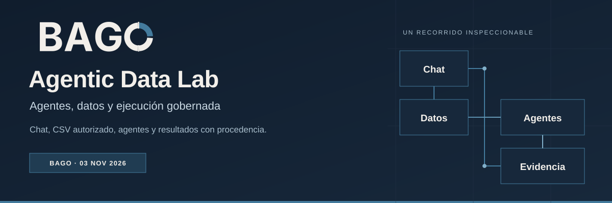
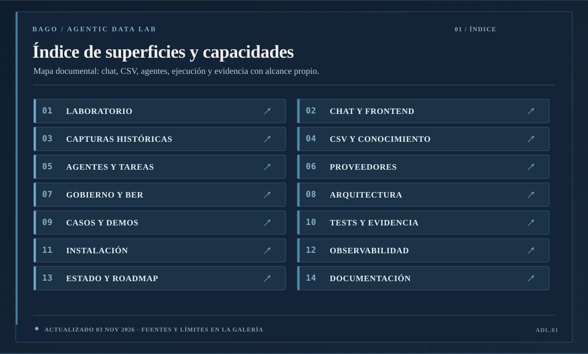
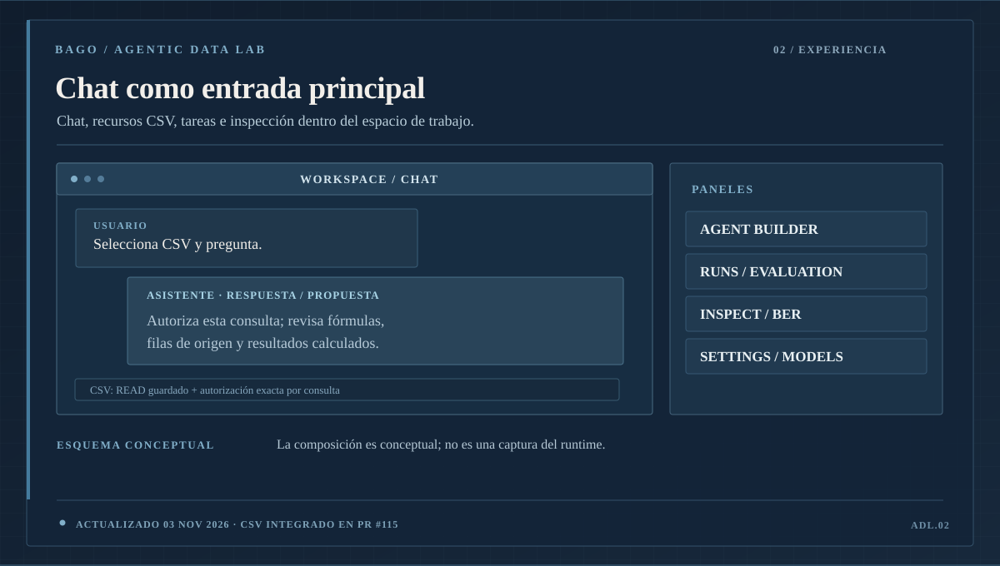
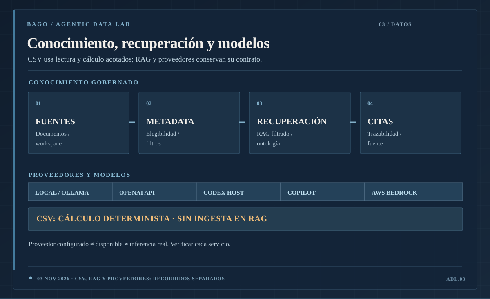
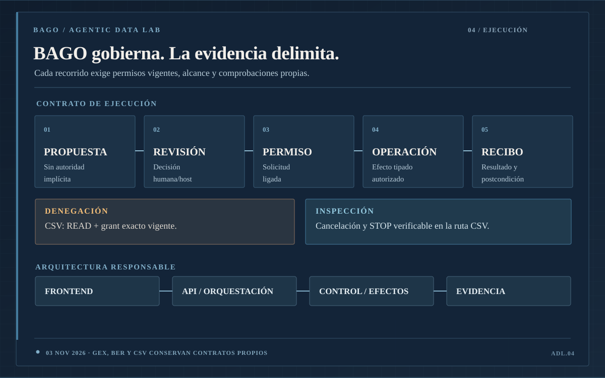
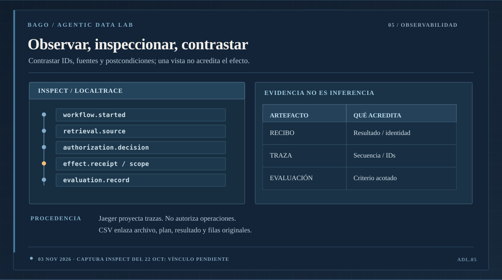
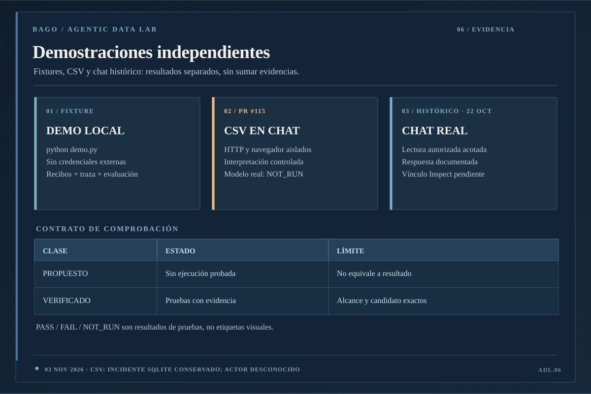
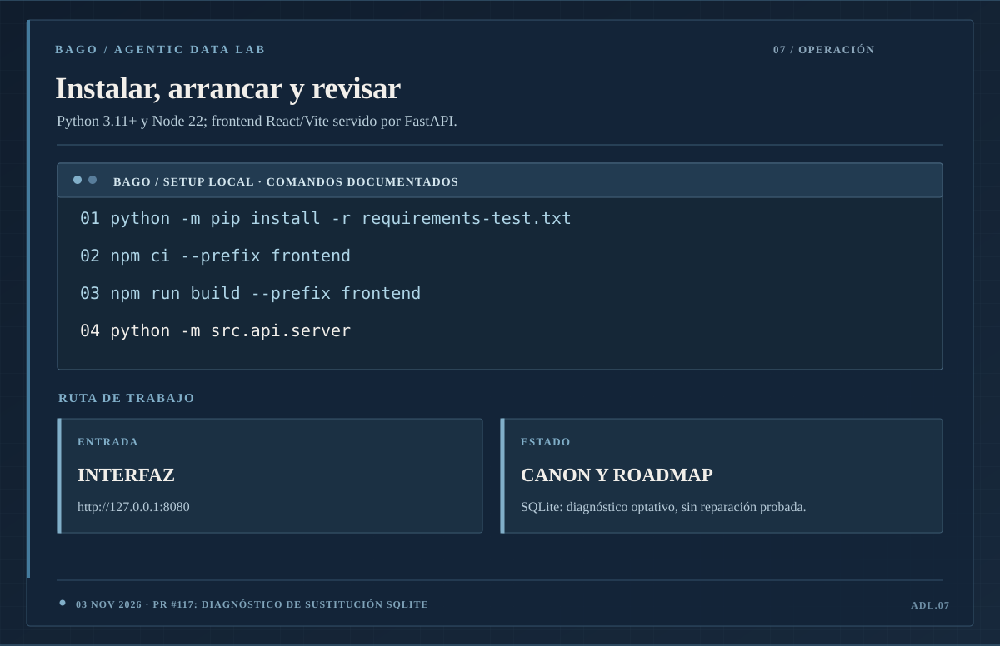
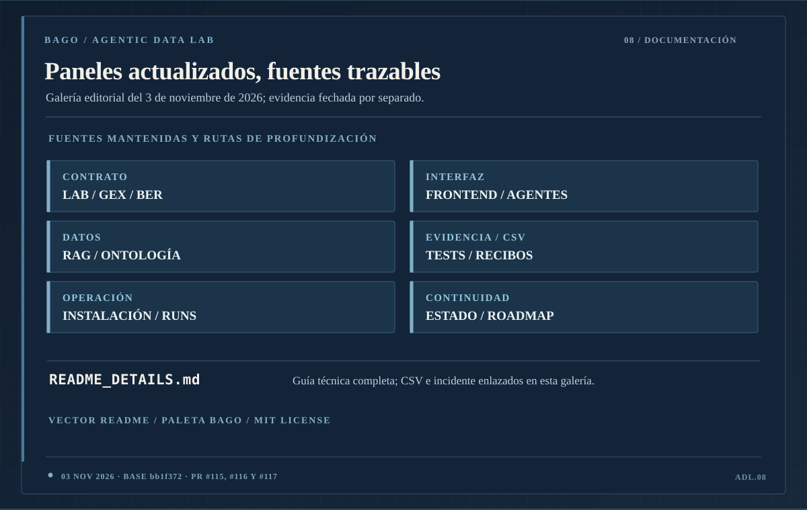
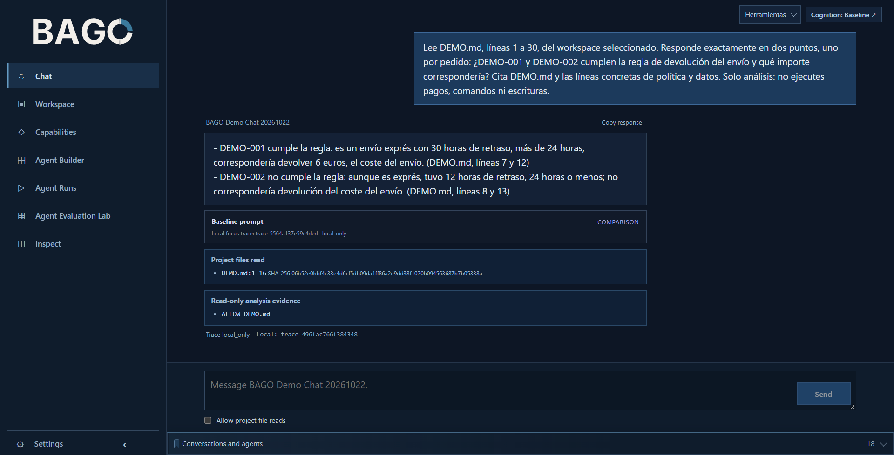

# BAGO Agentic Data Lab

**Agentes, datos y ejecución gobernada desde un espacio de trabajo.**

ADL permite formular una intención desde el chat, preparar una operación, revisar su autorización y consultar resultados con evidencias. Cada recorrido debe distinguir lo que el agente afirma de lo que el sistema realmente ejecutó y comprobó.

[Empezar en Windows](docs/agent-chat-control/LOCAL_SETUP.md) · [Probar la demo local](docs/one_command_demo.md) · [Explorar la arquitectura](.bago/canon/ARCHITECTURE.md) · [Ver trazas y evaluación](docs/observability_evals.md)

## Paneles del laboratorio

Resumen visual actualizado; cada panel enlaza su documentación y conserva los límites de sus fuentes.

---

## Qué ofrece

**[Chat y workspace](docs/readme_frontend.md)** — Conversar, preparar contexto y consultar un CSV autorizado con cálculos deterministas, fórmulas y filas de origen. Cada recorrido conserva sus condiciones y límites.

**[Agentes y conocimiento](docs/governed_rag.md)** — Organizar capacidades, recuperar información con procedencia y mantener los límites de autoridad.

**[Ejecución gobernada](docs/governed-execution/GEX_V1_NORMATIVE_CONTRACT.md)** — Aplicar permisos y controles antes de efectos materiales; registrar resultados y excepciones.

**[Inspect y observabilidad](docs/observability_evals.md)** — Relacionar solicitudes, recibos, trazas, evidencias y verificaciones.

## Del chat a una operación verificable

**Intención** → **Propuesta** → **Revisión y autorización** → **Ejecución** → **Recibo** → **Verificación**

Este es el principio arquitectónico; cada capacidad y recorrido tiene su propio estado y alcance. Las capacidades no demostradas de extremo a extremo no se presentan como verificadas.

## La aplicación

Captura documentada del 2026-10-22; no acredita por sí sola el estado actual de la interfaz ni la ejecución de herramientas. [Procedencia y límites](docs/readme_frontend.md).

## Probar ADL

**Aplicación Windows:** sigue la [instalación local](docs/agent-chat-control/LOCAL_SETUP.md) para iniciar el frontend y configurar el proveedor.

**Demostración reproducible:** sigue la [demo de ejecución gobernada](docs/one_command_demo.md) para ejecutar un recorrido local sin claves externas y examinar los archivos de resultado. La demostración utiliza fixtures; no valida servicios cloud en producción.

## Documentación y evidencia

**Referencia:** [Contrato de ejecución](docs/governed-execution/GEX_V1_NORMATIVE_CONTRACT.md) · [Estado canónico](.bago/canon/STATE.md) · [Seguridad](SECURITY.md) · [Guía técnica completa](README_DETAILS.md)

[Paneles SVG actualizados y fuentes](docs/assets/readme-banner/) · [Contrato de generación](docs/readme_generation.md)

Portada generada desde el manifiesto; los estados y resultados conservan la fecha y el alcance de sus fuentes.
