# 🧪 BAGO Agentic Data Lab

[](https://github.com/MarcValls/BAGO_AGENTIC_DATA_LAB/actions/workflows/ci.yml)
[](https://github.com/MarcValls/BAGO_AGENTIC_DATA_LAB/actions/workflows/readme-consistency.yml)
[](https://github.com/MarcValls/BAGO_AGENTIC_DATA_LAB/tree/main)
[](LICENSE)

> Laboratorio experimental para desarrollar capacidades de AI Engineering con gobernanza BAGO.
> README generado desde fuentes canónicas y artefactos del checkout.

## Qué es

Un laboratorio para construir agentes cuya evidencia, permisos y efectos puedan inspeccionarse. Una respuesta del modelo, por sí sola, no demuestra autorización ni ejecución.

## Demo local

La demo principal usa fixtures locales y no llama a AWS ni a otros proveedores externos.

```bash
python -m pip install -r requirements.txt
python demo.py
```

La guía explica la instalación en Windows y POSIX, los artefactos y sus límites: [demo de una orden](docs/one_command_demo.md) · [recorrido de artefactos](docs/one_command_demo_walkthrough.md).

## Estado del proyecto

| Campo | Valor |
|---|---|
| Rama pública | `main` |
| Resumen actualizado | 2026-10-15 |
| Fase actual | **L15 · OpenTelemetry + Jaeger Local Live** · VERIFIED (local live) |
| Siguiente bloque declarado | do not make additional cloud calls under the zero-cost rule; confirm a later billing record manually only if zero-dollar charging must be claimed, and keep streaming, Knowledge Base and remote integrations separately scoped |
| Último resultado completo de CI registrado | GitHub Actions run [38665463586](https://github.com/MarcValls/BAGO_AGENTIC_DATA_LAB/actions/runs/38665463586) completed successfully on commit `ff9292fe4340a2bdab9658a2e804579fa4ef8fb0` (2026-10-15). Its complete test-suite step and README check both succeeded. This result does not cover later changes. |

**Alcance declarado:** VERIFIED for the local RDF/Turtle materialization, bounded SPARQL subset, deterministic inference, contradiction constraints, RAG seed handoff, the real local OpenMetadata 1.12.6 validation, the local restricted sandbox execution boundary, the local trace/evaluation chain, the public zero-cost E2E demo executed by the same CI contract, the persistent local SQLite vector index consumed by GovernedRAG and the local OpenTelemetry → Jaeger trace projection; one bounded live AWS Bedrock `Converse` call through the governed adapter is `VERIFIED`; a separate read-only AWS Free Tier check observes an active `FREE` account plan with USD 100.00 remaining at validation time; AWS `ConverseStream`, Bedrock Knowledge Base, remote OpenMetadata, commercetools live integrations remain `NOT_RUN`, while zero-dollar billing for the Bedrock call remains `NOT_PROVEN`; GitHub issue #14 is separately executed and verified under human authorization, and the local human-reviewed checkpoint is recorded in `evidence/bago_canon_compliance_review.md`.

La fecha corresponde a la actualización del resumen. Cada observación externa conserva la fecha y el alcance de su evidencia; este README no representa una consulta en vivo.

## Arquitectura y fases

- `summary.json`
- `agent_run.json`
- `receipts.json`
- `trace.json`
- `evaluation.json`

Read the artifact contract, Windows setup, governance controls and limits in [`docs/one_command_demo.md`](docs/one_command_demo.md); use [`docs/one_command_demo_walkthrough.md`](docs/one_command_demo_walkthrough.md) for the 30-second, 90-second and 5-minute explanations.

The injected provider is a fixture, not an AWS call; this local demo does not prove production answer quality or sandbox isolation. AWS and remote integrations remain scoped by `STATE.md`.

## Fuentes canónicas

El contexto del proyecto y el mapa de autoridad están centralizados en [BAGO context](.bago/INDEX.md). El README proyecta estos documentos; no los sustituye ni los edita.

| Documento | Función | Estado |
| --- | --- | --- |
| `.bago/canon/STATE.md` | estado operativo actual | PRESENTE |
| `.bago/canon/LAB_CONTRACT.md` | contrato del laboratorio | PRESENTE |
| `.bago/canon/ARCHITECTURE.md` | arquitectura y límites | PRESENTE |
| `.bago/canon/ROADMAP.md` | roadmap ejecutable | PRESENTE |
| `.bago/canon/LEARNING_LEDGER.md` | aprendizaje y evidencia | PRESENTE |
| `.bago/canon/JOB_SKILL_MATRIX.md` | skills y alineación laboral | PRESENTE |
| `docs/cv_linkedin/portfolio-demo-v1.md` | snapshot freeze portfolio-demo-v1 (CV/LinkedIn) | PRESENTE |
| `docs/one_command_demo.md` | quickstart and artifact contract for one-command governed demo | PRESENTE |
| `docs/one_command_demo_walkthrough.md` | canonical demo explanations and artifact walkthrough | PRESENTE |
| `docs/releases/RELEASE_NOTES_DEMO_V1.md` | frozen one-command demo v1.0.0 release notes | PRESENTE |
| `VERSION` | current repository version | PRESENTE |

## Agente de sincronización

La sincronización operativa está separada del catálogo de copias de referencia.

| Componente | Estado | Función |
| --- | --- | --- |
| `.github/agents/bago-sync-agent.agent.md` | PRESENTE | Definición del agente: contrato operativo |
| `scripts/bago_sync_agent.py` | PRESENTE | Ejecutor gobernado: commit, push, PR y merge con receipts |
| `docs/bago-sync-agent.md` | PRESENTE | Documentación: uso y límites |

## Catálogo de agentes

El catálogo organizado por responsabilidad se genera desde `agents/CATALOG_MANIFEST.json`.

Alcance: `reference-only` · activación: `none`.
El catálogo es de referencia; la definición operativa sigue en `.github/agents`.

| Grupo | Archivos | Responsabilidad |
| --- | ---: | --- |
| `01-gobierno-orquestacion` | 11 | arranque, contexto, coordinación y entrega |
| `02-exploracion-arquitectura` | 13 | exploración, arquitectura, modularidad y archivo |
| `03-backend-contratos` | 4 | backend y contratos frontend-backend |
| `04-frontend-ui` | 10 | frontend, UI, estado y navegación |
| `05-seguridad-verdad` | 8 | seguridad, sinceridad, comandos y aislamiento |
| `06-tests-calidad-release` | 20 | tests, higiene, análisis, verificación y release |
| `07-sincronizacion` | 6 | Git, documentación y sincronización de runtime |
| `08-runtime-supervision` | 3 | infraestructura de agentes |
| `09-activadores-no-agentes` | 11 | skills y paquetes de activación, no agentes |

## Roadmap detectado

```mermaid
flowchart LR
    L0["L0 Baseline & Lab Contract (COMPLETE)"]
    L1["L1 LangGraph Governed Execution (VALIDATED (local governed graph evidence))"]
    L2["L2 ETL / Data Pipeline (VALIDATED)"]
    L3["L3 Metadata & Ontology (VERIFIED)"]
    L4["L4 Governed RAG (VERIFIED)"]
    L5["L5 MCP con gobernanza (VERIFIED)"]
    L6["L6 AWS Bedrock Provider (VERIFIED (live Converse + Free Plan observed))"]
    L7["L7 Bedrock Knowledge Base (VERIFIED (offline))"]
    L8["L8 Metadata Catalog (VERIFIED (local live))"]
    L9["L9 End-to-End Governed Agent (VERIFIED (offline))"]
    L10["L10 Governed Ontology Engine (VERIFIED (local))"]
    L11["L11 Governed Sandbox Layer (VERIFIED (local))"]
    L12["L12 Local Observability & Evals (VERIFIED (local))"]
    L13["L13 Public E2E Demo & CI (VERIFIED (local))"]
    L14["L14 Governed Local Vector Store (VERIFIED (local))"]
    L15["L15 OpenTelemetry + Jaeger Local Live (VERIFIED (local live))"]
    L0 --> L1
    L1 --> L2
    L2 --> L3
    L3 --> L4
    L4 --> L5
    L5 --> L6
    L6 --> L7
    L7 --> L8
    L8 --> L9
    L9 --> L10
    L10 --> L11
    L11 --> L12
    L12 --> L13
    L13 --> L14
    L14 --> L15
```



La tabla muestra estados declarados en el manifiesto del proyecto; consulta las fuentes canónicas para conocer el alcance comprobado.

| Fase | Estado declarado | Objetivo | Área |
|---|---|---|---|
| L0 | COMPLETE | — | Baseline & Lab Contract |
| L1 | VALIDATED (local governed graph evidence) | — | LangGraph Governed Execution |
| L2 | VALIDATED | — | ETL / Data Pipeline |
| L3 | VERIFIED | — | Metadata & Ontology |
| L4 | VERIFIED | Orbitant | Governed RAG |
| L5 | VERIFIED | Orbitant | MCP con gobernanza |
| L6 | VERIFIED (live Converse + Free Plan observed) | Tuio | AWS Bedrock Provider |
| L7 | VERIFIED (offline) | Devoteam | Bedrock Knowledge Base |
| L8 | VERIFIED (local live) | Devoteam | Metadata Catalog |
| L9 | VERIFIED (offline) | commercetools | End-to-End Governed Agent |
| L10 | VERIFIED (local) | BAGO / portfolio | Governed Ontology Engine |
| L11 | VERIFIED (local) | BAGO / secure execution | Governed Sandbox Layer |
| L12 | VERIFIED (local) | BAGO / portfolio | Local Observability & Evals |
| L13 | VERIFIED (local) | BAGO / portfolio | Public E2E Demo & CI |
| L14 | VERIFIED (local) | BAGO / portfolio | Governed Local Vector Store |
| L15 | VERIFIED (local live) | BAGO / portfolio | OpenTelemetry + Jaeger Local Live |

## Evidencia y límites

- [Verificación L15 con Jaeger local](evidence/l15_otel_jaeger_live.md): resultado fechado del 2026-10-08; es evidencia histórica local, no disponibilidad actual del servicio.
- [Último resultado completo de CI](https://github.com/MarcValls/BAGO_AGENTIC_DATA_LAB/actions/runs/38665463586): estado y SHA del commit verificados en `STATE.md`; no cubre cambios posteriores.
- [Límites operativos actuales](.bago/canon/STATE.md): AWS, OpenMetadata remoto y commercetools mantienen su alcance `NOT_RUN` o `NOT_PROVEN` donde corresponde.

Pipeline actual:

1. RAG recupera documentos y citas
2. Ontology Engine materializa RDF/Turtle
3. SPARQL local consulta relaciones
4. Inference añade inversas, transitivas y simétricas
5. Constraints detecta endpoints, evidencia y contradicciones
6. El LLM recibe caminos y evidencia; no recibe autoridad implícita
7. ExecutionGateway exige una SandboxRequest tipada
8. SandboxManager materializa filesystem y proceso acotados
9. Receipt evidencia el resultado o la denegación
10. LocalTrace enlaza workflow, retrieval, permits, sandbox y receipts
11. Local evaluator comprueba cobertura y ausencia de efectos no autorizados
12. Public E2E compone las fronteras locales con fixtures deterministas
13. SQLiteVectorStore persiste vectores deterministas y conserva el gate de metadata
14. GovernedRAG puede consumir el backend semántico persistente y recargar su fingerprint
15. OpenTelemetry proyecta LocalTrace a Jaeger local sin conceder autoridad
16. GitHub Actions repite tests, README, demo, vector validation, Jaeger validation y compile checks

## Job market alignment

La tabla se extrae de .bago/canon/LAB_CONTRACT.md; no se duplica manualmente aquí.

| Empresa | Rol | Fit | Gap principal | Timeline |
| --- | --- | ---: | --- | --- |
| Tuio | Forward Deployed AI Engineer | ~96% | Seniority (~5 años) | 4-5 semanas |
| Orbitant | AI Engineer | ~91% | LangGraph + Cloud | 2-3 semanas |
| Devoteam | GCP AI Engineer (Gemini) | ~87% → 93% | Vertex AI / GCP | 6-7 semanas |
| commercetools | AI Engineer | ~97% | Seniority + LLM production | Stretch goal |

## Skills evidenciadas

La tabla se genera desde `.bago/canon/JOB_SKILL_MATRIX.md`; actualiza allí los datos.

| Skill | Demanda | Nivel actual | Nivel objetivo | Primera evidencia | Entrevista |
| --- | --- | --- | --- | --- | --- |
| Python | Alta | ✅ Senior | ✅ Senior | BAGO backend | ✅ Sí |
| REST APIs | Alta | ✅ Senior | ✅ Senior | BAGO FastAPI | ✅ Sí |
| LangGraph | Very High | Implemented locally | Proficient | Integrated StateGraph + exact approval + governed RAG/gateway/sandbox/receipt/LocalTrace | L1 VALIDATED in local scope; identity, durability and OS isolation are not claimed |
| LangChain concepts | High | Practical baseline | Basic | StateGraph, interrupt/resume, in-memory checkpoint | L1 VALIDATED local |
| Multi-agent systems | Muy Alta | 🟢 Reinforced | 🎯 Proficient | GovernedKnowledgeAgent + L9 evidence | L9 offline |
| Tool use | Muy Alta | ✅ Implementado | 🎯 Proficient | BAGO tools + MCP receipts | L5 baseline |
| MCP | Muy Alta | ✅ Baseline gobernado | 🎯 Proficient | L5 MCP adapter + video | L5 baseline |
| RAG | Muy Alta | 🟡 Basic | 🎯 Advanced | L4 governed RAG | L4 completado |
| Hybrid retrieval | Alta | 🟡 Implemented locally; deterministic benchmark is limited | 🎯 Proficient | 32-document offline corpus; 9 labelled queries; Recall@1/@3 and MRR | Synthetic baseline only; production embeddings and broader relevance validation remain |
| Embeddings | Alta | 🟢 Deterministic local | 🎯 Implementado | HashEmbedding + SQLiteVectorStore | L14 local |
| Vector DB | Alta | 🟢 Local persistent | 🎯 Proficient | SQLiteVectorStore + GovernedRAG reload | L14 local; distributed service separate |
| ETL | Alta | 🟡 Implemented locally; coverage partial | 🎯 Proficient | L2 source-to-SQLite pipeline; deduplication, receipts and enforced chunk-overlap test | Local pipeline verified; partial-failure and transaction recovery coverage remains |
| Data pipelines | Alta | 🟡 Implemented locally; local/document scope | 🎯 Implementado | L2 ingestion consumed by L4 SQLite retrieval adapter | No evidence yet for scheduled recovery or distributed processing |
| Metadata/Ontology | Media | 🟢 Implementado | 🎯 Proficient | L3 schema + L10 engine | L10 local |
| RDF / SPARQL / Knowledge Graphs | Alta | 🟢 Baseline local | 🎯 Proficient | L10 RDF/Turtle + SPARQL + inference | L10 local; triplestore live separado |
| Lineage | Media | 🟢 Implementado | 🎯 Proficient | L3 relations + L10 paths | L10 local |
| AWS | Alta | 🟢 Bedrock live + Free Plan observado | 🎯 Bedrock fluent | L6 adapter + live Converse + Free Tier receipts | IAM least-privilege + cargo cero posterior |
| Bedrock | Alta | 🟢 Converse live acotado | 🎯 Proficient | L6 Converse/Stream + live receipt | Stream + model evaluation |
| Bedrock Knowledge Bases | Alta | 🟡 Baseline offline | 🎯 Proficient | L7 Retrieve/Generate + citations | Live KB evaluation |
| OpenMetadata Catalog | Media | 🟢 Local live verificado | 🎯 Proficient | L8 adapter + Docker local + lineage/quality receipts | OpenMetadata remoto |
| IAM | Alta | 🟡 Basic | 🎯 Configurable | L6 least-privilege setup | Live policy check |
| CI/CD | Alta | 🟢 Reproducible | 🎯 Implementado | GitHub Actions + pinned requirements + public E2E | L13 CI |
| Evaluation | Muy Alta | 🟢 Local governance evals | 🎯 Framework | 203 test cases + trace/evidence linkage + L8/L9/L10/L11/L12/L13/L14/L15 scenarios | L15 local + CI |
| Observability | Alta | 🟢 OpenTelemetry local live | 🎯 Completo | LocalTrace + OTLP/HTTP + Jaeger Docker + parent-linked spans | L15 local; remoto separado |
| Secure execution | Muy Alta | 🟢 Local backend verified | 🎯 Implementado | BAGO auth boundary + LocalRestrictedBackend + escape tests | L11 local |
| Authorization | Muy Alta | ✅ Diseñado | 🎯 Implementado | L1 fail-closed gate; MCP, Bedrock y sandbox tienen límites probados por separado | L1 evidencia parcial |
| Auditability | Alta | ✅ Diseñado | 🎯 Implementado | Recibos de adapters/sandbox; L1 no fabrica recibos si no hay gateway | L1 evidencia parcial |
| Docker/K8s | Media | 🟡 Docker Compose local | 🎯 Basic | OpenMetadata Compose + reproducible healthcheck | L8 local |

## Skills estratégicas

La tabla se genera desde `.bago/canon/JOB_SKILL_MATRIX.md`; actualiza allí los datos.

| Skill | Nivel actual | Nivel objetivo | Evidencia |
| --- | --- | --- | --- |
| Arquitectura de sistemas | ✅ Fuerte | ✅ Mantener | AGENTS.md, CANON_BAGO |
| Diseño de contratos | ✅ Fuerte | ✅ Mantener | BAGO contracts |
| Documentación técnica | ✅ Fuerte | ✅ Mantener | Este repo |
| Análisis de trade-offs | ✅ Fuerte | ✅ Mantener | Decision records |
| Comunicación escrita | ✅ Fuerte | ✅ Mantener | Docs claras |

## Inventario real del checkout

### Código fuente

- `src/adapters/__init__.py`
- `src/adapters/bedrock_kb_adapter.py`
- `src/adapters/bedrock_provider_adapter.py`
- `src/adapters/mcp_adapter.py`
- `src/adapters/openmetadata_adapter.py`
- `src/agent/__init__.py`
- `src/agent/governed_knowledge_agent.py`
- `src/agent_tools/code_duplicates.py`
- `src/agent_tools/workspace_read.py`
- `src/api/__init__.py`
- `src/api/server.py`
- `src/capabilities/__init__.py`
- `src/capabilities/manager.py`
- `src/cognition/__init__.py`
- `src/cognition/bago5_chat.py`
- `src/context/__init__.py`
- `src/context/workspace_binding.py`
- `src/conversations/__init__.py`
- `src/conversations/library.py`
- `src/etl/pipeline.py`
- `src/evaluation/__init__.py`
- `src/evaluation/agent_lab.py`
- `src/evaluation/local_evals.py`
- `src/execution/__init__.py`
- `src/execution/gateway.py`
- `src/jobs/__init__.py`
- `src/metadata/ontology.py`
- `src/metadata/ontology_engine.py`
- `src/metadata/ontology_generator.py`
- `src/metadata/schema.py`
- `src/observability/__init__.py`
- `src/observability/local_trace.py`
- `src/observability/otel_bridge.py`
- `src/orchestration/governed_execution.py`
- `src/orchestration/state_graph.py`
- `src/providers/__init__.py`
- `src/providers/ollama.py`
- `src/retrieval/__init__.py`
- `src/retrieval/governed_rag.py`
- `src/retrieval/sqlite_vector_store.py`
- `src/sandbox/__init__.py`
- `src/sandbox/backend.py`
- `src/sandbox/exceptions.py`
- `src/sandbox/filesystem.py`
- `src/sandbox/manager.py`
- `src/sandbox/process.py`
- `src/sandbox/receipt.py`
- `src/sandbox/specification.py`

### Tests

- `tests/test_agent_chat_trace.py` (2 checks)
- `tests/test_agent_draft_retry.py` (2 checks)
- `tests/test_agent_evaluation_lab.py` (11 checks)
- `tests/test_agent_execution_unavailable.py` (1 checks)
- `tests/test_bago5_chat_cognition.py` (6 checks)
- `tests/test_bago_sync_agent.py` (8 checks)
- `tests/test_bedrock_integration.py` (10 checks)
- `tests/test_bedrock_kb_adapter.py` (10 checks)
- `tests/test_capability_manager.py` (8 checks)
- `tests/test_chat_context.py` (2 checks)
- `tests/test_code_duplicates.py` (8 checks)
- `tests/test_conversation_library.py` (5 checks)
- `tests/test_dynamic_readme.py` (5 checks)
- `tests/test_l10_ontology_engine.py` (4 checks)
- `tests/test_l12_observability.py` (5 checks)
- `tests/test_l15_otel_bridge.py` (4 checks)
- `tests/test_l1_governance.py` (8 checks)
- `tests/test_l1_integrated_graph.py` (6 checks)
- `tests/test_l2_etl_pipeline.py` (4 checks)
- `tests/test_l3_evidence.py` (2 checks)
- `tests/test_l3_ontology.py` (12 checks)
- `tests/test_l9_end_to_end_agent.py` (7 checks)
- `tests/test_mcp_governance.py` (7 checks)
- `tests/test_metadata_schema.py` (4 checks)
- `tests/test_one_command_demo.py` (2 checks)
- `tests/test_ontology_generator.py` (7 checks)
- `tests/test_openmetadata_adapter.py` (22 checks)
- `tests/test_provider_cognition_repair.py` (5 checks)
- `tests/test_public_e2e_demo.py` (5 checks)
- `tests/test_render_portfolio_demo_video.py` (3 checks)
- `tests/test_retrieval_accuracy.py` (9 checks)
- `tests/test_retrieval_benchmark.py` (3 checks)
- `tests/test_sandbox.py` (14 checks)
- `tests/test_sqlite_vector_store.py` (4 checks)
- `tests/test_team_monitor_api.py` (2 checks)
- `tests/test_workspace_binding.py` (6 checks)
- `tests/test_workspace_read.py` (4 checks)

### Evidencia

- `evidence/bago_canon_compliance_review.md`
- `evidence/bago_etl_vs_bedrock_kb_comparison.md`
- `evidence/bedrock_provider_benchmark.md`
- `evidence/bruma_market_demo_v1.es.srt`
- `evidence/bruma_market_demo_v1.md`
- `evidence/bruma_market_demo_v1.mp4`
- `evidence/bruma_market_demo_v1.mp4.sha256`
- `evidence/l1-governed-execution-20261010/FULL_SUITE.txt`
- `evidence/l1-governed-execution-20261010/L1_TESTS.txt`
- `evidence/l1-governed-execution-20261010/README_CHECK.txt`
- `evidence/l1-governed-execution-20261010/README_GENERATION.txt`
- `evidence/l1-governed-execution-20261010/REGRESSION_TESTS.txt`
- `evidence/l1-governed-execution-completion-20261010/COMPILEALL.txt`
- `evidence/l1-governed-execution-completion-20261010/L1_DEMO_RECEIPTS.json`
- `evidence/l1-governed-execution-completion-20261010/L1_DEMO_TRANSCRIPT.md`
- `evidence/l1-governed-execution-completion-20261010/L1_VALIDATION.md`
- `evidence/l1-governed-execution-completion-20261010/README_CHECK.txt`
- `evidence/l1-governed-execution-completion-20261010/README_GENERATION.txt`
- `evidence/l10_ontology_engine.md`
- `evidence/l12_observability_evals.md`
- `evidence/l14_vector_store.md`
- `evidence/l15_jaeger_capture_attempt.md`
- `evidence/l15_otel_jaeger_live.md`
- `evidence/l1_governed_execution_20261010.md`
- `evidence/l3_ontology_graph.md`
- `evidence/l6_aws_free_tier.md`
- `evidence/l6_aws_live.md`
- `evidence/l8_openmetadata_catalog.md`
- `evidence/l8_openmetadata_live.md`
- `evidence/l9_authorized_actions_20260922.md`
- `evidence/l9_commercetools_agent.md`
- `evidence/mcp_governed_demo.md`
- `evidence/mcp_governed_demo.mp4`
- `evidence/mcp_governed_demo.mp4.sha256`
- `evidence/one_command_demo/agent_run.json`
- `evidence/one_command_demo/evaluation.json`
- `evidence/one_command_demo/receipts.json`
- `evidence/one_command_demo/summary.json`
- `evidence/one_command_demo/trace.json`
- `evidence/ontology_proposal.md`
- `evidence/ontology_proposal_examples.md`
- `evidence/portfolio_demo_v1.md`
- `evidence/portfolio_demo_v1.mp4`
- `evidence/portfolio_demo_v1.mp4.sha256`
- `evidence/public_e2e_demo.md`
- `evidence/retrieval_benchmark_results.md`
- `evidence/sandbox_local_restricted.md`

### Documentación

- `docs/AGENT_CHAT_COMPLETE.md`
- `docs/FINAL_STATUS.md`
- `docs/IMPLEMENTATION_COMPLETE.md`
- `docs/README.md`
- `docs/agent-chat-control/FINAL_STATUS.md`
- `docs/agent-chat-control/LOCAL_SETUP.md`
- `docs/agent-chat-control/TUTORIAL_PRIMER_USO.md`
- `docs/agent-chat-control/audit/CODEX_CLI_PROMPT.md`
- `docs/agent-chat-control/audit/CODEX_CLI_README.md`
- `docs/agent-chat-control/audit/FRONTEND_AUDIT_HANDOFF.md`
- `docs/agent-chat-control/contracts/CONTROL_PLANE_V1.md`
- `docs/agent-chat-control/verification/AC04-review.md`
- `docs/agent-chat-control/verification/agent-creation-assistance-followup.md`
- `docs/agent-chat-control/verification/local-port-reuse-followup.md`
- `docs/agent_builder_ui.md`
- `docs/agent_evaluation_lab.md`
- `docs/aws_bedrock_setup.md`
- `docs/bago-sync-agent.md`
- `docs/bedrock_knowledge_base.md`
- `docs/commercetools_capstone.md`
- `docs/cv_linkedin/portfolio-demo-v1.md`
- `docs/decision-inspector/FINAL_STATUS.md`
- `docs/decision-inspector/MANUAL_PARA_DUMMIES.md`
- `docs/decision-inspector/contracts/action/decision-action-v1.md`
- `docs/decision-inspector/contracts/evidence/decision-evidence-v1.md`
- `docs/decision-inspector/contracts/trace/decision-trace-v1.md`
- `docs/decision-inspector/inventory/REPOSITORY_INVENTORY.md`
- `docs/decision-inspector/ux/UX_CONTRACT.md`
- `docs/decision-inspector/verification/W11_INDEPENDENT_VERIFICATION.md`
- `docs/decision-inspector/verification/W13_RECEIPT_RUN_BINDING.md`
- `docs/decision-inspector/verification/W14_INDEPENDENT_RECEIPT_VERIFICATION.md`
- `docs/full_orchestration.md`
- `docs/governed_rag.md`
- `docs/langgraph_architecture.md`
- `docs/local_vector_store.md`
- `docs/mcp_governance.md`
- `docs/observability_evals.md`
- `docs/one_command_demo.md`
- `docs/one_command_demo_walkthrough.md`
- `docs/ontology_engine.md`
- `docs/ontology_generator.md`
- `docs/openmetadata_catalog.md`
- `docs/otel_jaeger.md`
- `docs/portfolio_ui.md`
- `docs/public_e2e_demo.md`
- `docs/readme_generation.md`
- `docs/releases/RELEASE_NOTES_DEMO_V1.md`
- `docs/sandbox_manager.md`
- `docs/submodule-candidates.md`
- `docs/workspace_binding.md`

### Scripts

- `scripts/bago.py`
- `scripts/bago_sync_agent.py`
- `scripts/benchmark_bedrock_provider.py`
- `scripts/benchmark_retrieval.py`
- `scripts/compare_bago_etl_vs_bedrock_kb.py`
- `scripts/generate_dynamic_readme.py`
- `scripts/generate_git_change_review.py`
- `scripts/generate_l10_ontology_evidence.py`
- `scripts/generate_l3_ontology_evidence.py`
- `scripts/generate_l8_catalog_evidence.py`
- `scripts/generate_l9_agent_evidence.py`
- `scripts/generate_ontology_proposal.py`
- `scripts/local_mcp_server.py`
- `scripts/render_bruma_market_demo_video.py`
- `scripts/render_mcp_evidence_video.py`
- `scripts/render_portfolio_demo_video.py`
- `scripts/run_l12_observability_evidence.py`
- `scripts/run_l14_vector_store_validation.py`
- `scripts/run_l15_otel_live_validation.py`
- `scripts/run_l1_governed_execution_demo.py`
- `scripts/run_l6_aws_free_tier_validation.py`
- `scripts/run_l6_aws_live_validation.py`
- `scripts/run_l8_openmetadata_live_validation.py`
- `scripts/run_mcp_demo.py`
- `scripts/run_public_e2e_demo.py`
- `scripts/run_sandbox_local_validation.py`

### Infraestructura reproducible

- `infra/observability/docker-compose.yml`
- `infra/openmetadata/docker-compose.yml`

### CI automática

- `.github/workflows/ci.yml` · suite, README, demo de portfolio, demo E2E, vector, Jaeger live y compile check

## Comandos reproducibles

```bash
python -m pytest tests -q
python scripts/generate_dynamic_readme.py --check --skip-tests
python scripts/run_public_e2e_demo.py --check
```

Tests por fase:

- `L1`: `python -m pytest tests/test_l1_governance.py tests/test_l1_integrated_graph.py -q`
- `L2`: `python -m pytest tests/test_l2_etl_pipeline.py -q`
- `L3`: `python -m pytest tests/test_l3_evidence.py tests/test_l3_ontology.py tests/test_metadata_schema.py tests/test_ontology_generator.py -q`
- `L4`: `python -m pytest tests/test_retrieval_accuracy.py tests/test_retrieval_benchmark.py -q`
- `L5`: `python -m pytest tests/test_mcp_governance.py -q`
- `L6`: `python -m pytest tests/test_bedrock_integration.py -q`
- `L7`: `python -m pytest tests/test_bedrock_kb_adapter.py -q`
- `L8`: `python -m pytest tests/test_openmetadata_adapter.py -q`
- `L9`: `python -m pytest tests/test_l9_end_to_end_agent.py -q`
- `L10`: `python -m pytest tests/test_l10_ontology_engine.py -q`
- `L11`: `python -m pytest tests/test_sandbox.py -q`
- `L12`: `python -m pytest tests/test_l12_observability.py -q`
- `L13`: `python -m pytest tests/test_public_e2e_demo.py -q`
- `L14`: `python -m pytest tests/test_sqlite_vector_store.py -q`
- `L15`: `python -m pytest tests/test_l15_otel_bridge.py -q`

## Contrato de generación

README.md es un artefacto generado. No editarlo manualmente.
Las decisiones estables viven en docs/readme_manifest.json y en los
documentos canónicos enlazados arriba; los inventarios, métricas,
métricas de tests y estado declarado se calculan al generar.

- Generar: python scripts/generate_dynamic_readme.py
- Comprobar deriva: python scripts/generate_dynamic_readme.py --check --skip-tests
- Comprobar con la suite completa: python scripts/generate_dynamic_readme.py --check

Fuente de estado: `.bago/canon/STATE.md`; contrato: `.bago/canon/LAB_CONTRACT.md`;
skills: `.bago/canon/JOB_SKILL_MATRIX.md`; manifiesto: `docs/readme_manifest.json`.

## Releases congelados

### `portfolio-demo-v1` — 2026-10-02

#### Portfolio Demo v1

L0..L15 VERIFIED local + zero-cost rule. Snapshot for CV/LinkedIn.

- Tag: <https://github.com/MarcValls/BAGO_AGENTIC_DATA_LAB/releases/tag/portfolio-demo-v1>
- Docs: `docs/cv_linkedin/portfolio-demo-v1.md`, `evidence/portfolio_demo_v1.md`, `evidence/l15_jaeger_capture_attempt.md`
- Vídeo: `evidence/portfolio_demo_v1.mp4` (76.50s)
- SHA-256 sidecar: `evidence/portfolio_demo_v1.mp4.sha256`
- Frame-set SHA-256 (deterministic): `f7417a1f5d03ac332000ffb31fe4d1f5ee69f9f4606692f779735d419d6645d2` — byte-stable across encoder runs
- Boundaries:
  - `verified_local`: L0..L15
  - `aws_live`: one bounded Bedrock Converse call (NOT_PROVEN zero-dollar billing)
  - `not_run`: AWS ConverseStream, Bedrock KB live, remote OpenMetadata, commercetools live, remote observability

MIT License — ver [LICENSE](LICENSE).
