# 🧪 BAGO Agentic Data Lab

[](https://github.com/MarcValls/BAGO_AGENTIC_DATA_LAB/actions/workflows/ci.yml)
[](https://github.com/MarcValls/BAGO_AGENTIC_DATA_LAB/actions/workflows/readme-consistency.yml)
[](https://github.com/MarcValls/BAGO_AGENTIC_DATA_LAB/tree/main)
[](LICENSE)

> Laboratorio experimental para desarrollar capacidades de AI Engineering con gobernanza BAGO.
> README generado desde fuentes canónicas y artefactos del checkout.

## Qué es

Un laboratorio para construir agentes cuya evidencia, permisos y efectos puedan inspeccionarse. Una respuesta del modelo, por sí sola, no demuestra autorización ni ejecución.

## Demo local

La demo principal usa fixtures locales y no llama a AWS ni a otros proveedores externos.

```bash
python -m pip install -r requirements.txt
python demo.py
```

La guía explica la instalación en Windows y POSIX, los artefactos y sus límites: [demo de una orden](docs/one_command_demo.md) · [recorrido de artefactos](docs/one_command_demo_walkthrough.md).

**Demo gobernada:** pregunta → agente → recuperación con citas → ejecución tipada → receipts → LocalTrace → evaluación. Genera cinco JSON (`summary`, `agent_run`, `receipts`, `trace`, `evaluation`) en `demo_output/`; el proveedor es un fixture y no contacta AWS. [Contrato y requisitos](docs/one_command_demo.md) · [lectura de artefactos](docs/one_command_demo_walkthrough.md).

## Estado del proyecto

| Campo | Valor |
|---|---|
| Rama pública | `main` |
| Resumen actualizado | 2026-10-18 |
| Fase actual | **L15 · OpenTelemetry + Jaeger Local Live** · VERIFIED (local live) |
| Siguiente bloque declarado | NOT_DECLARED |
| Último resultado completo de CI registrado | GitHub Actions run [38665463586](https://github.com/MarcValls/BAGO_AGENTIC_DATA_LAB/actions/runs/38665463586) completed successfully on commit `ff9292fe4340a2bdab9658a2e804579fa4ef8fb0` (2026-10-15). Its complete test-suite step and README check both succeeded. This result does not cover later changes. |

**Alcance declarado:** VERIFIED for the local RDF/Turtle materialization, bounded SPARQL subset, deterministic inference, contradiction constraints, RAG seed handoff, the real local OpenMetadata 1.12.6 validation, the local restricted sandbox execution boundary, the local trace/evaluation chain, the public fixture E2E demo executed by the same CI contract, the persistent local SQLite vector index consumed by GovernedRAG and the local OpenTelemetry → Jaeger trace projection. A historical bounded AWS Bedrock `Converse` call succeeded through the governed adapter; it does not establish current quota or billing. The latest read-only AWS Free Tier check observed USD 100.00 remaining, while two subsequent bounded `Converse` attempts failed on the daily token quota with no inference tokens reported. Billing/credit consumption for those failed calls is `NOT_PROVEN`. AWS `ConverseStream`, Bedrock Knowledge Base, remote OpenMetadata and commercetools live integrations remain `NOT_RUN`; GitHub issue #14 is separately executed and verified under human authorization, and the local human-reviewed checkpoint is recorded in `evidence/bago_canon_compliance_review.md`.

La fecha corresponde a la actualización del resumen. Cada observación externa conserva la fecha y el alcance de su evidencia; este README no representa una consulta en vivo.

## Arquitectura y fases

**Principio:** LangGraph propone → BAGO autoriza → ExecutionGateway → SandboxManager → Receipt → LocalTrace → Eval.

```mermaid
flowchart LR
    L0["L0 Baseline & Lab Contract (COMPLETE)"]
    L1["L1 LangGraph Governed Execution (VALIDATED (local governed graph evidence))"]
    L2["L2 ETL / Data Pipeline (VALIDATED)"]
    L3["L3 Metadata & Ontology (VERIFIED)"]
    L4["L4 Governed RAG (VERIFIED)"]
    L5["L5 MCP con gobernanza (VERIFIED)"]
    L6["L6 AWS Bedrock Provider (VERIFIED (historical live Converse; latest attempts throttled))"]
    L7["L7 Bedrock Knowledge Base (VERIFIED (offline))"]
    L8["L8 Metadata Catalog (VERIFIED (local live))"]
    L9["L9 End-to-End Governed Agent (VERIFIED (offline))"]
    L10["L10 Governed Ontology Engine (VERIFIED (local))"]
    L11["L11 Governed Sandbox Layer (VERIFIED (local))"]
    L12["L12 Local Observability & Evals (VERIFIED (local))"]
    L13["L13 Public E2E Demo & CI (VERIFIED (local))"]
    L14["L14 Governed Local Vector Store (VERIFIED (local))"]
    L15["L15 OpenTelemetry + Jaeger Local Live (VERIFIED (local live))"]
    L0 --> L1
    L1 --> L2
    L2 --> L3
    L3 --> L4
    L4 --> L5
    L5 --> L6
    L6 --> L7
    L7 --> L8
    L8 --> L9
    L9 --> L10
    L10 --> L11
    L11 --> L12
    L12 --> L13
    L13 --> L14
    L14 --> L15
```



La tabla muestra estados declarados en el manifiesto del proyecto; consulta las fuentes canónicas para conocer el alcance comprobado.

| Fase | Estado declarado | Objetivo | Área |
|---|---|---|---|
| L0 | COMPLETE | — | Baseline & Lab Contract |
| L1 | VALIDATED (local governed graph evidence) | — | LangGraph Governed Execution |
| L2 | VALIDATED | — | ETL / Data Pipeline |
| L3 | VERIFIED | — | Metadata & Ontology |
| L4 | VERIFIED | Orbitant | Governed RAG |
| L5 | VERIFIED | Orbitant | MCP con gobernanza |
| L6 | VERIFIED (historical live Converse; latest attempts throttled) | Tuio | AWS Bedrock Provider |
| L7 | VERIFIED (offline) | Devoteam | Bedrock Knowledge Base |
| L8 | VERIFIED (local live) | Devoteam | Metadata Catalog |
| L9 | VERIFIED (offline) | commercetools | End-to-End Governed Agent |
| L10 | VERIFIED (local) | BAGO / portfolio | Governed Ontology Engine |
| L11 | VERIFIED (local) | BAGO / secure execution | Governed Sandbox Layer |
| L12 | VERIFIED (local) | BAGO / portfolio | Local Observability & Evals |
| L13 | VERIFIED (local) | BAGO / portfolio | Public E2E Demo & CI |
| L14 | VERIFIED (local) | BAGO / portfolio | Governed Local Vector Store |
| L15 | VERIFIED (local live) | BAGO / portfolio | OpenTelemetry + Jaeger Local Live |

## Arquitectura y recorrido de datos

**Recorrido:** RAG recupera documentos y citas → Ontology Engine materializa RDF/Turtle → SPARQL local consulta relaciones → Inference añade inversas, transitivas y simétricas → Constraints detecta endpoints, evidencia y contradicciones → El LLM recibe caminos y evidencia; no recibe autoridad implícita → ExecutionGateway exige una SandboxRequest tipada → SandboxManager materializa filesystem y proceso acotados → Receipt evidencia el resultado o la denegación → LocalTrace enlaza workflow, retrieval, permits, sandbox y receipts → Local evaluator comprueba cobertura y ausencia de efectos no autorizados → Public E2E compone las fronteras locales con fixtures deterministas → SQLiteVectorStore persiste vectores deterministas y conserva el gate de metadata → GovernedRAG puede consumir el backend semántico persistente y recargar su fingerprint → OpenTelemetry proyecta LocalTrace a Jaeger local sin conceder autoridad → GitHub Actions repite tests, README, demo, vector validation, Jaeger validation y compile checks

## Evidencia y límites

### Jaeger y OpenTelemetry (L15)

La evidencia local del 2026-10-08 enlaza la traza BAGO `trace-5b385699ffda0529` con la traza consultada en Jaeger `04b58bb123bb6cc94a8cc0d60c7145ae`: 15 spans proyectados y 15 observados, 13 operaciones y estado `PASS`. La captura archivada muestra el timeline de esa traza; es evidencia histórica del resultado, no disponibilidad actual de Jaeger.


[Informe y datos completos L15](evidence/l15_otel_jaeger_live.md) · [intento de captura del freeze](evidence/l15_jaeger_capture_attempt.md) · [guía para reproducir Jaeger](docs/otel_jaeger.md).

- [Último resultado completo de CI](https://github.com/MarcValls/BAGO_AGENTIC_DATA_LAB/actions/runs/38665463586): estado y SHA del commit verificados en `STATE.md`; no cubre cambios posteriores.
- [Estado y límites AWS](.bago/canon/STATE.md): la consulta Free Tier observó USD 100 de crédito activo; los dos intentos Bedrock más recientes fueron rechazados por cuota diaria y no generaron tokens. El consumo/facturación de esos intentos no está probado.
- [Consulta de créditos Free Tier](evidence/l6_aws_free_tier.md) · [último recibo Bedrock](evidence/l6_aws_live.md) · [intento Nova Lite](evidence/aws-live-attempts/20261018_nova_lite_throttled.md) · [intento Nova Micro](evidence/aws-live-attempts/20261018_nova_micro_throttled.md).

La demo local evalúa trazas y controles estructurales; no prueba calidad general de respuestas, aislamiento de producción ni integraciones cloud en vivo.

## Tutorial de interfaz

- [Guía y límites](docs/agent-chat-control/TUTORIAL_PRIMER_USO.md)
- [Vídeo narrado](docs/agent-chat-control/assets/ADL_videotutorial_primer_usuario.mp4) · [subtítulos](docs/agent-chat-control/assets/ADL_videotutorial_primer_usuario.es.srt)
- [Traza de la sesión documentada](docs/agent-chat-control/assets/trace-c7ec5fcc40284a42.json) · [archivo de ejemplo](output/tutorial/sample-note.txt)

La grabación acredita la lectura y respuesta acotadas descritas en la guía; no una auditoría del código ni ejecución de trabajos.
## Objetivos profesionales y skills

El contrato registra 4 objetivos de rol; la matriz incluye 28 skills técnicas y 5 estratégicas. Son estimaciones del proyecto, no una evaluación independiente ni ofertas vigentes. Roles y requisitos: [.bago/canon/LAB_CONTRACT.md](.bago/canon/LAB_CONTRACT.md) · [matriz completa](.bago/canon/JOB_SKILL_MATRIX.md).

## Catálogo de agentes y sincronización

El [catálogo de agentes](agents/CATALOG_MANIFEST.json) es de referencia; las definiciones operativas están en `.github/agents/`. El [agente de sincronización](docs/bago-sync-agent.md) enlaza definición, ejecutor gobernado y documentación.

## Fuentes canónicas

| Documento | Función | Estado en este checkout |
|---|---|---|
| [`.bago/canon/STATE.md`](.bago/canon/STATE.md) | estado operativo actual | PRESENTE |
| [`.bago/canon/LAB_CONTRACT.md`](.bago/canon/LAB_CONTRACT.md) | contrato del laboratorio | PRESENTE |
| [`.bago/canon/ARCHITECTURE.md`](.bago/canon/ARCHITECTURE.md) | arquitectura y límites | PRESENTE |
| [`.bago/canon/ROADMAP.md`](.bago/canon/ROADMAP.md) | roadmap ejecutable | PRESENTE |
| [`.bago/canon/LEARNING_LEDGER.md`](.bago/canon/LEARNING_LEDGER.md) | aprendizaje y evidencia | PRESENTE |
| [`.bago/canon/JOB_SKILL_MATRIX.md`](.bago/canon/JOB_SKILL_MATRIX.md) | skills y alineación laboral | PRESENTE |
| [`docs/cv_linkedin/portfolio-demo-v1.md`](docs/cv_linkedin/portfolio-demo-v1.md) | snapshot freeze portfolio-demo-v1 (CV/LinkedIn) | PRESENTE |
| [`docs/one_command_demo.md`](docs/one_command_demo.md) | quickstart and artifact contract for one-command governed demo | PRESENTE |
| [`docs/one_command_demo_walkthrough.md`](docs/one_command_demo_walkthrough.md) | canonical demo explanations and artifact walkthrough | PRESENTE |
| [`docs/releases/RELEASE_NOTES_DEMO_V1.md`](docs/releases/RELEASE_NOTES_DEMO_V1.md) | frozen one-command demo v1.0.0 release notes | PRESENTE |
| [`VERSION`](VERSION) | current repository version | PRESENTE |

- [Índice de contexto BAGO](.bago/INDEX.md)
- [Contrato del laboratorio y estimaciones de planificación](.bago/canon/LAB_CONTRACT.md)
- [Matriz de skills](.bago/canon/JOB_SKILL_MATRIX.md); sus porcentajes son estimaciones del proyecto, no evaluaciones independientes.
- [Catálogo de agentes](agents/CATALOG_MANIFEST.json), de referencia; las definiciones operativas están en `.github/agents/`.
- [Agente de sincronización: documentación](docs/bago-sync-agent.md) · [definición](.github/agents/bago-sync-agent.agent.md)

## Reproducción y CI

```bash
python -m pytest tests -q
python scripts/generate_dynamic_readme.py --check --skip-tests
python scripts/run_public_e2e_demo.py --check
```

La CI completa ejecuta la suite, valida este README y comprueba las demos y servicios locales. `--check --skip-tests` solo comprueba el render y recoge casos; informa `NOT_RUN` y no acredita que pasen.

Las llamadas AWS requieren autorización explícita y evidencia de identidad, cuota y créditos disponibles. Los recibos de coste estimado no prueban facturación real; revisa el alcance actual en `STATE.md` antes de una ejecución live.

## Generación

`README.md` es un artefacto generado. No lo edites manualmente; modifica las fuentes canónicas y ejecuta el generador.

- [Contrato de generación y revisión](docs/readme_generation.md)
- Manifiesto de contenido: `docs/readme_manifest.json`
- [Registro congelado portfolio-demo-v1](docs/cv_linkedin/portfolio-demo-v1.md)

MIT License · [LICENSE](LICENSE)
