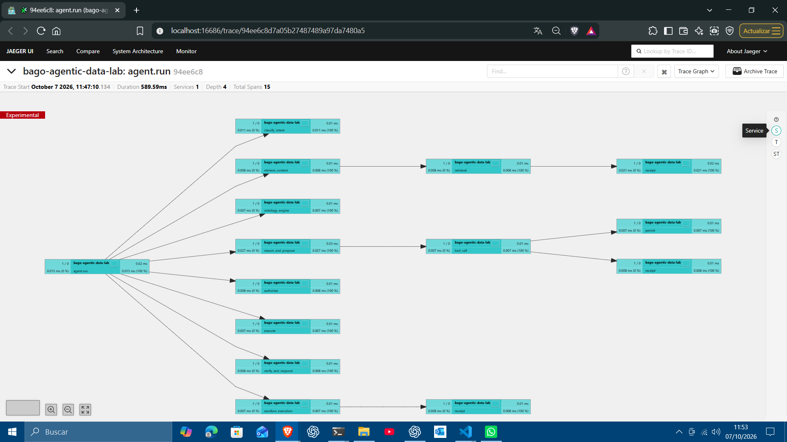

# 🧪 BAGO Agentic Data Lab

[](https://github.com/MarcValls/BAGO_AGENTIC_DATA_LAB/actions/workflows/ci.yml)
[](https://github.com/MarcValls/BAGO_AGENTIC_DATA_LAB/actions/workflows/readme-consistency.yml)
[](https://github.com/MarcValls/BAGO_AGENTIC_DATA_LAB/tree/main)
[](LICENSE)

> Laboratorio experimental para desarrollar capacidades de AI Engineering con gobernanza BAGO.
> README generado desde fuentes canónicas y artefactos del checkout.

## El laboratorio

Un laboratorio experimental de AI Engineering gobernada: reúne agentes, datos, recuperación, ejecución y observabilidad en un recorrido donde se puede inspeccionar qué se propuso, qué se autorizó y qué efecto quedó registrado. Una respuesta del modelo, por sí sola, no demuestra autorización ni ejecución.

## Arquitectura de un vistazo

**Principio:** LangGraph propone → BAGO autoriza → ExecutionGateway → SandboxManager → Receipt → LocalTrace → Eval.



```mermaid
flowchart LR
    L0["L0 Baseline & Lab Contract (COMPLETE)"]
    L1["L1 LangGraph Governed Execution (VALIDATED (local governed graph evidence))"]
    L2["L2 ETL / Data Pipeline (VALIDATED)"]
    L3["L3 Metadata & Ontology (VERIFIED)"]
    L4["L4 Governed RAG (VERIFIED)"]
    L5["L5 MCP con gobernanza (VERIFIED)"]
    L6["L6 AWS Bedrock Provider (VERIFIED (historical live Converse; latest attempts throttled))"]
    L7["L7 Bedrock Knowledge Base (VERIFIED (offline))"]
    L8["L8 Metadata Catalog (VERIFIED (local live))"]
    L9["L9 End-to-End Governed Agent (VERIFIED (offline))"]
    L10["L10 Governed Ontology Engine (VERIFIED (local))"]
    L11["L11 Governed Sandbox Layer (VERIFIED (local))"]
    L12["L12 Local Observability & Evals (VERIFIED (local))"]
    L13["L13 Public E2E Demo & CI (VERIFIED (local))"]
    L14["L14 Governed Local Vector Store (VERIFIED (local))"]
    L15["L15 OpenTelemetry + Jaeger Local Live (VERIFIED (local live))"]
    L0 --> L1
    L1 --> L2
    L2 --> L3
    L3 --> L4
    L4 --> L5
    L5 --> L6
    L6 --> L7
    L7 --> L8
    L8 --> L9
    L9 --> L10
    L10 --> L11
    L11 --> L12
    L12 --> L13
    L13 --> L14
    L14 --> L15
```

La tabla muestra estados declarados en el manifiesto del proyecto; consulta las fuentes canónicas para conocer el alcance comprobado.

| Fase | Estado declarado | Objetivo | Área |
|---|---|---|---|
| L0 | COMPLETE | — | Baseline & Lab Contract |
| L1 | VALIDATED (local governed graph evidence) | — | LangGraph Governed Execution |
| L2 | VALIDATED | — | ETL / Data Pipeline |
| L3 | VERIFIED | — | Metadata & Ontology |
| L4 | VERIFIED | Orbitant | Governed RAG |
| L5 | VERIFIED | Orbitant | MCP con gobernanza |
| L6 | VERIFIED (historical live Converse; latest attempts throttled) | Tuio | AWS Bedrock Provider |
| L7 | VERIFIED (offline) | Devoteam | Bedrock Knowledge Base |
| L8 | VERIFIED (local live) | Devoteam | Metadata Catalog |
| L9 | VERIFIED (offline) | commercetools | End-to-End Governed Agent |
| L10 | VERIFIED (local) | BAGO / portfolio | Governed Ontology Engine |
| L11 | VERIFIED (local) | BAGO / secure execution | Governed Sandbox Layer |
| L12 | VERIFIED (local) | BAGO / portfolio | Local Observability & Evals |
| L13 | VERIFIED (local) | BAGO / portfolio | Public E2E Demo & CI |
| L14 | VERIFIED (local) | BAGO / portfolio | Governed Local Vector Store |
| L15 | VERIFIED (local live) | BAGO / portfolio | OpenTelemetry + Jaeger Local Live |

## Ejecutar la demo local

La demo principal usa fixtures locales y no llama a AWS ni a otros proveedores externos.

```bash
python -m pip install -r requirements.txt
python demo.py
```

La guía explica la instalación en Windows y POSIX, los artefactos y sus límites: [demo de una orden](docs/one_command_demo.md) · [recorrido de artefactos](docs/one_command_demo_walkthrough.md).

**Demo gobernada:** pregunta → agente → recuperación con citas → ejecución tipada → receipts → LocalTrace → evaluación. Genera cinco JSON (`summary`, `agent_run`, `receipts`, `trace`, `evaluation`) en `demo_output/`; el proveedor es un fixture y no contacta AWS. [Contrato y requisitos](docs/one_command_demo.md) · [lectura de artefactos](docs/one_command_demo_walkthrough.md).

## Evidencia de ejecución y límites

### Jaeger y OpenTelemetry (L15)

La evidencia L15 del 2026-10-08 enlaza la traza BAGO `trace-5b385699ffda0529` con la traza consultada en Jaeger `04b58bb123bb6cc94a8cc0d60c7145ae`: 15 spans proyectados y 15 observados, 13 operaciones y estado `PASS`. La captura del grafo que acompaña la demo corresponde a otra ejecución local del 2026-10-07 (`94ee6c8d7a05b27487489a97da7480a5`), también con 15 spans; es una referencia visual y no la captura de la traza del informe L15.



[Informe y datos completos L15](evidence/l15_otel_jaeger_live.md) · [intento de captura del freeze](evidence/l15_jaeger_capture_attempt.md) · [guía para reproducir Jaeger](docs/otel_jaeger.md).

- [Último resultado completo de CI](https://github.com/MarcValls/BAGO_AGENTIC_DATA_LAB/actions/runs/38665463586): estado y SHA del commit verificados en `STATE.md`; no cubre cambios posteriores.
- [Estado y límites AWS](.bago/canon/STATE.md): la consulta Free Tier observó USD 100 de crédito activo; los dos intentos Bedrock más recientes fueron rechazados por cuota diaria y no generaron tokens. El consumo/facturación de esos intentos no está probado.
- [Consulta de créditos Free Tier](evidence/l6_aws_free_tier.md) · [último recibo Bedrock](evidence/l6_aws_live.md) · [intento Nova Lite](evidence/aws-live-attempts/20261018_nova_lite_throttled.md) · [intento Nova Micro](evidence/aws-live-attempts/20261018_nova_micro_throttled.md).

La demo local evalúa trazas y controles estructurales; no prueba calidad general de respuestas, aislamiento de producción ni integraciones cloud en vivo.

## Ver la interfaz en acción

- [Guía y límites](docs/agent-chat-control/TUTORIAL_PRIMER_USO.md)
- [Vídeo narrado](docs/agent-chat-control/assets/ADL_videotutorial_primer_usuario.mp4) · [subtítulos](docs/agent-chat-control/assets/ADL_videotutorial_primer_usuario.es.srt)
- [Traza de la sesión documentada](docs/agent-chat-control/assets/trace-c7ec5fcc40284a42.json) · [archivo de ejemplo](output/tutorial/sample-note.txt)

La grabación acredita la lectura y respuesta acotadas descritas en la guía; no una auditoría del código ni ejecución de trabajos.

## Estado actual

| Campo | Valor |
|---|---|
| Rama pública | `main` |
| Resumen actualizado | 2026-10-18 |
| Fase actual | **L15 · OpenTelemetry + Jaeger Local Live** · VERIFIED (local live) |
| Siguiente bloque declarado | NOT_DECLARED |
| Último resultado completo de CI registrado | GitHub Actions run [38665463586](https://github.com/MarcValls/BAGO_AGENTIC_DATA_LAB/actions/runs/38665463586) completed successfully on commit `ff9292fe4340a2bdab9658a2e804579fa4ef8fb0` (2026-10-15). Its complete test-suite step and README check both succeeded. This result does not cover later changes. |

**Alcance declarado:** VERIFIED for the local RDF/Turtle materialization, bounded SPARQL subset, deterministic inference, contradiction constraints, RAG seed handoff, the real local OpenMetadata 1.12.6 validation, the local restricted sandbox execution boundary, the local trace/evaluation chain, the public fixture E2E demo executed by the same CI contract, the persistent local SQLite vector index consumed by GovernedRAG and the local OpenTelemetry → Jaeger trace projection. A historical bounded AWS Bedrock `Converse` call succeeded through the governed adapter; it does not establish current quota or billing. The latest read-only AWS Free Tier check observed USD 100.00 remaining, while two subsequent bounded `Converse` attempts failed on the daily token quota with no inference tokens reported. Billing/credit consumption for those failed calls is `NOT_PROVEN`. AWS `ConverseStream`, Bedrock Knowledge Base, remote OpenMetadata and commercetools live integrations remain `NOT_RUN`; GitHub issue #14 is separately executed and verified under human authorization, and the local human-reviewed checkpoint is recorded in `evidence/bago_canon_compliance_review.md`.

La fecha corresponde a la actualización del resumen. Cada observación externa conserva la fecha y el alcance de su evidencia; este README no representa una consulta en vivo.

## Recorrido de datos y arquitectura actual

**Principio:** LangGraph propone → BAGO autoriza → ExecutionGateway → SandboxManager → Receipt → LocalTrace → Eval.



```mermaid
flowchart LR
    RAG["Governed RAG"]
    RDF["RDF/Turtle"]
    SPARQL["SPARQL local"]
    INFERENCE["Inference"]
    CONSTRAINTS["Constraints"]
    LLM["LLM context"]
    GATEWAY["ExecutionGateway"]
    SANDBOX["SandboxManager"]
    RECEIPT["Receipt"]
    RAG --> RDF
    RDF --> SPARQL
    SPARQL --> INFERENCE
    INFERENCE --> CONSTRAINTS
    CONSTRAINTS --> LLM
    LLM --> GATEWAY
    GATEWAY --> SANDBOX
    SANDBOX --> RECEIPT
```

Pipeline actual:

1. RAG recupera documentos y citas
2. Ontology Engine materializa RDF/Turtle
3. SPARQL local consulta relaciones
4. Inference añade inversas, transitivas y simétricas
5. Constraints detecta endpoints, evidencia y contradicciones
6. El LLM recibe caminos y evidencia; no recibe autoridad implícita
7. ExecutionGateway exige una SandboxRequest tipada
8. SandboxManager materializa filesystem y proceso acotados
9. Receipt evidencia el resultado o la denegación
10. LocalTrace enlaza workflow, retrieval, permits, sandbox y receipts
11. Local evaluator comprueba cobertura y ausencia de efectos no autorizados
12. Public E2E compone las fronteras locales con fixtures deterministas
13. SQLiteVectorStore persiste vectores deterministas y conserva el gate de metadata
14. GovernedRAG puede consumir el backend semántico persistente y recargar su fingerprint
15. OpenTelemetry proyecta LocalTrace a Jaeger local sin conceder autoridad
16. GitHub Actions repite tests, README, demo, vector validation, Jaeger validation y compile checks

## Recorrido comercial de la app: Bruma Market

Este tutorial usa pedidos y políticas totalmente ficticios. Documenta dos conversaciones de agentes ejecutadas en la app: un extractor produce JSON y un revisor aplica la política con evidencia autorizada. No son pedidos ni clientes reales.

| Pedido | Envío | Retraso | Decisión registrada | Importe de envío elegible |
|---|---|---:|---|---:|
| BM-1001 | express | 32 h | `ELIGIBLE` | €7.90 (solo envío) |
| BM-1002 | express | 24 h | `NOT_ELIGIBLE` | — |
| BM-1003 | standard | 48 h | `NOT_ELIGIBLE` | — |
| BM-1004 | express | sin dato | `PENDING` | — |

**Ejecución registrada:** `VERIFIED`; cuatro casos QA: `ELIGIBLE, NOT_ELIGIBLE, NOT_ELIGIBLE, PENDING`; `actions_executed` vacío: `True`. Ningún reembolso se ejecutó.
**Trazas de las conversaciones:** `trace-e884fa5f23414206`, `trace-63cc286f9d574a38` (`local_only`; no Jaeger export). SHA-256 del CSV autorizado: `016acee85ee5afdb23eaf13caf3f664417e1398b5bba3aad8ff6e991e6a3d1e3`. SHA distintos presentes en recibos: 3.

La regla estricta solo cubre envíos EXPRESS con más de 24 h de retraso y devuelve únicamente la tarifa de envío. Exactamente 24 h no cumple; STANDARD no entra en la regla; sin hora de entrega queda pendiente.

**Revisa el tutorial:** [guía paso a paso](output/playwright/bruma-market-tutorial/README.md) · [vídeo MP4](output/playwright/bruma-market-tutorial/tutorial-bruma-market.mp4) · [subtítulos](output/playwright/bruma-market-tutorial/tutorial-bruma-market.srt) · [hash manifest](output/playwright/bruma-market-tutorial/sha256-manifest.json). Entradas: [CSV de pedidos](output/playwright/bruma-market-tutorial/inputs/orders.csv), [política](output/playwright/bruma-market-tutorial/inputs/policy.md) y [QA esperado](output/playwright/bruma-market-tutorial/inputs/qa-expected.md). Resultados y receipts: [extracción JSON](output/playwright/bruma-market-tutorial/extracted/orders.json), [decisiones](output/playwright/bruma-market-tutorial/extracted/policy-decisions.json), [recibos de lectura y trazas](output/playwright/bruma-market-tutorial/extracted/run-evidence.json) y [perfiles/runs guardados](output/playwright/bruma-market-tutorial/cloud-runs/profiles.json).

**Límite del conjunto:** solo contiene pedidos sintéticos, política, QA y recibos de lectura. No aporta directorio de clientes, facturas ni albaranes; esos casos requieren datos y escenarios propios antes de afirmar que están demostrados.

## Roadmap y evidencia por fase

Cada bloque muestra los archivos localizados mediante los patrones declarados en el checkout. Los patrones sin coincidencias aparecen indicados; eso no demuestra que el recurso no exista fuera de este repositorio.

### L0 — Baseline & Lab Contract
**Estado:** COMPLETE

**Código localizado:** —
**Tests:** —
**Evidencia:** —
**Patrones sin resolver:** `ninguno`

### L1 — LangGraph Governed Execution
**Estado:** VALIDATED (local governed graph evidence)

**Código localizado:** [`src/orchestration/governed_execution.py`](src/orchestration/governed_execution.py) · [`src/orchestration/state_graph.py`](src/orchestration/state_graph.py)
**Tests:** [`tests/test_l1_governance.py`](tests/test_l1_governance.py) · [`tests/test_l1_integrated_graph.py`](tests/test_l1_integrated_graph.py)
**Evidencia:** [`evidence/l1-governed-execution-completion-20261010/L1_DEMO_RECEIPTS.json`](evidence/l1-governed-execution-completion-20261010/L1_DEMO_RECEIPTS.json) · [`evidence/l1-governed-execution-completion-20261010/L1_DEMO_TRANSCRIPT.md`](evidence/l1-governed-execution-completion-20261010/L1_DEMO_TRANSCRIPT.md) · [`evidence/l1-governed-execution-completion-20261010/L1_VALIDATION.md`](evidence/l1-governed-execution-completion-20261010/L1_VALIDATION.md) · [`evidence/l1_governed_execution_20261010.md`](evidence/l1_governed_execution_20261010.md)
**Patrones sin resolver:** `ninguno`

### L2 — ETL / Data Pipeline
**Estado:** VALIDATED

**Código localizado:** [`src/etl/pipeline.py`](src/etl/pipeline.py)
**Tests:** [`tests/test_l2_etl_pipeline.py`](tests/test_l2_etl_pipeline.py)
**Evidencia:** [`l2_etl_metadata.db`](l2_etl_metadata.db)
**Patrones sin resolver:** `ninguno`

### L3 — Metadata & Ontology
**Estado:** VERIFIED

**Código localizado:** [`src/metadata/ontology.py`](src/metadata/ontology.py) · [`src/metadata/ontology_generator.py`](src/metadata/ontology_generator.py) · [`src/metadata/schema.py`](src/metadata/schema.py)
**Tests:** [`tests/test_l3_evidence.py`](tests/test_l3_evidence.py) · [`tests/test_l3_ontology.py`](tests/test_l3_ontology.py) · [`tests/test_metadata_schema.py`](tests/test_metadata_schema.py) · (+1 archivos)
**Evidencia:** [`docs/ontology_generator.md`](docs/ontology_generator.md) · [`evidence/l3_ontology_graph.md`](evidence/l3_ontology_graph.md)
**Patrones sin resolver:** `ninguno`

### L4 — Governed RAG
**Estado:** VERIFIED

**Código localizado:** [`src/retrieval/governed_rag.py`](src/retrieval/governed_rag.py)
**Tests:** [`tests/test_retrieval_accuracy.py`](tests/test_retrieval_accuracy.py) · [`tests/test_retrieval_benchmark.py`](tests/test_retrieval_benchmark.py)
**Evidencia:** [`docs/governed_rag.md`](docs/governed_rag.md) · [`evidence/retrieval_benchmark_results.md`](evidence/retrieval_benchmark_results.md)
**Patrones sin resolver:** `ninguno`

### L5 — MCP con gobernanza
**Estado:** VERIFIED

**Código localizado:** [`src/adapters/mcp_adapter.py`](src/adapters/mcp_adapter.py)
**Tests:** [`tests/test_mcp_governance.py`](tests/test_mcp_governance.py)
**Evidencia:** [`docs/mcp_governance.md`](docs/mcp_governance.md) · [`evidence/mcp_governed_demo.md`](evidence/mcp_governed_demo.md) · [`evidence/mcp_governed_demo.mp4`](evidence/mcp_governed_demo.mp4)
**Patrones sin resolver:** `ninguno`

### L6 — AWS Bedrock Provider
**Estado:** VERIFIED (historical live Converse; latest attempts throttled)

**Código localizado:** [`scripts/run_l6_aws_free_tier_validation.py`](scripts/run_l6_aws_free_tier_validation.py) · [`src/adapters/bedrock_provider_adapter.py`](src/adapters/bedrock_provider_adapter.py)
**Tests:** [`tests/test_bedrock_integration.py`](tests/test_bedrock_integration.py)
**Evidencia:** [`docs/aws_bedrock_setup.md`](docs/aws_bedrock_setup.md) · [`evidence/bedrock_provider_benchmark.md`](evidence/bedrock_provider_benchmark.md) · [`evidence/l6_aws_free_tier.md`](evidence/l6_aws_free_tier.md) · [`evidence/l6_aws_live.md`](evidence/l6_aws_live.md)
**Patrones sin resolver:** `ninguno`

### L7 — Bedrock Knowledge Base
**Estado:** VERIFIED (offline)

**Código localizado:** [`src/adapters/bedrock_kb_adapter.py`](src/adapters/bedrock_kb_adapter.py)
**Tests:** [`tests/test_bedrock_kb_adapter.py`](tests/test_bedrock_kb_adapter.py)
**Evidencia:** [`docs/bedrock_knowledge_base.md`](docs/bedrock_knowledge_base.md) · [`evidence/bago_etl_vs_bedrock_kb_comparison.md`](evidence/bago_etl_vs_bedrock_kb_comparison.md)
**Patrones sin resolver:** `ninguno`

### L8 — Metadata Catalog
**Estado:** VERIFIED (local live)

**Código localizado:** [`infra/openmetadata/docker-compose.yml`](infra/openmetadata/docker-compose.yml) · [`scripts/run_l8_openmetadata_live_validation.py`](scripts/run_l8_openmetadata_live_validation.py) · [`src/adapters/openmetadata_adapter.py`](src/adapters/openmetadata_adapter.py)
**Tests:** [`tests/test_openmetadata_adapter.py`](tests/test_openmetadata_adapter.py)
**Evidencia:** [`docs/openmetadata_catalog.md`](docs/openmetadata_catalog.md) · [`evidence/l8_openmetadata_catalog.md`](evidence/l8_openmetadata_catalog.md) · [`evidence/l8_openmetadata_live.md`](evidence/l8_openmetadata_live.md)
**Patrones sin resolver:** `ninguno`

### L9 — End-to-End Governed Agent
**Estado:** VERIFIED (offline)

**Código localizado:** [`src/agent/governed_knowledge_agent.py`](src/agent/governed_knowledge_agent.py)
**Tests:** [`tests/test_l9_end_to_end_agent.py`](tests/test_l9_end_to_end_agent.py)
**Evidencia:** [`docs/commercetools_capstone.md`](docs/commercetools_capstone.md) · [`evidence/l9_authorized_actions_20260922.md`](evidence/l9_authorized_actions_20260922.md) · [`evidence/l9_commercetools_agent.md`](evidence/l9_commercetools_agent.md)
**Patrones sin resolver:** `ninguno`

### L10 — Governed Ontology Engine
**Estado:** VERIFIED (local)

**Código localizado:** [`scripts/generate_l10_ontology_evidence.py`](scripts/generate_l10_ontology_evidence.py) · [`src/agent/governed_knowledge_agent.py`](src/agent/governed_knowledge_agent.py) · [`src/metadata/ontology_engine.py`](src/metadata/ontology_engine.py)
**Tests:** [`tests/test_l10_ontology_engine.py`](tests/test_l10_ontology_engine.py)
**Evidencia:** [`docs/ontology_engine.md`](docs/ontology_engine.md) · [`evidence/l10_ontology_engine.md`](evidence/l10_ontology_engine.md)
**Patrones sin resolver:** `ninguno`

### L11 — Governed Sandbox Layer
**Estado:** VERIFIED (local)

**Código localizado:** [`src/execution/gateway.py`](src/execution/gateway.py) · [`src/sandbox/__init__.py`](src/sandbox/__init__.py) · [`src/sandbox/backend.py`](src/sandbox/backend.py) · (+6 archivos)
**Tests:** [`tests/test_sandbox.py`](tests/test_sandbox.py)
**Evidencia:** [`docs/sandbox_manager.md`](docs/sandbox_manager.md) · [`evidence/sandbox_local_restricted.md`](evidence/sandbox_local_restricted.md) · [`scripts/run_sandbox_local_validation.py`](scripts/run_sandbox_local_validation.py)
**Patrones sin resolver:** `ninguno`

### L12 — Local Observability & Evals
**Estado:** VERIFIED (local)

**Código localizado:** [`src/evaluation/__init__.py`](src/evaluation/__init__.py) · [`src/evaluation/agent_lab.py`](src/evaluation/agent_lab.py) · [`src/evaluation/local_evals.py`](src/evaluation/local_evals.py) · (+3 archivos)
**Tests:** [`tests/test_l12_observability.py`](tests/test_l12_observability.py)
**Evidencia:** [`docs/observability_evals.md`](docs/observability_evals.md) · [`evidence/l12_observability_evals.md`](evidence/l12_observability_evals.md) · [`scripts/run_l12_observability_evidence.py`](scripts/run_l12_observability_evidence.py)
**Patrones sin resolver:** `ninguno`

### L13 — Public E2E Demo & CI
**Estado:** VERIFIED (local)

**Código localizado:** [`.github/workflows/ci.yml`](.github/workflows/ci.yml) · [`demo.py`](demo.py) · [`portfolio/README.md`](portfolio/README.md) · (+4 archivos)
**Tests:** [`tests/test_public_e2e_demo.py`](tests/test_public_e2e_demo.py)
**Evidencia:** [`docs/public_e2e_demo.md`](docs/public_e2e_demo.md) · [`evidence/public_e2e_demo.md`](evidence/public_e2e_demo.md)
**Patrones sin resolver:** `ninguno`

### L14 — Governed Local Vector Store
**Estado:** VERIFIED (local)

**Código localizado:** [`scripts/run_l14_vector_store_validation.py`](scripts/run_l14_vector_store_validation.py) · [`src/retrieval/sqlite_vector_store.py`](src/retrieval/sqlite_vector_store.py)
**Tests:** [`tests/test_sqlite_vector_store.py`](tests/test_sqlite_vector_store.py)
**Evidencia:** [`docs/local_vector_store.md`](docs/local_vector_store.md) · [`evidence/l14_vector_store.md`](evidence/l14_vector_store.md)
**Patrones sin resolver:** `ninguno`

### L15 — OpenTelemetry + Jaeger Local Live
**Estado:** VERIFIED (local live)

**Código localizado:** [`infra/observability/docker-compose.yml`](infra/observability/docker-compose.yml) · [`scripts/run_l15_otel_live_validation.py`](scripts/run_l15_otel_live_validation.py) · [`src/observability/otel_bridge.py`](src/observability/otel_bridge.py)
**Tests:** [`tests/test_l15_otel_bridge.py`](tests/test_l15_otel_bridge.py)
**Evidencia:** [`docs/otel_jaeger.md`](docs/otel_jaeger.md) · [`evidence/l15_otel_jaeger_live.md`](evidence/l15_otel_jaeger_live.md)
**Patrones sin resolver:** `ninguno`

## Fuentes canónicas del proyecto

| Área | Cobertura | Fuentes presentes / declaradas |
|---|---|---|
| Gobierno del proyecto | Estado, contrato, arquitectura, roadmap, aprendizaje y skills | 6/6 presentes |
| Demo y portfolio | Tutoriales, walkthrough, snapshot y notas de release | 4/4 presentes |
| Versionado | Versión declarada del repositorio | 1/1 presentes |

**Gobierno del proyecto:**

- [`.bago/canon/STATE.md`](.bago/canon/STATE.md) — estado operativo actual
- [`.bago/canon/LAB_CONTRACT.md`](.bago/canon/LAB_CONTRACT.md) — contrato del laboratorio
- [`.bago/canon/ARCHITECTURE.md`](.bago/canon/ARCHITECTURE.md) — arquitectura y límites
- [`.bago/canon/ROADMAP.md`](.bago/canon/ROADMAP.md) — roadmap ejecutable
- [`.bago/canon/LEARNING_LEDGER.md`](.bago/canon/LEARNING_LEDGER.md) — aprendizaje y evidencia
- [`.bago/canon/JOB_SKILL_MATRIX.md`](.bago/canon/JOB_SKILL_MATRIX.md) — skills y alineación laboral

**Demo y portfolio:**

- [`docs/cv_linkedin/portfolio-demo-v1.md`](docs/cv_linkedin/portfolio-demo-v1.md) — snapshot freeze portfolio-demo-v1 (CV/LinkedIn)
- [`docs/one_command_demo.md`](docs/one_command_demo.md) — quickstart and artifact contract for one-command governed demo
- [`docs/one_command_demo_walkthrough.md`](docs/one_command_demo_walkthrough.md) — canonical demo explanations and artifact walkthrough
- [`docs/releases/RELEASE_NOTES_DEMO_V1.md`](docs/releases/RELEASE_NOTES_DEMO_V1.md) — frozen one-command demo v1.0.0 release notes

**Versionado:**

- [`VERSION`](VERSION) — current repository version

- [Índice de contexto BAGO](.bago/INDEX.md)
- [Contrato del laboratorio y estimaciones de planificación](.bago/canon/LAB_CONTRACT.md)
- [Matriz de skills](.bago/canon/JOB_SKILL_MATRIX.md); sus porcentajes son estimaciones del proyecto, no evaluaciones independientes.
- [Catálogo de agentes](agents/CATALOG_MANIFEST.json), de referencia; las definiciones operativas están en `.github/agents/`.
- [Agente de sincronización: documentación](docs/bago-sync-agent.md) · [definición](.github/agents/bago-sync-agent.agent.md)

## Agente de sincronización y catálogo de agentes

El [catálogo de agentes](agents/CATALOG_MANIFEST.json) es de referencia; las definiciones operativas están en `.github/agents/`. El [agente de sincronización](docs/bago-sync-agent.md) enlaza definición, ejecutor gobernado y documentación.

## Alineación profesional y matriz de skills

Datos copiados de los documentos canónicos; porcentajes, niveles, salarios y plazos son estimaciones históricas del proyecto, no evaluaciones independientes ni ofertas laborales vigentes.

### Roles objetivo

| Empresa | Rol | Fit | Gap principal | Timeline |
|---|---|---:|---|---|
| Tuio | Forward Deployed AI Engineer | ~96% | Seniority (~5 años) | 4-5 semanas |
| Orbitant | AI Engineer | ~91% | LangGraph + Cloud | 2-3 semanas |
| Devoteam | GCP AI Engineer (Gemini) | ~87% → 93% | Vertex AI / GCP | 6-7 semanas |
| commercetools | AI Engineer | ~97% | Seniority + LLM production | Stretch goal |

### Skills técnicas

**Matrix convention:** Market demand uses Muy alta, Alta and Media. Current-level colors describe evidence maturity: 🟢 implemented or evidenced locally; 🟡 practical baseline, partial evidence or bounded scope; 🟠 historical evidence or external constraint; 🔵 designed capability without an implementation claim. 🎯 marks the target level. Colors describe evidence scope, not professional proficiency. The final column records evidence scope and remaining limits.

| Skill | Demanda | Nivel actual | Nivel objetivo | Primera evidencia | Entrevista |
|---|---|---|---|---|---|
| Python | Alta | 🟢 Senior | 🎯 Senior | BAGO backend | ✅ Sí |
| REST APIs | Alta | 🟢 Senior | 🎯 Senior | BAGO FastAPI | ✅ Sí |
| LangGraph | Muy alta | 🟢 Implementado localmente | 🎯 Proficient | Integrated StateGraph + exact approval + governed RAG/gateway/sandbox/receipt/LocalTrace | L1 VALIDATED in local scope; identity, durability and OS isolation are not claimed |
| LangChain concepts | Alta | 🟡 Baseline práctico | 🎯 Basic | StateGraph, interrupt/resume, in-memory checkpoint | L1 VALIDATED in local scope; checkpoint is in-memory |
| Multi-agent systems | Muy alta | 🟢 Reinforced | 🎯 Proficient | GovernedKnowledgeAgent + L9 evidence | L9 offline |
| Tool use | Muy alta | 🟢 Implementado | 🎯 Proficient | BAGO tools + MCP receipts | L5 baseline |
| MCP | Muy alta | 🟡 Baseline gobernado | 🎯 Proficient | L5 MCP adapter + video | L5 baseline |
| RAG | Muy alta | 🟡 Basic | 🎯 Advanced | L4 governed RAG | L4 completado |
| Hybrid retrieval | Alta | 🟡 Implemented locally; deterministic benchmark is limited | 🎯 Proficient | 32-document offline corpus; 9 labelled queries; Recall@1/@3 and MRR | Synthetic baseline only; production embeddings and broader relevance validation remain |
| Embeddings | Alta | 🟡 Deterministic local | 🎯 Implementado | HashEmbedding + SQLiteVectorStore | L14 local |
| Vector DB | Alta | 🟢 Local persistent | 🎯 Proficient | SQLiteVectorStore + GovernedRAG reload | L14 local; distributed service separate |
| ETL | Alta | 🟡 Implemented locally; coverage partial | 🎯 Proficient | L2 source-to-SQLite pipeline; deduplication, receipts and enforced chunk-overlap test | Local pipeline verified; partial-failure and transaction recovery coverage remains |
| Data pipelines | Alta | 🟡 Implemented locally; local/document scope | 🎯 Implementado | L2 ingestion consumed by L4 SQLite retrieval adapter | No evidence yet for scheduled recovery or distributed processing |
| Metadata/Ontology | Media | 🟢 Implementado | 🎯 Proficient | L3 schema + L10 engine | L10 local |
| RDF / SPARQL / Knowledge Graphs | Alta | 🟡 Baseline local | 🎯 Proficient | L10 RDF/Turtle + SPARQL + inference | L10 local; triplestore live separado |
| Lineage | Media | 🟢 Implementado | 🎯 Proficient | L3 relations + L10 paths | L10 local |
| AWS | Alta | 🟠 Bedrock Converse live histórico; cuota diaria agotada en los últimos intentos | 🎯 Bedrock fluent | L6 adapter + receipt live + consulta Free Tier | IAM least-privilege + recuperar cuota; saldo/cargo posterior no probado |
| Bedrock | Alta | 🟠 Converse histórico verificado; intentos actuales limitados por cuota | 🎯 Proficient | L6 Converse/Stream + receipts | Stream + evaluación de modelo y cuota disponible |
| Bedrock Knowledge Bases | Alta | 🟡 Baseline offline | 🎯 Proficient | L7 Retrieve/Generate + citations | Live KB evaluation |
| OpenMetadata Catalog | Media | 🟢 Local live verificado | 🎯 Proficient | L8 adapter + Docker local + lineage/quality receipts | OpenMetadata remoto |
| IAM | Alta | 🟡 Basic | 🎯 Configurable | L6 least-privilege setup | Live policy check |
| CI/CD | Alta | 🟢 Reproducible | 🎯 Implementado | GitHub Actions + pinned requirements + public E2E | L13 CI |
| Evaluation | Muy alta | 🟢 Local governance evals | 🎯 Framework | Local evaluation suites, trace/evidence linkage, and L8-L15 scenario evidence | L15 local + CI |
| Observability | Alta | 🟢 OpenTelemetry local live | 🎯 Completo | LocalTrace + OTLP/HTTP + Jaeger Docker + parent-linked spans | L15 local; remoto separado |
| Secure execution | Muy alta | 🟢 Local backend verified | 🎯 Implementado | BAGO auth boundary + LocalRestrictedBackend + escape tests | L11 local |
| Authorization | Muy alta | 🔵 Diseñado | 🎯 Implementado | L1 fail-closed gate; MCP, Bedrock y sandbox tienen límites probados por separado | L1 evidencia parcial |
| Auditability | Alta | 🔵 Diseñado | 🎯 Implementado | Recibos de adapters/sandbox; L1 no fabrica recibos si no hay gateway | L1 evidencia parcial |
| Docker/K8s | Media | 🟡 Docker Compose local | 🎯 Basic | OpenMetadata Compose + reproducible healthcheck | L8 local |

### Skills estratégicas y personales

| Skill | Nivel actual | Nivel objetivo | Evidencia |
|---|---|---|---|
| Arquitectura de sistemas | ✅ Fuerte | ✅ Mantener | AGENTS.md, CANON_BAGO |
| Diseño de contratos | ✅ Fuerte | ✅ Mantener | BAGO contracts |
| Documentación técnica | ✅ Fuerte | ✅ Mantener | Este repo |
| Análisis de trade-offs | ✅ Fuerte | ✅ Mantener | Decision records |
| Comunicación escrita | ✅ Fuerte | ✅ Mantener | Docs claras |

## Reproducir y verificar

```bash
python -m pytest tests -q
python scripts/generate_dynamic_readme.py --check --skip-tests
python scripts/run_public_e2e_demo.py --check
```

La CI completa ejecuta la suite, valida este README y comprueba las demos y servicios locales. `--check --skip-tests` solo comprueba el render y recoge casos; informa `NOT_RUN` y no acredita que pasen.

Las llamadas AWS requieren autorización explícita y evidencia de identidad, cuota y créditos disponibles. Los recibos de coste estimado no prueban facturación real; revisa el alcance actual en `STATE.md` antes de una ejecución live.

## Contrato de generación del README

`README.md` es un artefacto generado. No lo edites manualmente; modifica las fuentes canónicas y ejecuta el generador.

- [Contrato de generación y revisión](docs/readme_generation.md)
- Manifiesto de contenido: `docs/readme_manifest.json`
- [Registro congelado portfolio-demo-v1](docs/cv_linkedin/portfolio-demo-v1.md)

MIT License · [LICENSE](LICENSE)
