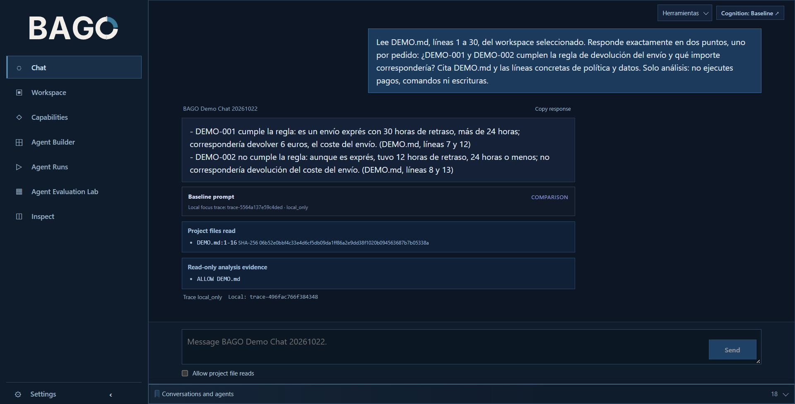

# BAGO · Agentic Data Lab

**Agentes, datos y ejecución gobernada desde un espacio de trabajo.**

ADL permite formular una intención desde el chat, preparar una operación, revisar su autorización y consultar resultados con evidencias. Cada recorrido debe distinguir lo que el agente afirma de lo que el sistema realmente ejecutó y comprobó.

**[Empezar en Windows](docs/agent-chat-control/LOCAL_SETUP.md)** · **[Probar la demo local](docs/one_command_demo.md)** · [Explorar la arquitectura](.bago/canon/ARCHITECTURE.md) · [Ver trazas y evaluación](docs/observability_evals.md)

---

## Qué ofrece

| Área | Función |
|---|---|
| **[Chat y workspace](docs/readme_frontend.md)** | Conversar, preparar contexto, consultar y revisar propuestas sin confundir una respuesta con una ejecución. |
| **[Agentes y conocimiento](docs/governed_rag.md)** | Organizar capacidades, recuperar información con procedencia y mantener los límites de autoridad. |
| **[Ejecución gobernada](docs/governed-execution/GEX_V1_NORMATIVE_CONTRACT.md)** | Aplicar permisos y controles antes de efectos materiales; registrar resultados y excepciones. |
| **[Inspect y observabilidad](docs/observability_evals.md)** | Relacionar solicitudes, recibos, trazas, evidencias y verificaciones. |

## Del chat a una operación verificable

**Intención** → **Propuesta** → **Revisión y autorización** → **Ejecución** → **Recibo** → **Verificación**

Este es el principio arquitectónico; cada capacidad y recorrido tiene su propio estado y alcance. Las capacidades no demostradas de extremo a extremo no se presentan como verificadas.

## La aplicación

*Captura documentada del 22/10/2026; no acredita por sí sola el estado actual de la interfaz ni la ejecución de herramientas.* [Ver recorrido y límites](docs/readme_frontend.md).

## Probar ADL

**Aplicación Windows:** sigue la [instalación local](docs/agent-chat-control/LOCAL_SETUP.md) para iniciar el frontend y configurar el proveedor.

**Demostración reproducible:** sigue la [demo de ejecución gobernada](docs/one_command_demo.md) para ejecutar un recorrido local sin claves externas y examinar los archivos de resultado. La demostración utiliza fixtures; no valida servicios cloud en producción.

## Documentación y evidencia

[Arquitectura](.bago/canon/ARCHITECTURE.md) · [Contrato de ejecución](docs/governed-execution/GEX_V1_NORMATIVE_CONTRACT.md) · [Estado canónico](.bago/canon/STATE.md) · [Seguridad](SECURITY.md) · [Guía técnica completa](README_DETAILS.md)

---

**Nota de esta vista previa:** propuesta de portada minimalista. No sustituye todavía al README generado de `main`; sus enlaces se han formulado como rutas relativas desde la raíz para facilitar su adopción.
