# Manual visual de BAGO

Guía de referencia con capturas para reconocer cada pantalla y seguir los recorridos habituales sin tener que memorizar comandos.

## Antes de empezar

Las capturas muestran la interfaz actual de BAGO. Las pantallas 05–28 y 30–35 se recorrieron con Playwright y respuestas de demostración interceptadas en el navegador. No se consultaron trabajos reales, no se guardó el agente de ejemplo, no se ejecutó ningún modelo y no se leyó la carpeta `src`: las autorizaciones, el escaneo y los resultados son ficticios. La pantalla “guardado” del agente y el resultado `PASS` de evaluación son estados ilustrativos.

### Revisión visual más reciente: escritorio y móvil

Estas dos capturas se tomaron el 26 de octubre de 2026 desde la candidata de la PR #71, servida en el entorno aislado `5194/8097`, con datos sintéticos. En escritorio se ve el chat y el pie de estado; en móvil, el panel de proyecto empieza plegado y el pie indica que se puede deslizar para ver Git y proveedores. Son capturas del producto renderizado, no de una ejecución con proveedor.

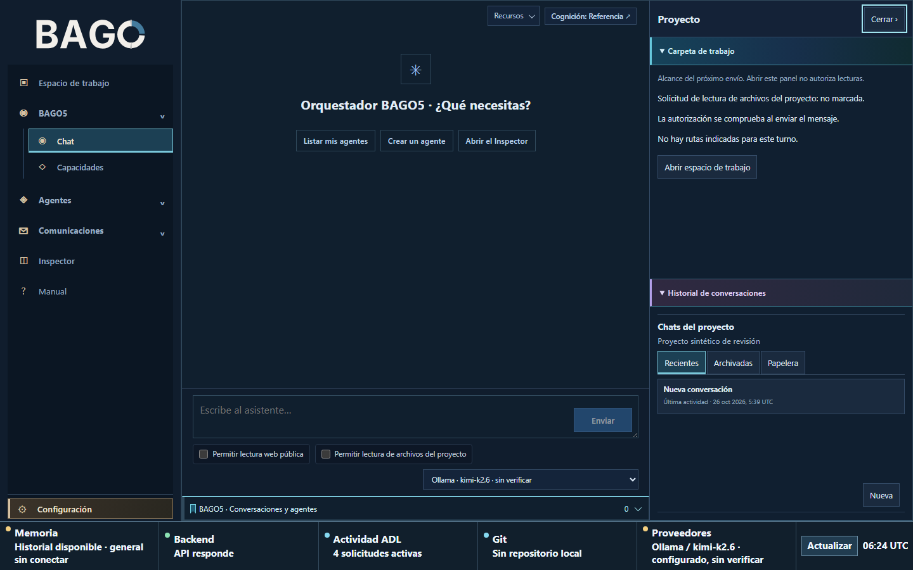

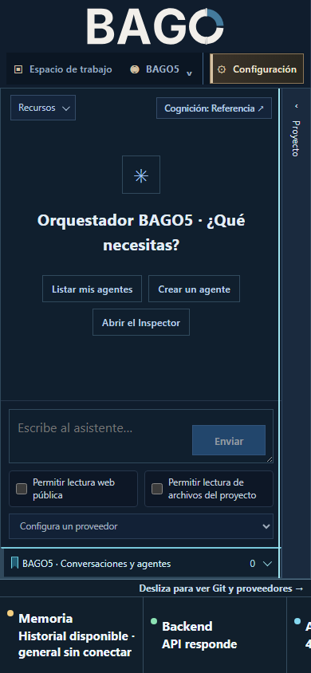

### Ejemplo observado de traza Jaeger

La captura siguiente documenta una lectura puntual de workspace autorizada en AgentChat: Jaeger mostró 14 spans y la operación `workspace.read` aparece con resultado ALLOW. Pertenece a una ejecución distinta de las dos capturas de interfaz anteriores; demuestra esa lectura concreta, no una misión de sector completa ni un recorrido integral de principio a fin.

Las cuatro primeras imágenes documentan el chat y sus respuestas dentro de la conversación:

1. Abre el chat y escribe una petición normal.

   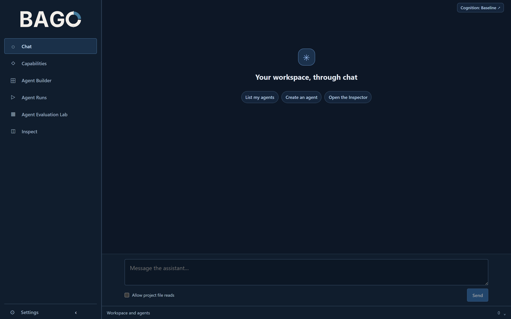

2. Pide el historial de jobs para ver la tabla dentro del chat.

   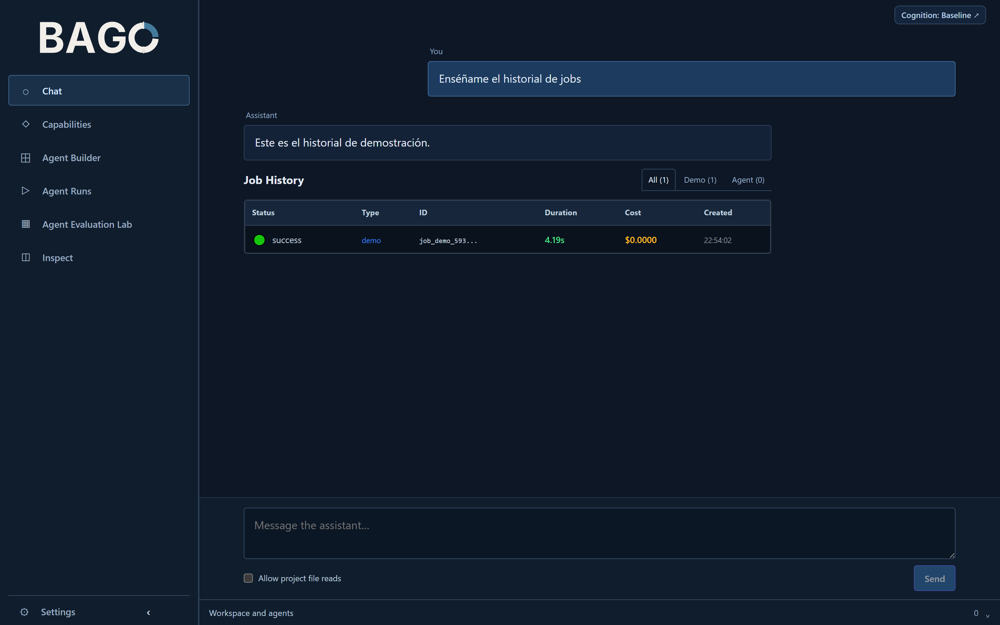

3. Describe el agente que quieres crear. El formulario aparece en el chat como borrador editable.

   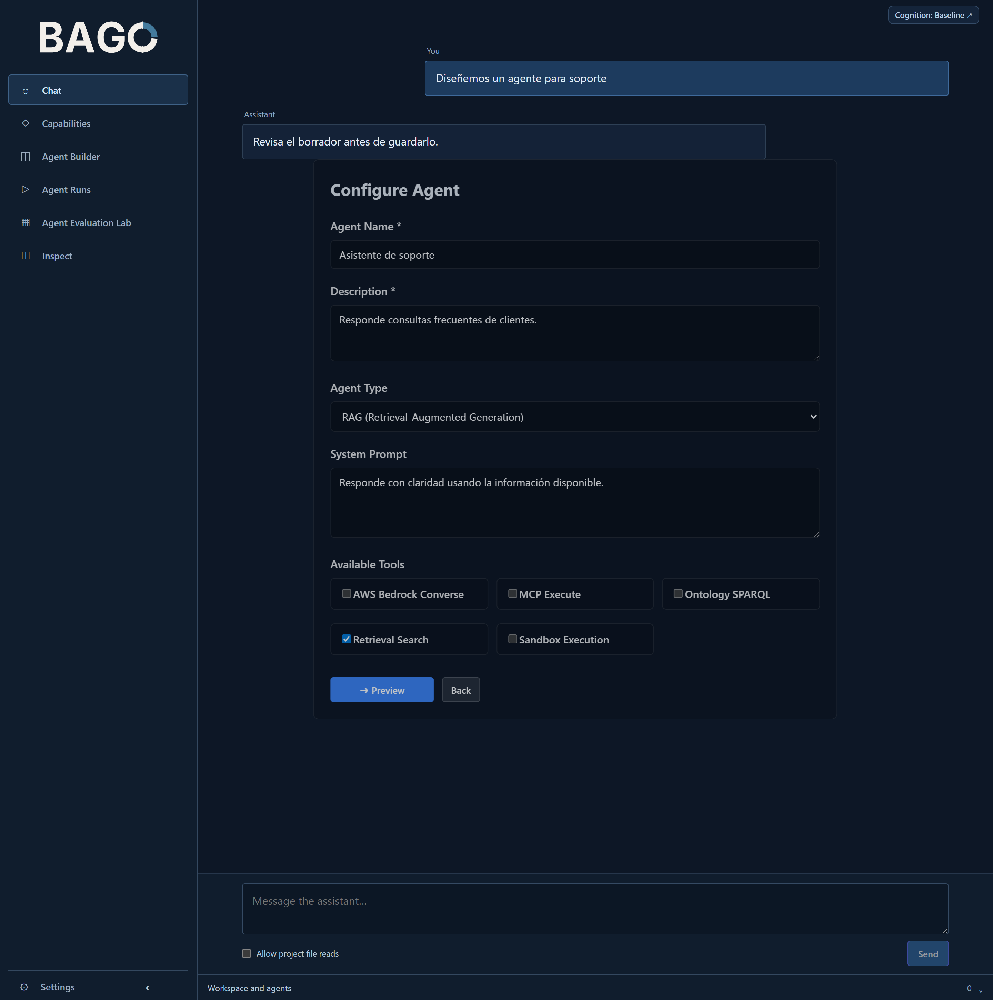

4. Si pides ir a Agent Builder, BAGO solicita confirmación antes de cambiar de pantalla.

   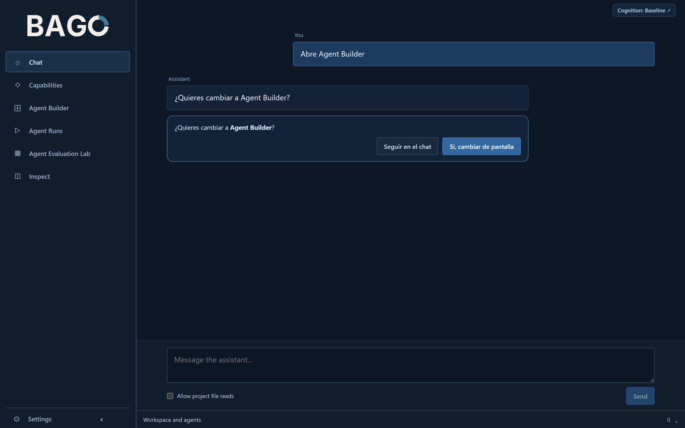

El chat también permite preparar una lectura autorizada de archivos o una propuesta de capacidad. En ambos casos revisa el alcance antes de enviar o guardar. Guardar una propuesta solo la deja pendiente de revisión; no concede acceso.

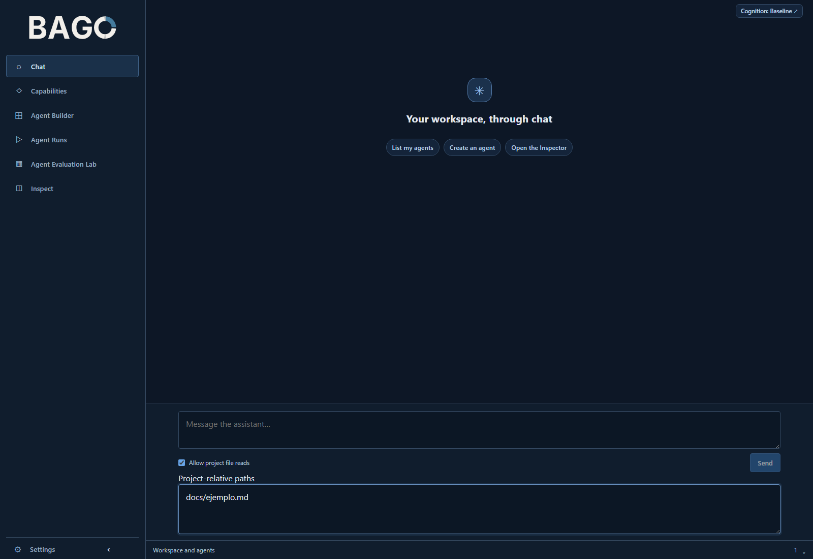

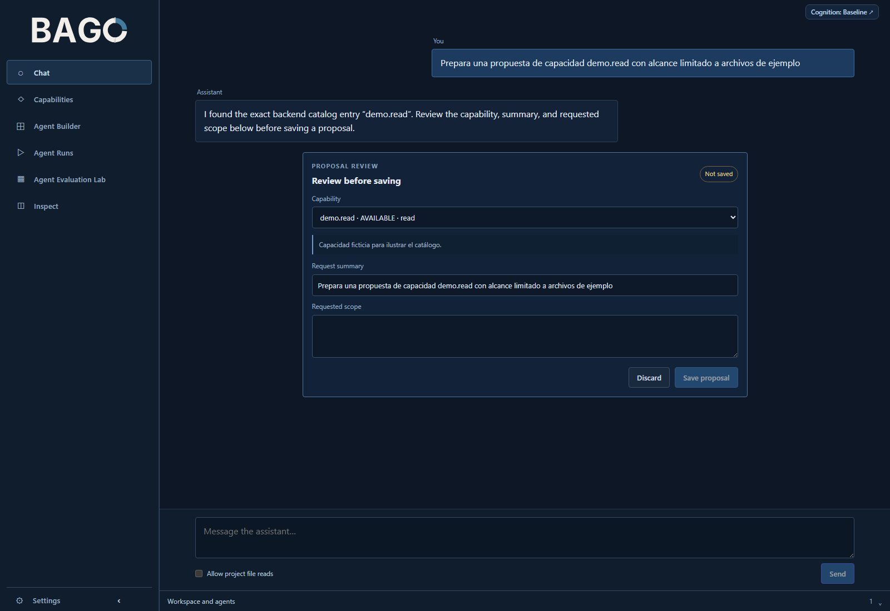

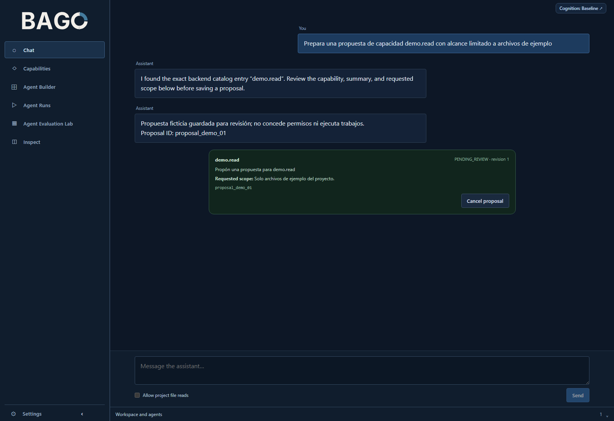

## Las 14 vistas de la aplicación

Las cinco primeras están en la navegación principal. **Inspect** abre las siete vistas de datos; **Settings** abre las dos preferencias.

| Vista | Cómo reconocerla | Captura |
|---|---|---|
| Chat | Conversa con App assistant o con un agente seleccionado. | [Chat completo](assets/manual/05-chat-vista-completa.png) |
| Capabilities | Catálogo de capacidades y propuestas. | [Catálogo](assets/manual/06-capacidades.png) |
| Agent Builder | Elige una plantilla o crea un agente desde cero. | [Plantillas](assets/manual/07-creador-agentes.png) |
| Agent Runs | Consulta agentes y el estado de ejecución; incluye el escáner local. | [Ejecuciones](assets/manual/08-ejecuciones-agente.png) |
| Agent Evaluation Lab | Prepara pruebas repetibles para un agente. | [Laboratorio](assets/manual/09-laboratorio-evaluacion.png) |
| Decision Inspector | Revisa una conclusión y sus evidencias. | [Decisión](assets/manual/18-inspector-decision.png) |
| Job History | Consulta y filtra el historial de trabajos. | [Historial](assets/manual/19-historial-jobs.png) |
| Summary | Lee un resumen de una ejecución y sus métricas. | [Resumen](assets/manual/20-resumen.png) |
| Retrieval & Ontology | Inspecciona documentos recuperados y relaciones. | [Recuperación y ontología](assets/manual/21-recuperacion-ontologia.png) |
| Authorization | Revisa propuestas, permisos y recibos. | [Autorización](assets/manual/22-autorizacion.png) |
| Trace | Sigue los eventos de una ejecución en orden. | [Traza](assets/manual/23-traza.png) |
| Evaluation | Consulta los controles y resultados de evaluación. | [Evaluación](assets/manual/24-evaluacion.png) |
| Provider & models | Configura el modo de acceso y consulta modelos. | [Proveedor y modelos](assets/manual/27-ajustes-proveedor.png) |
| Cognition & context | Elige el modo cognitivo y revisa ubicaciones de contexto. | [Cognición y contexto](assets/manual/28-ajustes-cognicion-contexto.png) |

El inspector tiene además tres secciones internas: **Decision**, **Trace** y **Actions**. Se cambia entre ellas dentro del mismo inspector.

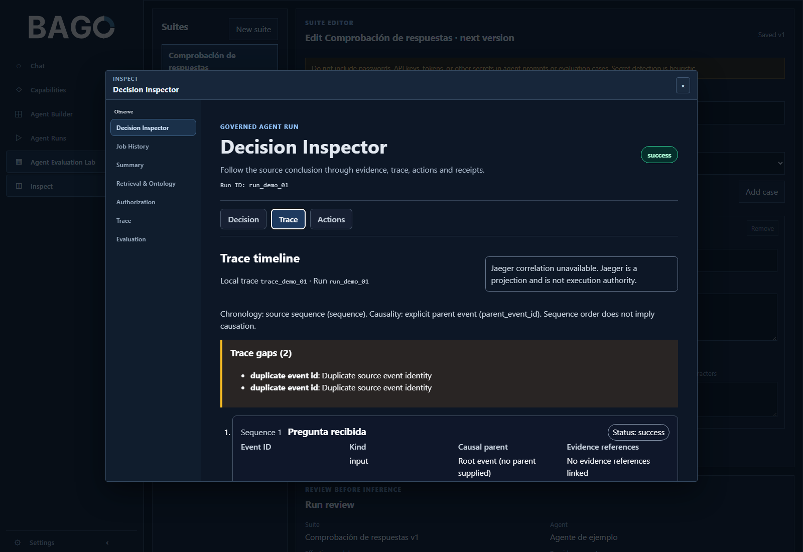

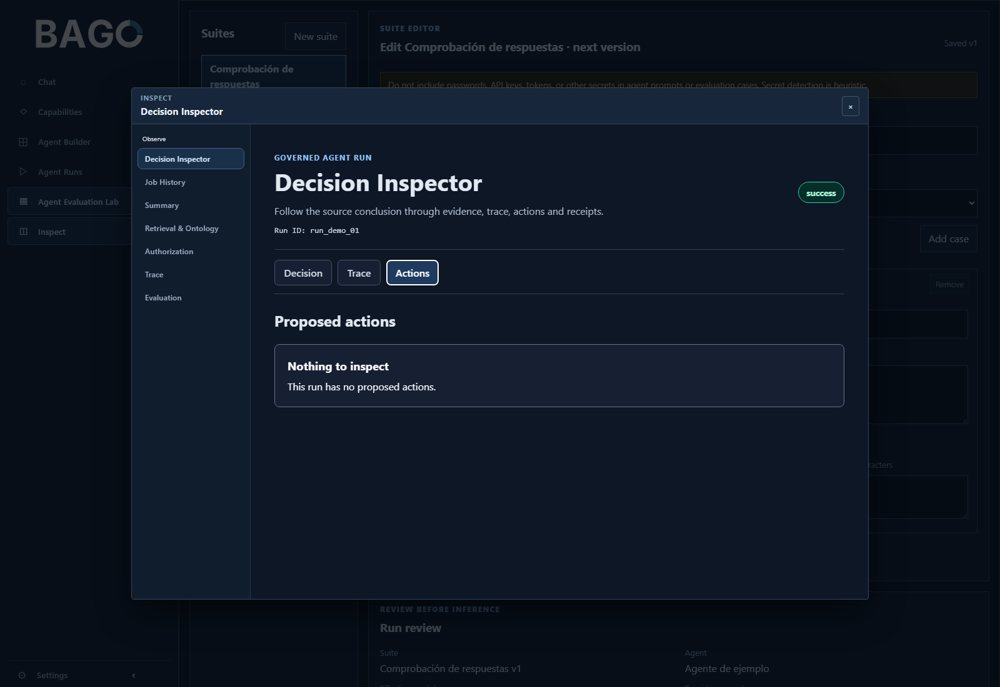

En **Job History**, pulsa una fila para abrir los detalles de ese trabajo.

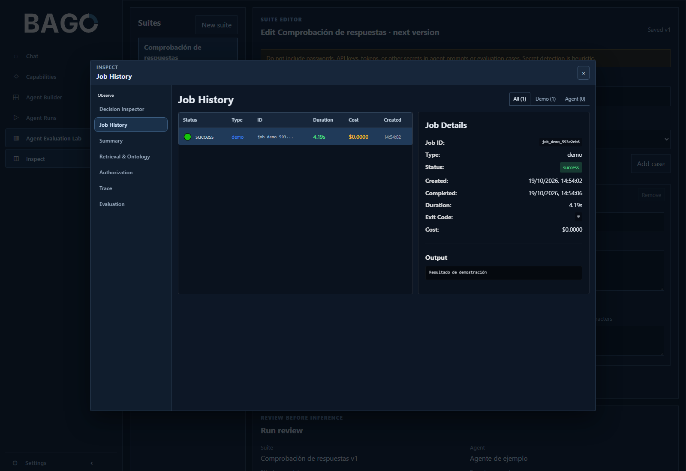

## Recorrido: preparar un agente

1. En **Agent Builder**, escoge una plantilla o pulsa **Create Custom Agent**.
2. Completa nombre, descripción, tipo, instrucciones y herramientas.
3. Pulsa **Preview** y revisa la configuración.
4. **Save Agent** guardaría el agente en el uso normal. La imagen final de esta guía solo imita la respuesta de éxito: no creó ningún agente.

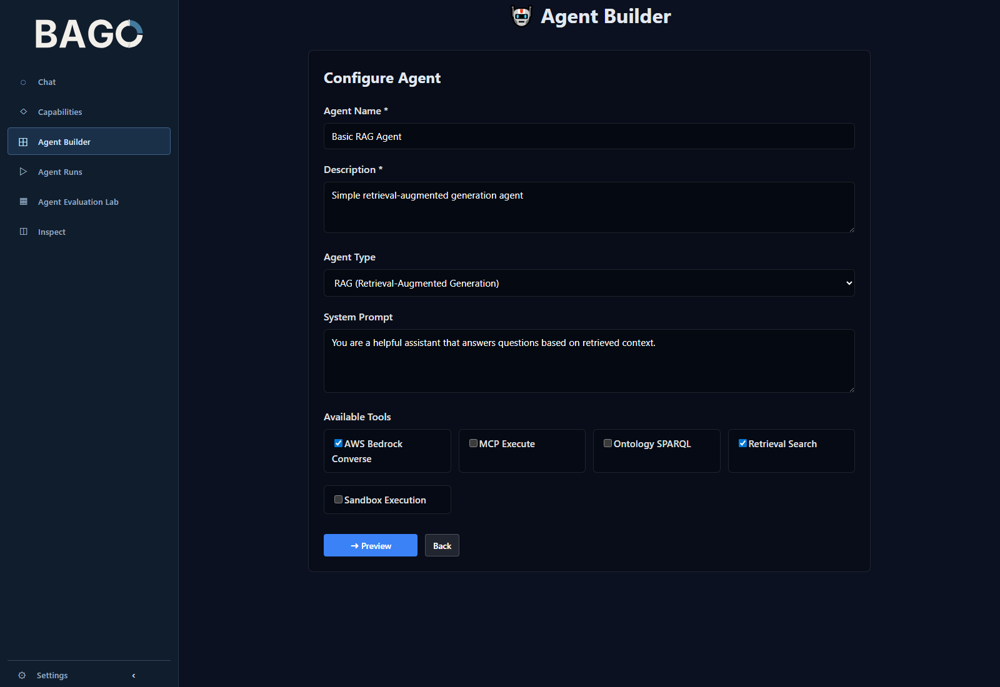

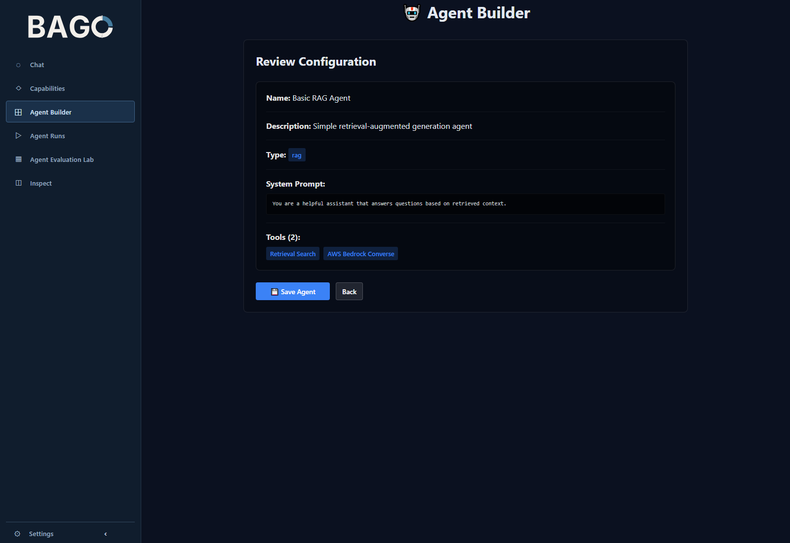

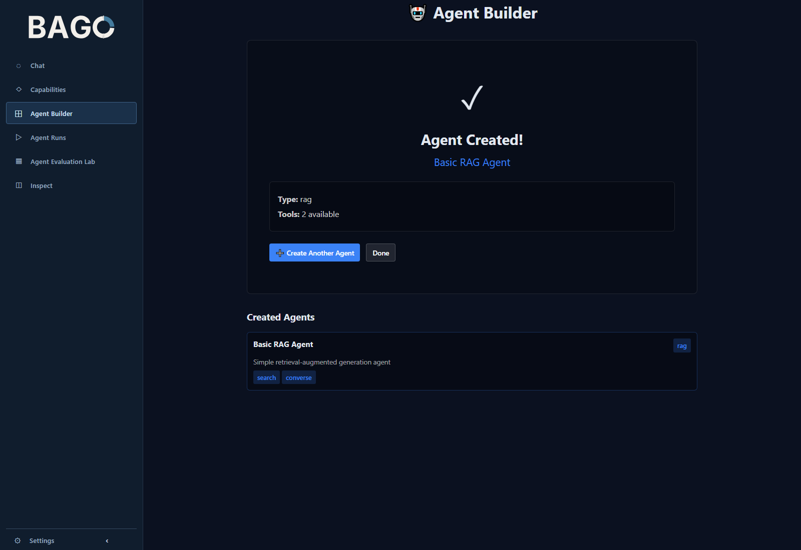

## Recorrido: escanear una carpeta del proyecto

1. Pide al orquestador que busque código duplicado. El formulario aparece dentro de la conversación.
2. La carpeta del proyecto ya aparece seleccionada. Puedes cambiarla por una ruta relativa concreta.
3. Marca la casilla para autorizar una lectura puntual y pulsa **Scan duplicates**.
4. Revisa en el chat los archivos y las líneas donde se encontraron coincidencias.

La explicación de los límites del análisis y de los recibos técnicos está en el tutorial; no hace falta conocerlos para usar el formulario.

En estas capturas los pasos están representados, pero la llamada de escaneo fue interceptada. No se leyó ningún archivo.

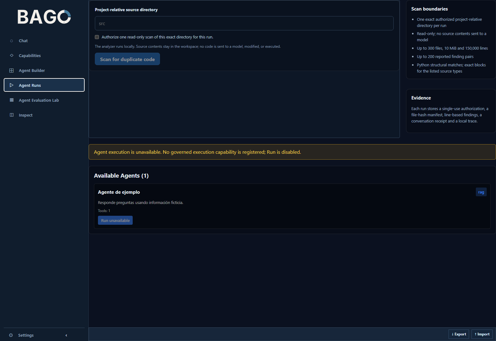

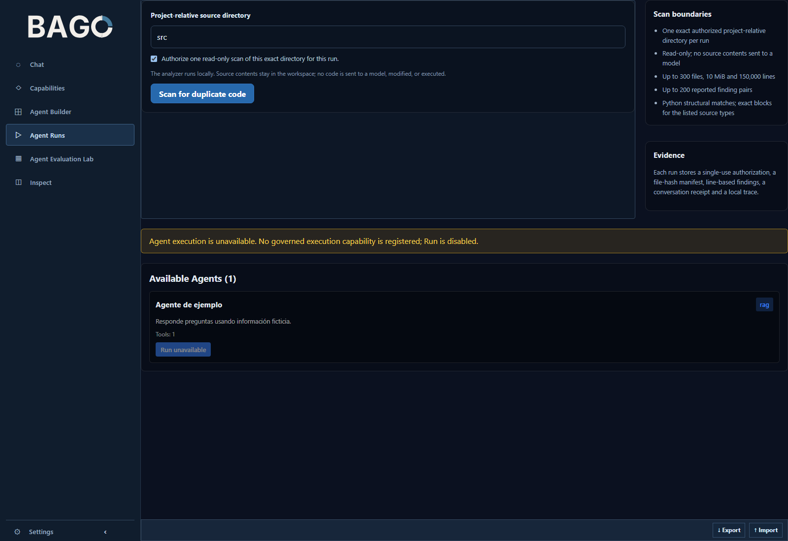

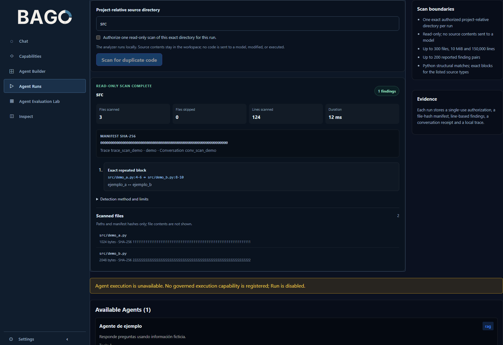

## Recorrido: revisar una evaluación

1. En **Agent Evaluation Lab**, elige una suite o pulsa **New suite**.
2. Selecciona un agente y un modelo disponible; añade casos con su pregunta y las condiciones que deben cumplirse.
3. Guarda la suite para poder revisar qué se enviaría.
4. Antes de ejecutar, comprueba la sección **Run review**: cada caso genera una petición al proveedor. En uso normal, **Run evaluation** envía las preguntas al modelo.

La captura del resultado usa una respuesta simulada `PASS`; no hubo inferencia ni consumo de tokens.

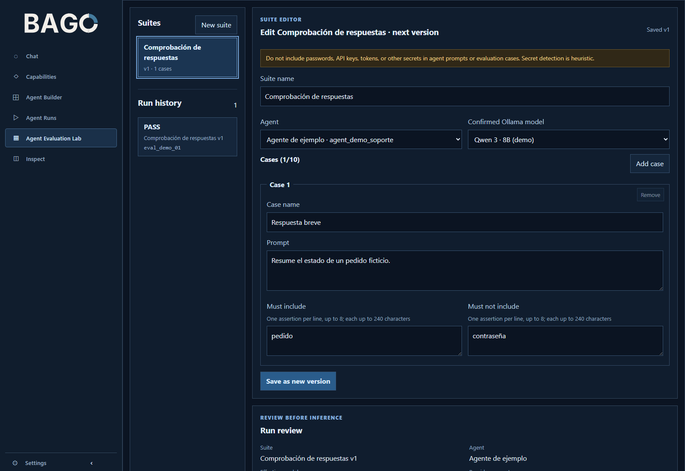

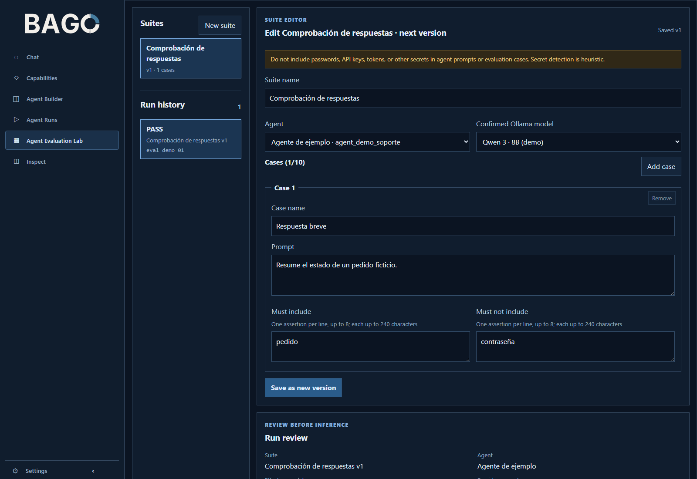

## Recorrido: consultar datos y ajustes

- Pulsa **Inspect** y escoge una vista para revisar el historial, el resumen, la recuperación, la autorización, la traza o la evaluación. Para volver, cierra el panel del inspector.
- Pulsa **Settings** y escoge **Provider & models** o **Cognition & context**. La clave de API es de solo escritura: no la incluyas en capturas ni la compartas.
- El modo cognitivo se aplica a mensajes nuevos y se guarda en el navegador. Antes de comparar modos, empieza una conversación nueva.

**Check model listing** solo comprueba si el proveedor muestra el modelo; no genera una respuesta. Cambiar a **BAGO5 experimental** se aplica de inmediato a los mensajes nuevos.

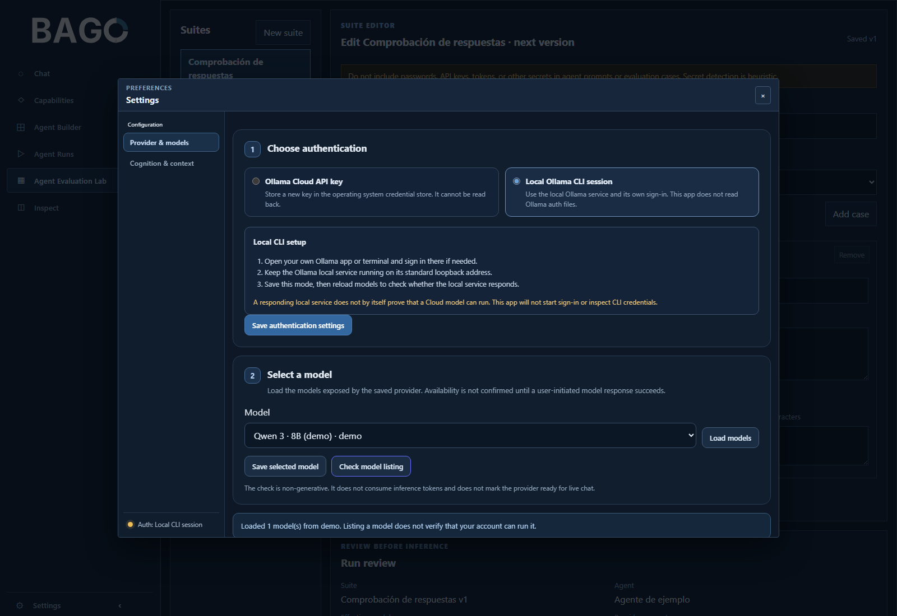

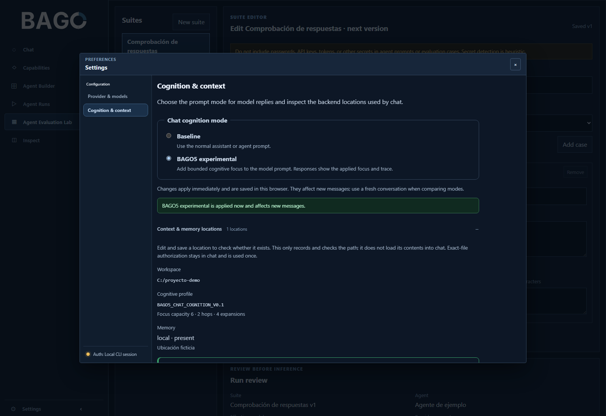

## Qué acciones cambian datos

Ver una pantalla o preparar un borrador no ejecuta la acción que describe. Guardar un agente o una suite, cambiar preferencias, cancelar una propuesta o ejecutar un trabajo sí puede producir cambios. Revisa el alcance y la confirmación que muestre BAGO antes de continuar. Si una petición implica salir del chat, confirma el cambio de pantalla cuando BAGO pregunte.

## Cobertura y límites de estas capturas

Se capturaron las 14 vistas principales y los estados mostrados en los recorridos de creación, revisión, escaneo, evaluación, consulta de modelos e inspección. Las imágenes acreditan cómo se renderiza la interfaz con estos datos de demostración; no acreditan que una operación real haya tenido éxito ni que toda navegación haya sido validada de extremo a extremo.

## Repetir la captura técnica

El recorrido automatizado está en [`scripts/capture_dummy_manual.py`](../../scripts/capture_dummy_manual.py). Requiere el frontend disponible en `http://127.0.0.1:5173`, Python Playwright y Chromium instalados. El script intercepta las rutas `/api/` y guarda las imágenes en `assets/manual/`; no necesita llamar al proveedor ni al backend real.
