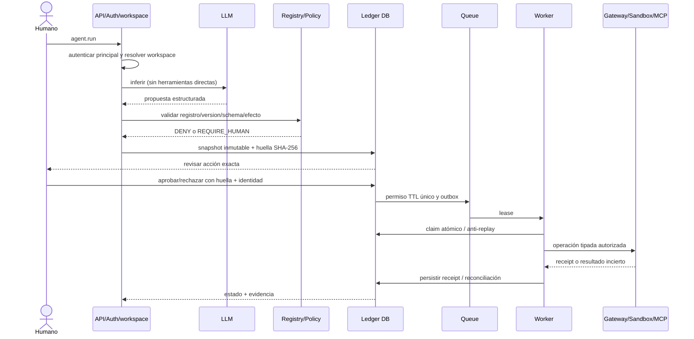

# Contrato agent.run gobernado — F0/F1

Base inspeccionada: `main@79149cdbc4174103a351ba454c3e71a50034d056`.
Estado de ejecución por `/ws/agents/run`: **UNAVAILABLE / FAIL_CLOSED**.

## Código existente y brechas

- `src/orchestration/state_graph.py` contiene `ExecutionRequest`, `Permit`, `AuthorizationDecision`. El método `ExecutionRequest.to_hash` solo liga id, nombre de tool y efecto: no sirve para autorización exacta.
- `src/orchestration/governed_execution.py` crea huella de petición, usa interrupt/resume, gateway y sandbox, pero solo en demo LangGraph con aprobación local y checkpoint en memoria.
- `src/execution/gateway.py` comprueba el request_id; `src/sandbox/manager.py` aplica perfiles y receipts, pero el consumo de permit es en memoria y no sobrevive reinicio.
- `src/sandbox/specification.py`/ `backend.py` restringen lógicamente. No aseguran aislamiento de SO/red ni eliminan la carrera symlink/path al leer.
- `src/adapters/mcp_adapter.py` separa descubierto/registrado; no habilita transporte de red por la API del producto.
- `src/context/workspace_binding.py` liga contexto a repositorio, no autentica principal.
- `src/capabilities/manager.py` marca `agent.run`, `sandbox.execute`, `mcp.execute` UNAVAILABLE. `src/api/server.py` mantiene el WebSocket fail-closed. `src/jobs` almacena JSON, no constituye ledger transaccional.

## Secuencia objetivo (no implementada)

## Fases, límites y verificación

F0 inventario → F1 solicitud inmutable + eventos/aprobación/rechazo/replay durables **sin dispatcher** → F2 autenticación real + una lectura tipada limitada por ExecutionGateway/SandboxManager y receipt persistido → F3 aislamiento de SO → F4 MCP/egress registrado → F5 cola y workers distribuidos.

El sobre F1 debe ligar los campos completos de ExecutionRequest, principal autenticado, agente y workspace resueltos por backend, versión/schema de tool y límites. JSON canónico, TTL limitado, decisión booleana estricta y claim SQLite de un uso. Cambiar un parámetro obliga a nueva propuesta. No crear Permit operativo por un hash heredado.

**P0:** identidad real ausente, scope no autenticado, ledger de efectos sin integración, workers y persistencia del receipt sin verificar. **P1:** aislamiento OS ausente, backend sin anti-TOCTOU, MCP red no gobernada. **P2:** proyección de eventos a UI/LocalTrace.

Vectores: V01 spoof identidad DENY; V02 workspace no resuelto DENY; V03 mutation fingerprint DENY; V04 tool desconocida DENY; V05 rechazo/expiración DENY; V06 replay tras restart y concurrencia DENY; V07 path/symlink/red/shell DENY; V08 persistencia incierta RECONCILIATION_REQUIRED; V09 receipt asociado a run/permit/sandbox; V10 una inferencia ≠ ejecución gobernada.

**Evidencia/NO_GO:** inspección GitHub fijada a SHA anterior. No hay checkout local de repositorio en este entorno; teamctl, suite completa, README generator y E2E reales NOT_RUN. El runner permanece UNAVAILABLE. Antes de publicación: checkout en worktree aislado, teamctl verify/pair/claim/handoff según misión, pruebas, independent CRIT, refresh main/merge-base, generar README exclusivamente mediante `python scripts/generate_dynamic_readme.py` y ejecutar `--check --skip-tests`.
