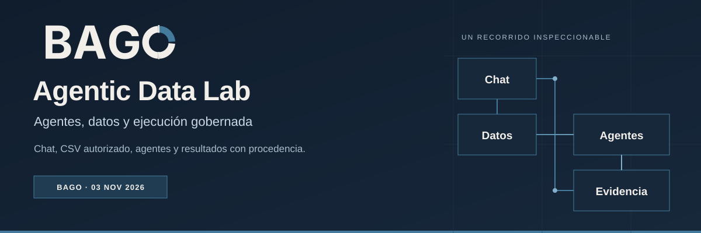
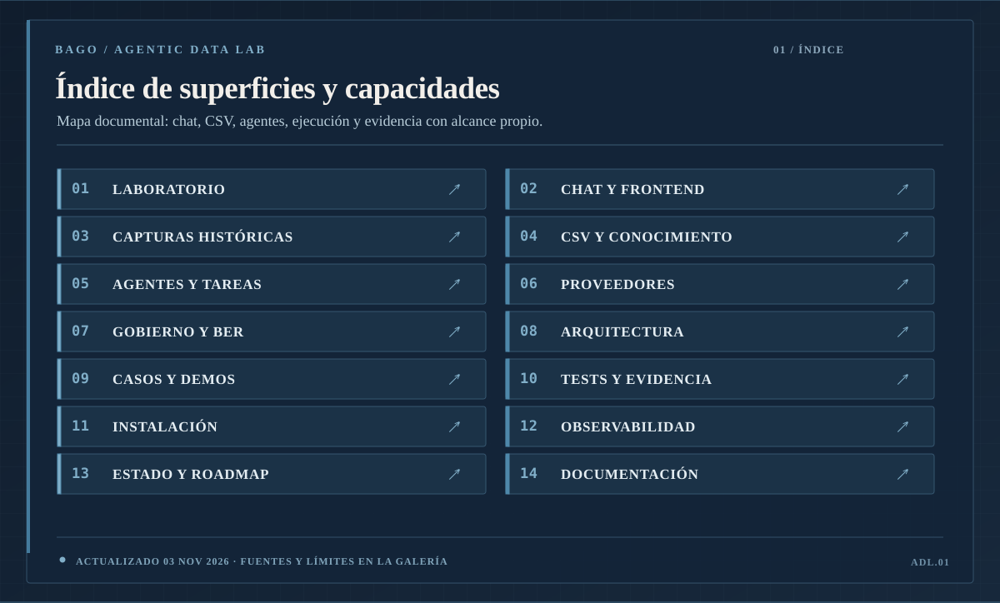
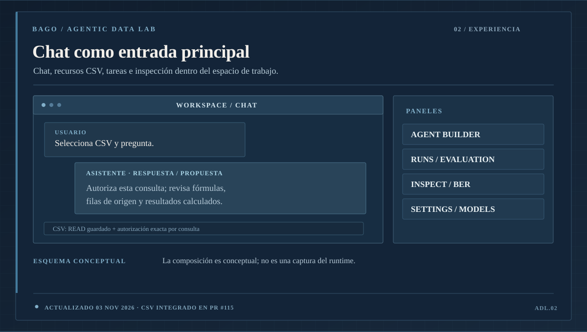
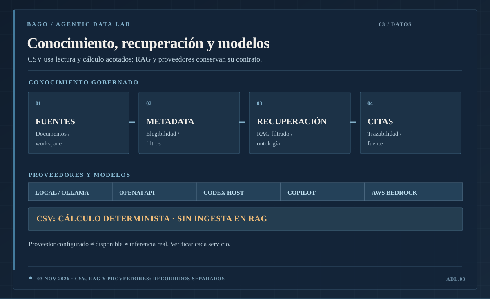
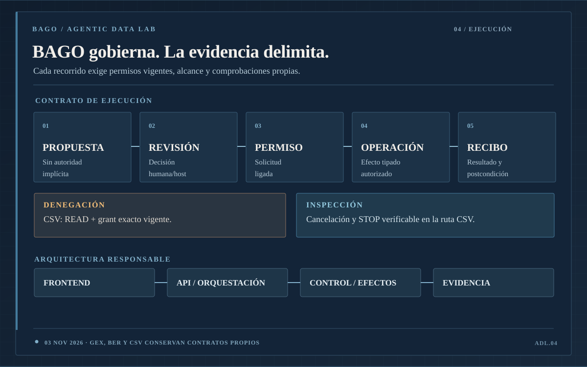
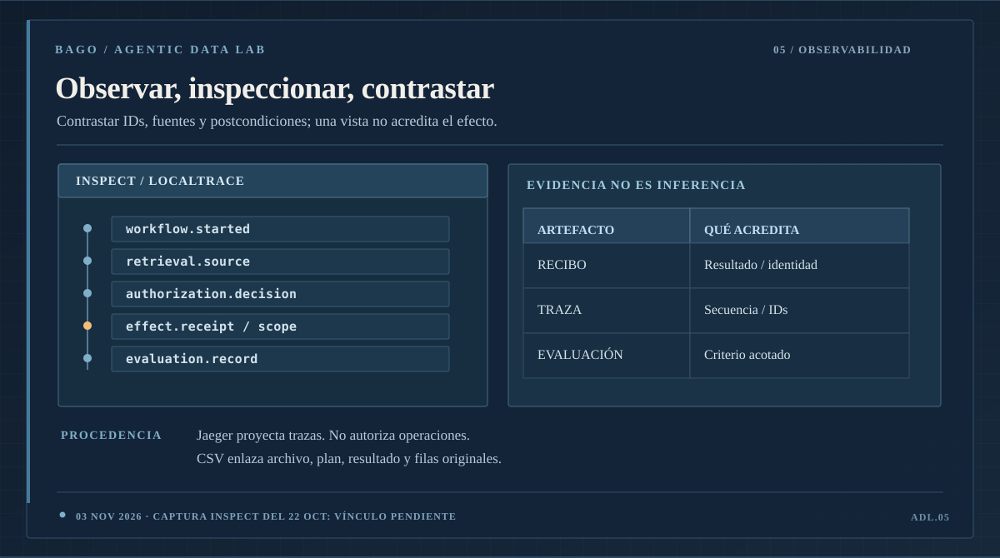
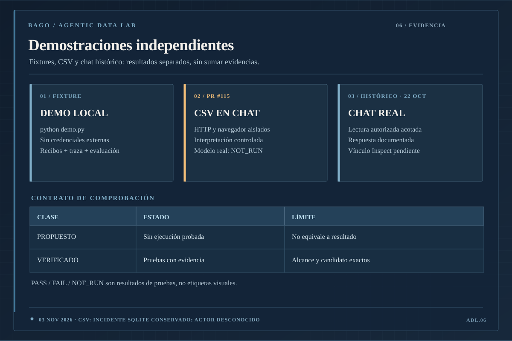
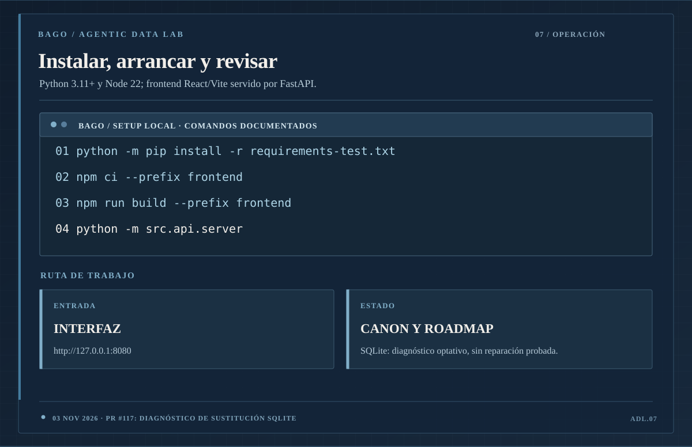
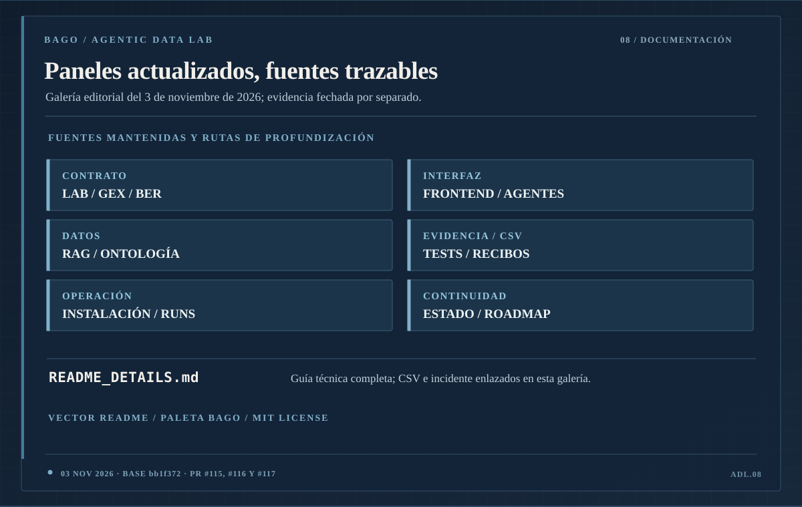

# BAGO / ADL · Paneles del README

Actualización editorial: **3 de noviembre de 2026**. Base revisada: `bb1f3725d9d3881ca48c183a3499d957dfd9bade` (`main`).

[Portada](../../../README.md) · [Guía completa](../../../README_DETAILS.md)

Los nueve paneles resumen las superficies y recorridos documentados. Son esquemas conceptuales; esta actualización no ejecuta la aplicación ni convierte evidencias históricas en pruebas actuales. Las capturas del 22 de octubre mantienen su fecha.

## Fuentes y alcance

| Fuente | Contenido actualizado / límite |
| --- | --- |
| [Frontend](../../readme_frontend.md) | Chat, agentes, tareas, proveedores e Inspect; vínculo del chat del 22 de octubre con Inspect pendiente. |
| [CSV · PR #115](../../verification/csv-chat-20261101/STATUS.md) | READ + autorización exacta, lectura y cálculo deterministas; HTTP y navegador aislados con interpretación controlada. Modelo real y Windows del usuario: NOT_RUN. |
| [Incidente SQLite](../../verification/csv-chat-20261101/review/SQLITE_RUNTIME_INCIDENT.md) | Fallos originales conservados; sustituciones físicas observadas, actor no identificado. El éxito en /tmp no repara la instalación del usuario. |
| [Diagnóstico optativo · PR #117](../../../src/conversations/diagnostics.py) | Instrumentación de diagnóstico; no prueba una reparación ni identifica al actor. |
| [Demo local](../../one_command_demo.md) | Fixtures sin llamada AWS; no acredita servicios cloud. |
| [GEX](../../governed-execution/GEX_V1_NORMATIVE_CONTRACT.md) / [BER](../../ber/AGENT_RUNNER_SCOPE.md) | Contratos separados; una prueba de un recorrido no acredita otro. |
| [Estado canónico](../../../.bago/canon/STATE.md) | Resultados con su candidato, fecha y alcance propios. |

## Galería

### 00-hero.svg

### 01-map.svg

### 02-workspace.svg

### 03-intelligence.svg

### 04-governance.svg

### 05-inspection.svg

### 06-demos.svg

### 07-operations.svg

### 08-sources.svg

