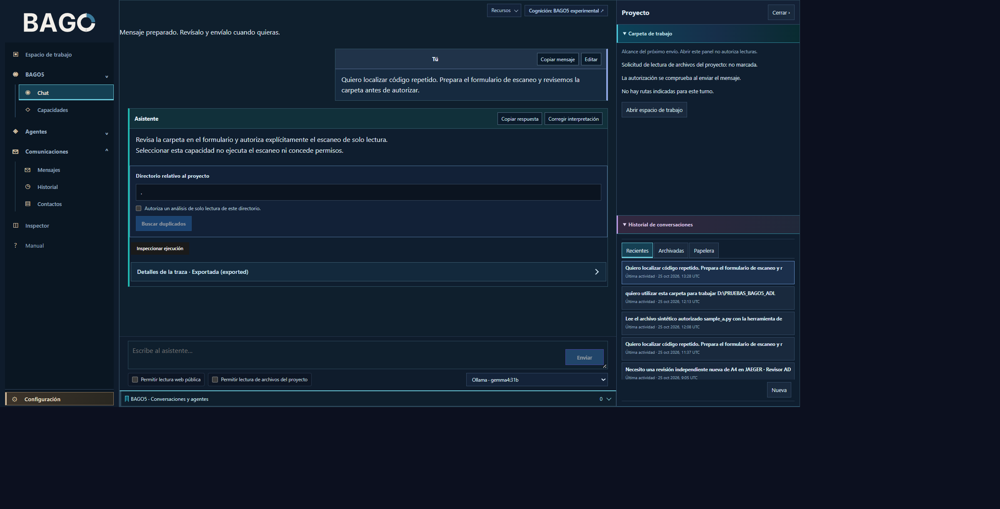
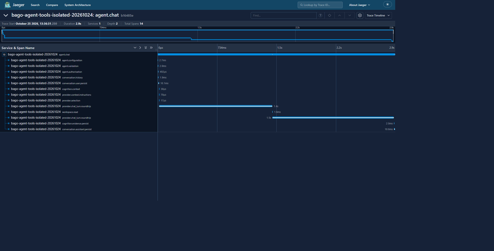

# Sprint 2026-10-25 · continuidad y verificación de ADL

Estado: **OPEN — no apto para release**.

## Resultados comprobados

- El runtime de revisión mantiene UI 8093 y API 8098. El SHA-256 de `src/api/server.py` cargado coincide con disco: `ed59880744f50119a6121efb374d15d03e97e3fa58045c76418a3b3ea12a0aa6`.
- Una lectura real por el endpoint AgentChat ejecutó la herramienta de workspace con permiso de un único archivo, recibo ALLOW y resumen de cuatro líneas. Jaeger recuperó la traza `b16485e4b49c2a122a7ab0877205c3ac`: 14 spans, 2,934 s, dos rondas del proveedor y una lectura medida. Esta evidencia no demuestra el recorrido completo del chat general ni una ejecución larga.
- El README local se regeneró con ocho capturas y carrusel. `generate_dynamic_readme.py --check --skip-tests` terminó correctamente; la suite no se ejecuta con esa opción.
- Una nueva ejecución de los nueve casos pendientes terminó **9 failed** en 5,36 s. No se borraron ni debilitaron pruebas.
- La revisión independiente de R12 comprobó integridad de handoffs/recibos y coincidencia de runtime/fuente. Después se comprobó desde la UI el recorrido capacidad → mensaje intacto → formulario, sin permisos, lecturas ni escaneo. La revisión independiente contrastó los dos terminales y sus criterios exactos; `teamctl close` terminó `VALIDATED_SCOPED_TASK`. El cierre es exclusivo de R12.
- Se vinculó la sesión persistente de WhatsApp mediante QR. Un envío autorizado desde BAGO terminó `uncertain / acknowledgement_not_observed` mientras el texto seguía en el editor. Tras comprobar que no existía un mensaje saliente duplicado, el operador pulsó Enviar en la sesión visible. Se observó un único mensaje saliente con marca Leído y el editor vacío. El recibo incierto original se conserva; este resultado no acredita el transporte automático de BAGO.

## Fallos y conflictos abiertos

1. El evento medido de `document_extract` conserva tipo `execution` en lugar del contrato `tool`.
2. El enriquecimiento de `web.read` omite la identidad segura del snapshot.
3. Tres variantes de fallo del agente encuentran una diferencia en el contrato de persistencia final.
4. Cuatro pruebas históricas esperan lecturas directas del asistente; el recorrido actual exige resolver primero el agente. Deben reconciliarse conservando autorización, lectura real y evidencia de fallo; no se eliminará el control de enrutamiento para obtener un resultado verde.
5. El transporte de WhatsApp necesita representar y verificar correctamente el envío en la interfaz actual.
6. Siguen pendientes la ejecución larga con herramientas, la continuidad causal de misiones/delegación y los gates globales.

La última suite completa anterior terminó **1386 passed, 1 skipped, 10 failed** en 627,34 s. Uno de esos diez fallos era el README desactualizado y se corrigió después mediante generación; no se repitió la suite completa tras ese render.

## Autoría y conservación

La reparación de Jaeger continúa mediante herramientas reales del chat ADL. Codex actúa como operador, prepara instrucciones externas, reproduce fallos y observa evidencias. Los intentos/candidatas anteriores permanecen conservados. En este sprint no se aplicó código nuevo ni se modificaron pruebas existentes.

El nuevo turno de lectura ADL registró cuatro recibos `development_read` ALLOW y una traza exportada `64973d5ac17fc22d9551f00217e88df2`. Su respuesta textual afirmó incorrectamente que no había herramientas disponibles; los recibos reales tienen precedencia sobre esa frase. Se preparó `dev_dbe2ba65d6444d738472569acd09c116` (patch `5e3c50f5c5893b596b4c05ddf7a0f0cda5a688d68ff158019ae38eae2cf24972`). Su check real terminó 194 PASS / 1 FAIL; se conservan los tres recibos repetidos por el proveedor. La revisión externa encontró también falta de referencia al snapshot y de atributos de fallo. La hija `dev_84e3a01cf1e74fe49a8ee34427301eff` (patch `da224b7a4154cabb4b93d4efd9132dd71348b70c48043f0ac720cc7b25e9726d`) corrige la repetición exacta del writeback y sigue PREPARED, sin check/review/apply final. Otros turnos fallaron en Copilot antes de ejecutar herramientas; se ensaya temporalmente otra selección de modelo con respaldo de la configuración anterior.

El runtime de coordinación R12 cerrado se archivó con sus 101 archivos byte-exactos. El control nativo Jaeger se restauró desde su snapshot preservado y `teamctl verify` devolvió PASS con gate OPEN.

## Actualización de GitHub por sprint

Por instrucción del usuario, cada sprint debe sincronizar sus cambios y registrar verificaciones, límites y pendientes reales. La sincronización se realiza mediante una rama y PR de revisión; no convierte evidencias locales en CI ni declara una release aprobada. No se publican datos de contactos, configuraciones privadas, credenciales ni contenido de mensajes.

Esta entrega incluye documentación y dos capturas reales de verificaciones locales. El código local y las otras capturas del README siguen pendientes de sincronización; no se presentan como release.

## Capturas verificadas

La selección envió `capability_id=workspace.scan_duplicates`. Sólo se observaron POST de creación de conversación y chat/control; el servidor devolvió `operation=workspace_scan`, cero fuentes y cero recibos de lectura.

La captura corresponde a la lectura directa por AgentChat del agente, no demuestra delegación completa desde el chat general. La traza dura 2,934 s y no cumple el requisito pendiente de ejecución larga.