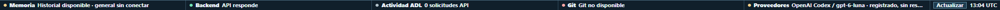

# Sprint 24 - barra de estado fina de 21 px

**Fecha:** 26 de octubre de 2026
**Estado:** `VERIFIED_SCOPED`; GO de producción sigue `NO_GO`.
**Rama:** `fix/runtime-status-bar-thin-20261026`
**PR:** [#74](https://github.com/MarcValls/BAGO_AGENTIC_DATA_LAB/pull/74), borrador.

## Cambio

La barra inferior queda en 21 px en total, incluido el borde; la fila de controles ocupa 20 px. El texto de estado usa 11 px para que los cinco indicadores quepan en una banda fina. Los valores largos conservan el recorte visual y el nombre accesible completo. Los detalles expandidos recuperan su altura normal y siguen desplazando el contenido desde el flujo del documento.

La línea de ayuda de desplazamiento sigue oculta visualmente. La fila mantiene desplazamiento horizontal cuando la ventana no permite mostrar todos los grupos. El cambio conserva actualización, tonos, estados y datos.

## Verificación

- Prueba focal `npm test -- --run tests/runtime-status-bar/status.test.tsx`: **38 PASS**.
- Build `npm run build`: **PASS**, 449 módulos; continúa el aviso existente de bundle principal superior a 500 kB.
- `python -B scripts/generate_dynamic_readme.py`: **PASS**, README generado tras **1574 pruebas pasadas**.
- `python scripts/generate_dynamic_readme.py --check --skip-tests`: **PASS**, README consistente; suite NOT_RUN en este segundo comando (1576 casos recogidos).
- `git diff --check`: **PASS**.
- En `http://127.0.0.1:8093/src/components/RuntimeStatusBar.css`, el servidor entrega `min-height: 21px`, `max-height: 21px` y una fila de 20 px. La captura de las 13:04 UTC tiene viewport `1920x978`; el recorte exacto de la franja inferior mide `1920x21`.
- No se reinició ningún servicio. La imagen compartida es sólo el recorte de la barra; el historial visible en la captura original se conserva fuera de Git.
- La revisión visual de esta captura valida la instancia 8093. La rama PR se verifica con prueba focal y build; una captura renderizada de esta rama está **NOT_RUN**.
- El renderizado de la rama PR sigue NOT_RUN.
- GitHub Actions sobre el commit de implementación `319448040c61728aa158c941ee4dc3dc767c53b5`: CI run **437 PASS**, Docker Build run **92 PASS** y README consistency run **455 PASS**. Son checks del commit citado; no validan la aceptación global de BAGO5.

## Límite del sprint

Esto valida la altura de la barra y su adaptación visual en la instancia observada. No valida los valores de memoria, Git, actividad ni proveedor, tampoco cierra la aceptación total del frontend ni los requisitos de ejecución de herramientas, delegación autónoma, recuperación o trazas causales. Producción continúa **NO GO**.
