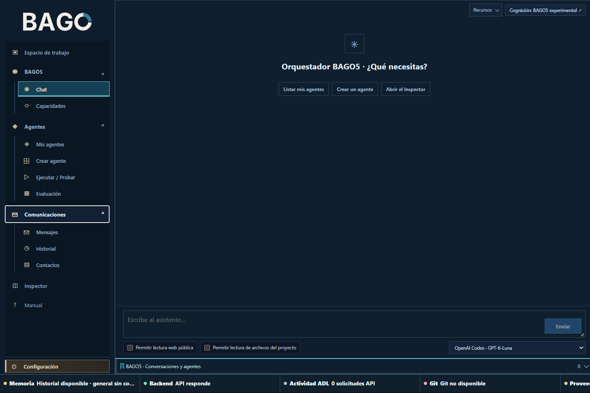

# Atención al cliente: borrador de respuesta

**Sector:** servicio y soporte. **Objetivo:** preparar una respuesta personalizada para revisión sin enviar mensajes por accidente.

## Recorrido

1. Consulta la ficha del contacto en **Comunicaciones > Contactos** y confirma que sea el destinatario correcto.
2. Comparte con el Chat únicamente el contexto necesario. No pegues contraseñas ni datos de pago.
3. Solicita un borrador y revisa hechos, tono, destinatario y adjuntos. Si usas WhatsApp, comprueba primero el estado de la sesión.
4. Guarda y prepara la revisión en Comunicaciones.
5. Envía o programa solo después de revisar la pantalla final y confirmar explícitamente. Comprueba el recibo y el historial.

**Salida sugerida:** borrador, destinatario validado y estado de envío. **Límite:** redactar no significa enviar; un estado incierto requiere verificar recepción antes de reintentar. Guía no ejecutada.

Vuelve al [manual principal](../MANUAL.md#preparar-mensajes-y-programarlos).
