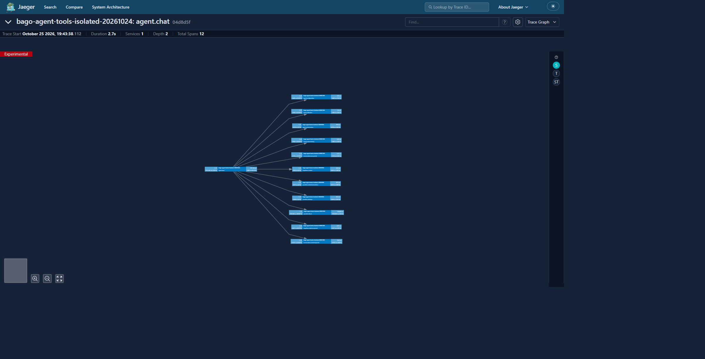

# Calidad: revisión de una operación

**Sector:** calidad y mejora operativa. **Objetivo:** validar evidencia de una tarea y documentar qué se comprobó, qué falló y qué sigue pendiente.

*La imagen es una traza sintética de 12 spans y 2,7 s; solo ilustra la pantalla de Jaeger.*

## Recorrido

1. Define los criterios observables antes de ejecutar. Si corresponde, usa **Agentes > Evaluación** para preparar casos y expectativas.
2. Ejecuta la tarea por el recorrido disponible y conserva el identificador de ejecución.
3. En **Inspector**, revisa salida, fuentes, permisos y recibos de la misma ejecución.
4. Abre la traza vinculada en Jaeger y contrasta su identidad/tiempo con la ejecución local. Una traza exportada no prueba por sí sola que el proceso terminara correctamente.
5. Registra PASS/FAIL/NOT_RUN por criterio. No ocultes fallos ni conviertas pruebas sintéticas en evidencia de producción.

**Límite:** esta guía no certifica que la orquestación completa o todas las dependencias causales estén implementadas. Escenario no ejecutado.

Vuelve al [manual principal](../MANUAL.md#revisar-fuentes-y-ejecuciones).
