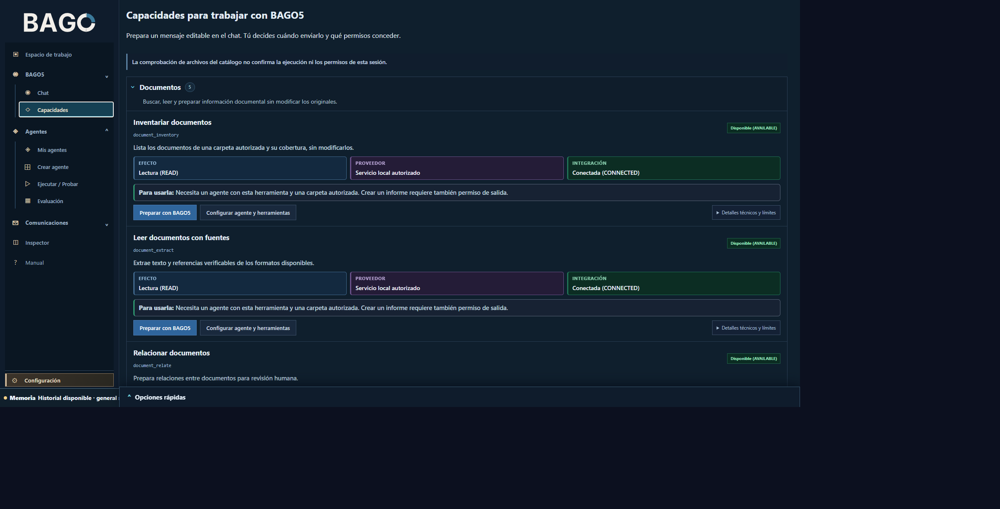

# Logística: revisión de inventario

**Sector:** distribución y operaciones. **Objetivo:** comparar un inventario suministrado con registros autorizados y señalar divergencias sin corregir datos automáticamente.

## Recorrido

1. En Workspace confirma el proyecto y la carpeta activa; hoy la carpeta activa es global para ADL, así que verifica que no estés usando un contexto de otro trabajo.
2. Prepara un agente de operaciones con tarea y herramientas acotadas. La captura del [formulario de agente](../assets/screenshots-2026-10-26/03-crear-agente-herramientas-completo.png) enseña dónde comienza esa configuración; el formulario está sin guardar.
3. Autoriza los archivos concretos de inventario y movimientos. Puedes usar `document_inventory` y `document_extract` si el catálogo y el runtime los ofrecen y el agente tiene asignación.
4. Pide que marque SKU, cantidades y fechas discrepantes e incluya referencias al origen.
5. Revisa excepciones con el responsable del almacén. Toda modificación de CSV/ERP debe quedar como operación separada, revisada y autorizada.

**Salida sugerida:** discrepancias priorizadas y consultas pendientes. **Límite:** no acredita stock físico ni sustituye el sistema de inventario. Guía no ejecutada.
