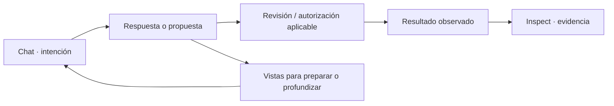

# ADL · Trabajar desde el chat y profundizar en las vistas

[Volver a la portada](../README.md) · [Instalar](agent-chat-control/LOCAL_SETUP.md) · [Resultados de verificación](verification/readme-corporate-status-20261022.json)

## Orientación

El principio de interacción es **empezar por Chat**: expresar una intención,
recibir ayuda o una propuesta, revisarla y consultar el resultado con su evidencia.
Las vistas de trabajo permiten preparar contexto, configurar perfiles y modelos,
revisar operaciones y profundizar. El menú es un acceso complementario.

Este principio describe tanto las conexiones existentes como la dirección del
producto. No significa que todas las operaciones estén implementadas de extremo
a extremo dentro de una conversación. Los pasos manuales y las condiciones del
runtime siguen siendo visibles y obligatorios cuando corresponden.



## Qué está conectado al chat

La implementación de referencia está en
[AgentChat.tsx](../frontend/src/components/AgentChat.tsx) y
[App.tsx](../frontend/src/App.tsx). El chat distingue conversación del asistente,
conversación con un agente seleccionado y operaciones de control.

| Intención | Conexión implementada | Revisión del usuario / límite |
|---|---|---|
| Pedir ayuda, listar agentes o capacidades | Operaciones de control específicas | El resultado listado no demuestra ejecución de una herramienta |
| Crear un agente | Borrador y Agent Builder integrado en el mensaje | Revisar y guardar el perfil; no equivale a ejecutar sus herramientas |
| Abrir una pantalla | Propuesta de navegación y callback hacia App | Confirmar «Sí, cambiar de pantalla» o seguir en el chat |
| Revisar ejecuciones disponibles | Historial integrado cuando lo devuelve el recorrido | Leer IDs, estados y evidencia; no deducir un efecto de una etiqueta |
| Leer archivos del proyecto | Control de autorización y rutas relativas explícitas | El permiso de lectura está acotado; el workspace por sí solo no autoriza acceso |
| Revisar duplicados en recorridos compatibles | Formulario/resultados de DirectoryScanRun integrados | Su alcance y autorización propios siguen aplicando |

Un error del proveedor permanece visible. Abrir Settings ayuda a corregir su
configuración; no sustituye la respuesta real que necesita la conversación.
Navegar a Agent Runs o a Evaluation Lab no ejecuta automáticamente una tarea.

## Vistas de apoyo

| Vista | Para qué entrar | Qué conservar o revisar |
|---|---|---|
| Chat | Formular la intención y continuar el trabajo | Conversación, contexto, propuestas y resultados disponibles |
| Workspace | Revisar el contexto y recursos del proyecto | Identidad y alcance del workspace; autorización de lecturas separada |
| Capabilities | Inspeccionar las capacidades y conexiones | Estado reportado, contrato y límites de disponibilidad |
| Agent Builder | Profundizar en el borrador o preparar un perfil | Prompt, modelo explícito, configuración y persistencia |
| Agent Runs | Recorrer la ejecución que ofrece el runtime | Solicitud exacta, decisión, permiso, recibo y verificación aplicables |
| Agent Evaluation Lab | Mantener suites y revisar runs | Versión de suite, agente/modelo, criterios y errores |
| Inspect | Examinar decisiones y artefactos | Claims, evidencia, procedencia, autorización y trazas |
| Settings | Configurar cognición, proveedores y modelos | Configuración, catálogo, selección y disponibilidad por separado |

Las [capturas del 22 de octubre de 2026](assets/readme-20261022/README.md)
documentan una sesión actual de Brave, con su servidor e identidad observados.
Son imágenes de navegación real; sus límites de ejecución se explican junto a
las observaciones. Los tutoriales antiguos conservan su fecha en sus propios
documentos y no se reutilizan como capturas actuales.

## Demostración nueva del 22 de octubre

La sesión visible de Brave sobre la app local del puerto 8080 produjo un
recorrido nuevo: agente creado a las **18:40:34 UTC** y respuesta registrada a
las **18:44:10 UTC**, con datos ficticios preparados para esta
demostración. No se reutilizaron agentes ni conversaciones históricas para
simular una ejecución nueva.

1. Desde el chat del orquestador, se preparó un borrador integrado y se revisó
   mediante **Preview**.
2. El primer **Save Agent** devolvió `model_registration_mismatch`. Se abrió
   Settings, se guardó y verificó Codex `gpt-6-luna` y se repitió el guardado.
3. El segundo intento creó **BAGO Demo Chat 20261022**, ID
   `agent_fe4947cc99074167ae5935d421dfc7b2`.
4. Se abrió la conversación nueva `conv_3a8cd957b69a4ddd9026ef065405ace1`
   con ese agente y un workspace nuevo, sin canon de proyecto. El fixture propio
   `DEMO.md` contenía dos pedidos ficticios y su regla de envío.
5. Se autorizó explícitamente leer `DEMO.md`. El agente respondió con dos puntos
   y citas: **DEMO-001**, 30 h, tarifa elegible **6 EUR**, líneas 7 y 12;
   **DEMO-002**, 12 h, **sin reembolso de envío**, líneas 8 y 13.

| Evidencia de esta ejecución | Valor observado |
|---|---|
| LocalTrace | `trace-496fac766f384348` |
| Decisión y lectura | `ALLOW`, una lectura autorizada |
| Estado y modelo | `COMPLETED`, `gpt-6-luna` |
| Duración registrada | 14,6 s |
| SHA-256 del archivo completo | `7fdbb3379f3abc59ef1d3c9fa5c9ffb4c7c2abc5de93a9c038e3ca8c25716677` |

La respuesta y la lectura quedaron observadas en ese recorrido. No se ejecutó un
reembolso ni se demostró acceso general a herramientas. El hash mostrado por la
UI para el contenido recuperado identifica el **excerpt numerado de líneas
1–16**; es un objeto distinto del archivo completo y no se comparan como si
fueran los mismos bytes.

### Hallazgo: Inspect no siguió la conversación nueva

Al abrir Inspect, la vista mostró la traza anterior de Bruma
`trace-5b385699ffda0529`. La captura es actual, pero el artefacto mostrado es
histórico y **no corresponde** a `trace-496fac766f384348`.

Se observó navegación a Inspect; no se observó vinculación automática a la nueva
conversación. La lectura y respuesta del chat conservan su evidencia. La cadena
Chat → Inspect queda pendiente de enlazar la identidad de conversación/run/traza
y comprobar que la vista muestra exactamente los artefactos de ese recorrido.
No se declara ese tramo PASS.

Consulta [pasos, capturas, identidad del servidor y hashes](assets/readme-20261022/README.md)
para reproducir la observación y distinguir sus artefactos.

## Agentes, tareas y resultados

1. Formula la intención en Chat y revisa el borrador o propuesta recibidos.
2. Cuando se prepara un agente, revisa nombre, prompt, proveedor/modelo y
   herramientas declaradas en Builder. Guarda solo el perfil que quieras usar.
3. Revisa la tarea en el recorrido correspondiente. El perfil guardado y una
   tarea pendiente no acreditan que ya se hayan ejecutado herramientas.
4. Si hay ejecución gobernada, comprueba que la revisión corresponde a la
   solicitud exacta. Runtime, proveedor y permisos determinan su disponibilidad.
5. Inspecciona el resultado y su evidencia. Conserva la distinción entre la
   respuesta del modelo, el efecto declarado y su postcondición comprobada.

[AgentTasks](../frontend/src/components/AgentTasks.tsx) conserva la interfaz de
tareas. [Agent Builder](agent_builder_ui.md) detalla perfiles y controles. Algunos
apartados de ese documento describen etapas anteriores: el alcance de ejecución
actual se decide por los contratos de GEX/BER y por el runtime efectivo.

### Evaluation Lab

El [contrato de evaluación](agent_evaluation_lab.md) guarda suites versionadas y
snapshots de runs en SQLite, aislados por workspace. Cada caso de una evaluación
real realiza una petición al proveedor después de validar versión, agente y
modelo. Los errores no se sustituyen por fixtures.

Los estados `PASS`, `FAIL`, `PARTIAL` y `ERROR` pertenecen a sus comprobaciones
declaradas. Las reglas de inclusión/exclusión de texto y respuesta no vacía no
demuestran corrección general, seguridad ni calidad del modelo. El score tampoco
establece coste cero; se necesita evidencia de uso/facturación propia.

## Datos y conocimiento

La ingesta prepara fuentes, la recuperación devuelve fragmentos y citas y la
ontología permite revisar relaciones e inferencias. La metadata condiciona qué
fuentes son elegibles. La presencia de una conexión configurada o de un documento
no demuestra una consulta ni autoriza su lectura por un agente.

| Recorrido | Profundización |
|---|---|
| Consulta con citas y metadata gobernada | [Governed RAG](governed_rag.md) |
| Persistencia de vectores y fingerprint | [Vector store local](local_vector_store.md) |
| RDF, SPARQL acotado y constraints | [Ontology Engine](ontology_engine.md) |
| Revisión de activos y calidad | [OpenMetadata](openmetadata_catalog.md) |
| Conexiones a herramientas | [MCP gobernado](mcp_governance.md) |

## Proveedores y modelos

La configuración de proveedor, la identidad de autenticación y el modelo elegido
tienen estados propios. Sigue esta secuencia antes de declarar una conexión
operativa en un recorrido concreto:

```text
Adaptador registrado → configuración válida → autenticación disponible
→ modelo elegible → selección efectiva → dispatch → respuesta observada
```

Settings puede mostrar proveedores o modelos que todavía no hayan completado la
secuencia. La elegibilidad del modelo del asistente y la asignación de un modelo
a un agente son decisiones distintas.

| Modalidad | Frontera que debe conservarse |
|---|---|
| Servicio local como Ollama | Disponibilidad del servicio/modelo y respuesta efectiva |
| API de OpenAI Platform u otro servicio | Credencial, adaptador y catálogo de ese servicio |
| Codex CLI / sesión del host | Autenticación y protocolo de sesión propios; no equivale a Platform |
| GitHub Copilot | Integración y elegibilidad propias del servicio |
| AWS Bedrock | Identidad, región, modelo, cuota y recibo de la llamada; facturación separada |

La [pantalla de proveedores](provider-models-screen.md) explica su diseño y estados.
La implementación y el backend resuelven la disponibilidad efectiva. No se copian
tokens de otra sesión ni se publican credenciales en capturas o evidencias.

## Ejecución y límites

| Recorrido | Qué ofrece | Qué no debe inferirse |
|---|---|---|
| Chat y agente seleccionado | Respuesta del proveedor y controles conectados | Una respuesta no prueba ejecución de herramientas |
| Demo local | Fixtures deterministas y evidencia estructural | No prueba integración cloud ni calidad general |
| GEX RUNTIME_FIXTURE | Lectura del fixture sintético registrado y cadena durable | No habilita herramientas genéricas ni rutas arbitrarias |
| BER Agent Runner | Adaptación al runtime fijado y efectos tipados del perfil | El runtime/proveedor deben estar disponibles; no hay fallback heredado |

Consulta el [perfil GEX](governed-execution/RUNTIME_FIXTURE_PROFILE.md) antes de
provisionar el workspace y el estado aislados. Su `READY` no acredita una
respuesta del proveedor ni una ejecución. La recuperación de estado durable no
vuelve a ejecutar la herramienta.

El [alcance BER](ber/AGENT_RUNNER_SCOPE.md) y su
[estado final documentado](ber/AGENT_RUNNER_FINAL_STATUS.md) tienen identidad y
condiciones propias. No se generaliza una prueba de GEX a BER ni una prueba local
a un host que no se haya probado.

## Inspeccionar la evidencia

La app abre Inspect como capa de profundización. Decision Inspector presenta
conclusiones, claims, evidencia y procedencia; BER Effect Record revisa el registro
del efecto. Summary, Retrieval & Ontology, Authorization, Trace y Evaluation
permiten recorrer otros artefactos disponibles.

Para una conclusión material, sigue **afirmación → fuente/acción → evidencia →
alcance → conclusión**. Comprueba identidad del candidato, IDs de tarea/run,
integridad de archivos y postcondición. Un estado UI o un JSON presente no
sustituyen estas comprobaciones.

LocalTrace conserva la evidencia local; OpenTelemetry/Jaeger es una proyección.
Una URL de Jaeger solo acredita conectividad cuando la exportación y la consulta
se observaron realmente. [Observabilidad y evaluación](observability_evals.md) y
[Jaeger](otel_jaeger.md) explican los contratos de esos recorridos.

La demostración nueva anterior descubrió que abrir Inspect no seleccionó su
traza. Comprueba siempre el ID antes de atribuir al chat el artefacto que muestra
la vista, aunque la navegación y la captura se hayan realizado en ese momento.

## Arranque y comprobaciones

Desde la raíz, con Python 3.11+, Node.js 22 y un entorno Python activado:

```bash
python -m pip install -r requirements-test.txt
npm ci --prefix frontend
npm run build --prefix frontend
python -m src.api.server
```

Abre <http://127.0.0.1:8080>. La API sirve `frontend/dist` después del build.
Para desarrollo, ejecuta `npm run dev --prefix frontend` junto a la API local.
En Windows, [LOCAL_SETUP](agent-chat-control/LOCAL_SETUP.md) y el
[launcher](../scripts/run-local-ui.ps1) explican build, puerto y proceso
administrado. Arrancar la UI no configura un proveedor ni autoriza efectos.

Las baterías son distintas y no deben sumarse como pruebas independientes si
repiten escenarios o recibos:

```bash
python -m pytest tests -q
npm test --prefix frontend
npm run test:ui --prefix frontend
npm run test:contracts --prefix frontend
npm run build --prefix frontend
```

Los [resultados versionados](verification/readme-corporate-status-20261022.json)
identifican fecha, candidata, comandos y evidencia. Escribir estos comandos no
acredita haberlos ejecutado en otra instalación.

## Mapa de fuentes para desarrollo

| Responsabilidad | Entrada |
|---|---|
| Navegación, Chat y capas Inspect/Settings | [App.tsx](../frontend/src/App.tsx) |
| Conversación y controles integrados | [AgentChat.tsx](../frontend/src/components/AgentChat.tsx) |
| Perfiles de agentes | [AgentBuilder.tsx](../frontend/src/components/AgentBuilder.tsx) |
| Tareas guardadas | [AgentTasks.tsx](../frontend/src/components/AgentTasks.tsx) |
| Proveedores/modelos | [ProviderSettings.tsx](../frontend/src/components/ProviderSettings.tsx) |
| API y conexión de routers | [server.py](../src/api/server.py) |
| Scripts y dependencias frontend | [package.json](../frontend/package.json) |
| Contexto y autoridad | [Índice BAGO](../.bago/INDEX.md) |

[Volver al README](../README.md)
