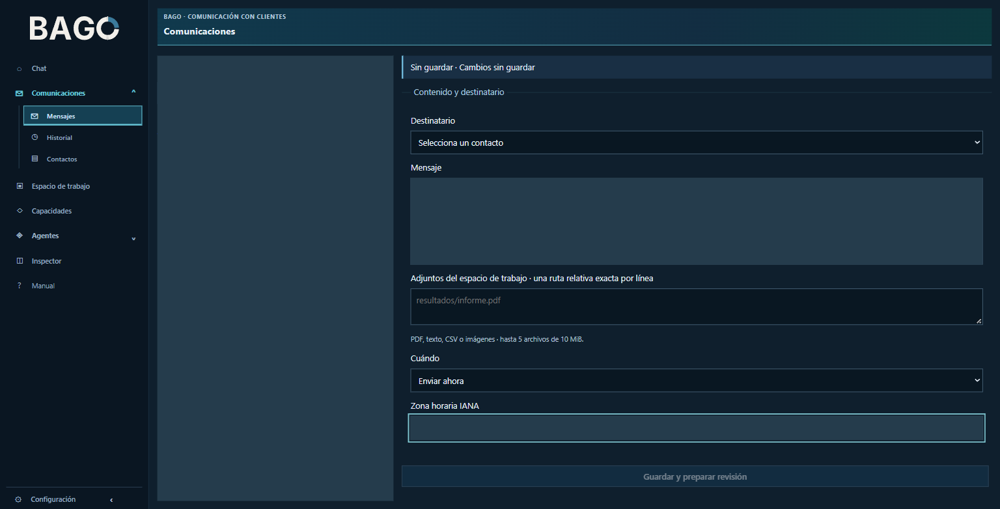
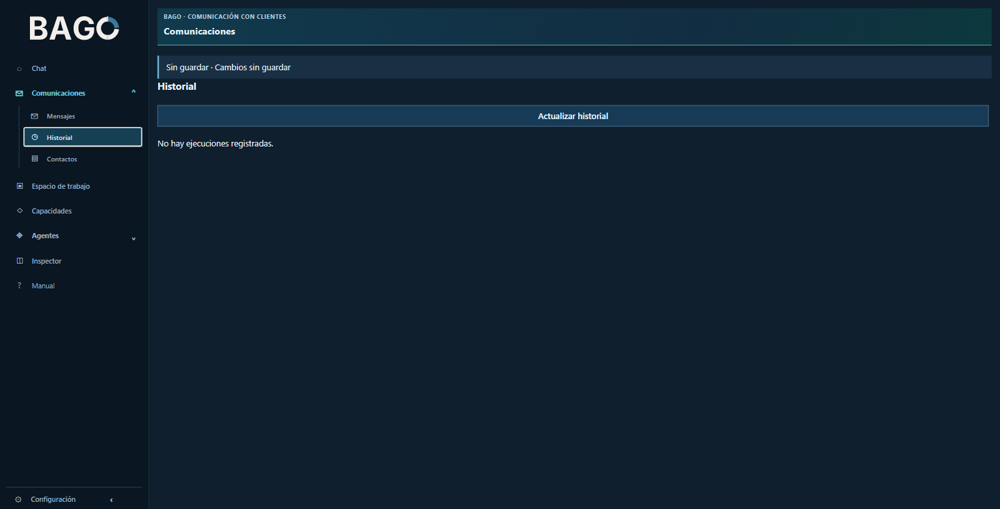
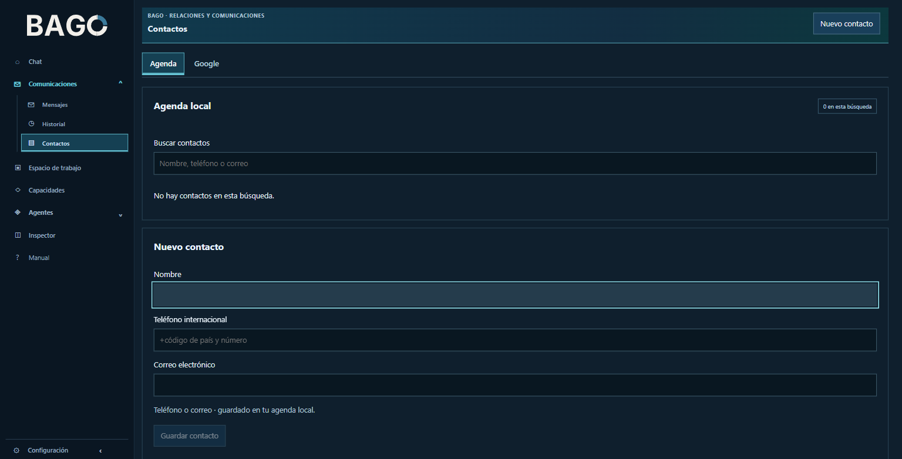
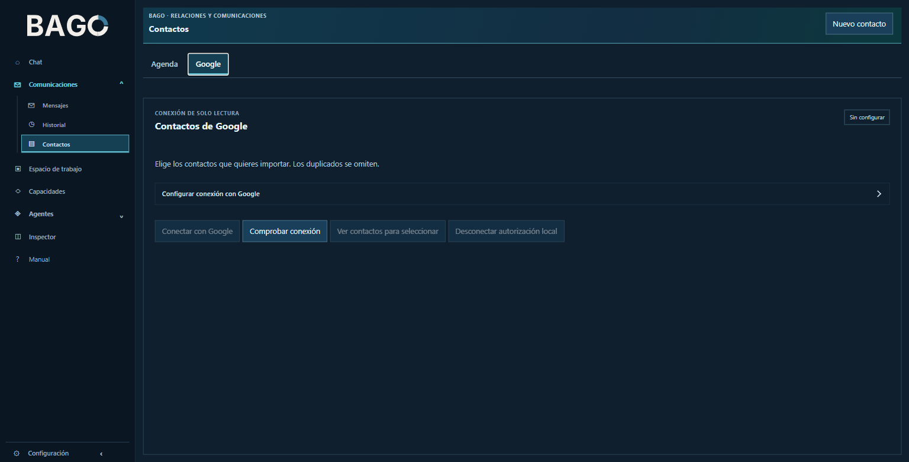
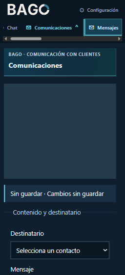
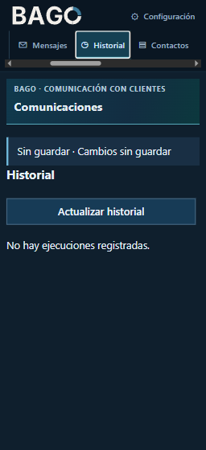
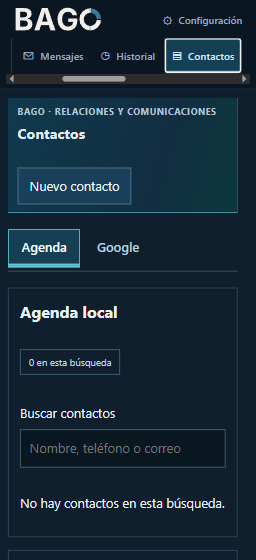

# Candidata de publicación: servicios integrados y Comunicaciones

**PREPARED para revisión independiente.** Rama `review/integrated-services-20261024`, basada en `origin/main` `c5a78d33fbf5da608f550c4e8809eb6a8cb1be4c`. Esta preparación no hace commit, push, merge ni cambia instalaciones activas. [Contrato](CONTRACT.md) · [selección finita](preparation/selection.json) · [identidad de origen](preparation/SOURCE_IDENTITY.json) · [resultado de la nueva candidata](preparation/ACCEPTANCE_REPAIRED.json).

## Producto incluido

| Área | Implementación incluida | Alcance y límites |
|---|---|---|
| Agentes y chat | Gestión de perfiles, navegación agrupada, conversaciones y acciones revisables | No equivale a una nueva ejecución con proveedor real |
| Proyectos y archivos | SDK de workspace derivado, operaciones autorizadas, revisión humana y recuperación | Se conserva la procedencia y referencia originales |
| Contactos | Servicio derivado, API, agenda y selección de destinatario | La disponibilidad de Google depende de configuración y pruebas propias |
| Comunicaciones | Mensajes, historial y contactos como destinos laterales; contenido compartido con el chat | La navegación conserva edición; confirmar efectos sigue siendo una acción separada |
| WhatsApp | Sesión propia, configuración, sonda y transporte con estados explícitos | No se declara QR vinculado ni envío real por pasar fixtures |
| Web e inspección | Lectura web autorizada, trazas, fuentes y presentación de resultados | Cada lectura y evidencia conserva su candidato y límites |
| Interfaz | Español/inglés, Markdown y superficies comunes | La misión de Inspector detenida permanece **PAUSED** |

Fuentes de producto seleccionadas se copian del ZIP RC10 identificado y se cotejan byte a byte con su snapshot. Las demás entradas son documentación pública, herramientas de desarrollo necesarias y siete capturas revisadas. [Manifiesto de copia](preparation/COPY_MANIFEST.json). La única reparación de documentación nueva marca como pendiente un enlace `HOST_DEMO.md` inexistente; no se fabrica una demostración.

## Documentación y README

Se conservan de la base los contratos del README corporativo: generador, manifiesto, guía frontend y tests de presentación. El README se regenera mediante ese generador para esta candidata; no se importa la galería local del día23. Sus imágenes históricas siguen siendo antecedentes fechados y no representan la interfaz RC10. Las cuatro variantes negativas añadidas localmente para la galería23 no se importan junto con ese contrato excluido; se conserva la batería base de presentación. Por ello los conteos de esta candidata no deben compararse como si fueran idénticos a la selección local anterior. El manifiesto de las siete capturas nuevas se verifica separadamente y no se cuenta como cuatro pruebas sustitutas.

[Servicios](../../services/README.md) · [manual de uso](../../public-web/MANUAL.md) · [escritura revisada](../../agent-write/MANUAL_ES.md) · [workspace](../../workspace/README.md) · [Comunicaciones](../../communications-navigation-20261024/MANUAL_ES.md) · [historial por entidad propuesto](../../communications-navigation-20261024/HISTORY_PATTERN_PROPOSED.md).

Los archivos de procedencia pueden conservar rutas locales históricas como metadatos de origen. No son credenciales ni instrucciones para instalar en esas rutas. No se alteran sus identidades para hacerlas parecer una ejecución nueva.

## Galería actual y privacidad

Capturas originales de la observación RC10 en Brave visible del24 de octubre; revisión visual sin contactos personales, números, credenciales ni QR visibles. Los campos sensibles están vacíos/enmascarados. Su [manifiesto público](captures/MANIFEST.json) liga cada imagen con su SHA-256. No se importan dumps DOM ni conversaciones. Las capturas prueban presentación observada, no envío ni inferencia.

| Mensajes | Historial | Contactos |
|---|---|---|
|  |  |  |

| Mensajes a320px | Historial a320px | Contactos a320px |
|---|---|---|
|  |  |  |

## Evidencia heredada y nueva

- **Heredado de RC10:**474 tests frontend PASS y36 comprobaciones visuales PASS, ligados a sus bytes y entorno originales. No se cuentan como ejecuciones de esta rama.
- **Nueva candidata:** consultar `preparation/ACCEPTANCE.json`, logs y manifiesto final. La primera suite Python detectó dos causas de preparación (README sin bootstrap y jsdom ausente). Sus10fallos/931PASS/1SKIP se conservan; el coordinador autorizó corregir ambas causas, comprobar los casos afectados y ejecutar una segunda suite completa mediante el generador base, sin sumar conteos entre intentos; el check posterior sólo comprueba reproducción del README.
- **NOT_RUN:** CI de GitHub para esta rama, publicación remota, nuevos proveedores, QR/envío WhatsApp y nuevas operaciones externas. La nueva preparación no ejecuta otra aplicación8093. El coordinador completó la entrega local RC10 y su observación; el resumen heredado y hashes se conservan por separado, sin atribuirlos a esta rama.
- **Entorno:** Windows, Python3.14 en un entorno de pruebas externo ya existente. Allí Playwright no está instalado; se conserva la dependencia declarada y la instalación de destino debe seguir `requirements.txt`/`requirements-whatsapp.txt`. No se atribuye a ese entorno una ejecución de navegador o transporte WhatsApp.

Quedan excluidos runtime activo, estados de otros goals, builds, dependencias instaladas, perfiles de navegador, SQLite, ZIP, objetos, extracciones y evidencia privada. La copia de implementación y sus candidatas anteriores se conservan intactas. La promoción remota requiere revisión independiente, base actualizada y puertas aplicables; esta preparación deja PP02 listo para el coordinador.

## Continuidad y límites de publicación

[Resumen heredado de entrega local](LOCAL_DELIVERY_SUMMARY.json): el coordinador registra RC10 aplicado en8093, revisión independiente y observación de los tres destinos PASS, con backend8094 y volúmenes preservados. Son resultados del candidato y entorno RC10 originales; esta rama sólo copia fuentes y prepara la publicación.

La nueva exigencia de jerarquía global del menú por autoridad continúa **PROPUESTO**, bajo revisión de lectura; esta candidata sólo incluye la agrupación de Comunicaciones. No se presenta como una implementación de esa jerarquía global.

Los SHA de origen identifican bytes del candidato Windows antes de la normalización que pueda aplicar Git. No se reescriben los manifiestos históricos para hacerlos corresponder a otro checkout. El commit/tree y los blobs de la publicación deben identificarse después de preparar el índice; su CI seguirá siendo NOT_RUN hasta ejecutarse sobre esa identidad.

[Pendientes fechados y hallazgos menores](PENDING.md): el snapshot no implementa la nueva jerarquía global por autoridad ni un nuevo registro dinámico de capacidades.

**Límite de capacidades:** el catálogo estático, los IDs de perfil y las herramientas autorizadas por turno no constituyen actualmente una admisión única demostrada. No se afirma que las asignaciones del perfil sean efectivas en chat ni que todo el sistema esté validado. El diagnóstico y su puerta de cierre están en PUB-PENDING-002 de [pendientes](PENDING.md). El runner genérico continúa no disponible cuando falta su ejecutor.

**Puerta previa al push:** el orden de preparación Node/npmci en el workflow base necesita el sucesor acotado descrito en PUB-PENDING-005. El PASS local de esta candidata no demuestra que CI remoto esté preparado ni ejecutado.
