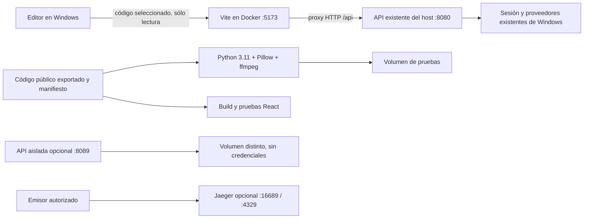

# BAGO · Entorno Docker de desarrollo

**Candidata independiente 2026-10-23 · desarrollo y pruebas en Linux containers.**

Este directorio prepara un entorno reproducible para React/Vite, Python 3.11,
Pillow y ffmpeg. Utiliza Docker Desktop ya instalado y conserva la API BAGO del
host para acceder al mismo canal de proveedores. No copia tokens ni perfiles y
no pide volver a registrar proveedores. Es un producto separado; no modifica
la instalación activa ni los checkouts de otros trabajos.

## Vista general



| Perfil | Servicio | Para qué sirve | Dirección del host |
|---|---|---|---|
| dev | frontend | Vite del snapshot identificado; ver pruebas y límites | http://127.0.0.1:5173 |
| test | python-smoke | Comprueba versión, genera PNG y persiste/lee fila SQLite nueva | Sin puerto |
| test | python-test | Regresión focal de conversaciones, ETL y vector store | Sin puerto |
| test | frontend-test | Build real y pruebas Vitest | Sin puerto |
| backend | api-isolated | API nueva con datos nuevos, sin sesión de proveedores | http://127.0.0.1:8089/api/health |
| observability | jaeger | Consultas de trazas y receptor OTLP HTTP | http://127.0.0.1:16689 y :4329 |

Los puertos publicados escuchan sólo en 127.0.0.1. El proyecto Compose por defecto
se llama `bago-dev-20261023`; otros IDs/instancias derivan proyectos y volúmenes distintos.
Jaeger ofrece una proyección de trazas; no autoriza acciones ni sustituye sus
recibos. Este entorno no inicia brokers de proveedores alternativos.

## 1. Preparar el código

Abrir PowerShell en esta carpeta. Comprobar Docker:

```powershell
docker version
docker compose version
```

Debe aparecer servidor Linux. La comprobación actual encontró Docker Desktop
4.96.2, Engine 29.9.2, Compose 5.6.1 y WSL2. No se instaló ni se reconfiguró nada
del sistema. Otros equipos deben ejecutar sus propias comprobaciones.

Exportar un checkout de ADL que se quiera revisar:

```powershell
$env:BAGO_DEV_CANDIDATE = 'mi-candidata-a'
python prepare_context.py --source "C:/ruta/al/checkout/ADL" --candidate-id $env:BAGO_DEV_CANDIDATE
python dev.py preflight
```

El exportador sólo admite archivos públicos seguidos por Git: usa los bytes
actuales y registra sus SHA-256 y HEAD. Excluye documentación histórica, builds,
entornos, perfiles, datos, credenciales, trazas, evidencias y worktrees anidados.
No incluye silenciosamente archivos nuevos sin seguimiento. Para admitir fuentes nuevas revisadas sin staging, añadir --include-snapshot
ruta/absoluta/docs/integration/evidence/I02/SOURCE_SNAPSHOT.json y el de I03.
Cada archivo debe conservar el hash de su snapshot; no se incorporan archivos
privados ni otro checkout por esa opción. Cualquier reparación posterior exige
un nuevo snapshot explícito y una nueva identidad de exportación.

La salida es `context-public/repository`, SOURCE_MANIFEST.json y EXPORT_IDENTITY.json.
La exportación de I04 usa ID integrated-20261023-phase1 (412 archivos).
El ID20261023 corresponde sólo al RC1 histórico externo; no reutilizarlo para
atribuir sus pruebas a la integración. El export fase1 tiene preflight/config PASS,
pero no es una imagen final verificada: I05 debe incorporar dependencias, Inspect
y seguridad, exportar otra identidad y ejecutar las puertas finales.
Usar un ID distinto para cada candidata nueva: deriva proyecto, imágenes y volúmenes.
Si ya existe, el script se detiene para conservarla: crear otra carpeta de bundle
para otra exportación. No copiar un perfil de usuario ni usar el home como fuente.
`.dockerignore` aplica una segunda exclusión al contexto de build. Las carpetas
`context` y `context-aborted-broad-docs` de esta ejecución son intentos históricos
interrumpidos, nunca contextos finales ni parte de la entrega aplicable.

## 2. Construir y comprobar

```powershell
docker compose --profile "*" config
docker compose --profile test build python-smoke frontend-test
docker compose run --rm python-smoke
docker compose run --rm python-test
docker compose run --rm frontend-test
```

Para el uso habitual, ejecutar primero `python dev.py preflight` y utilizar
`python dev.py config`, `build`, `test`, `up`, `ps` o `stop`. Estos comandos funcionan
también invocados por ruta absoluta desde otro directorio; fijan explícitamente
el proyecto y descartan COMPOSE_PROJECT_NAME heredado. Los comandos Compose
anteriores son la correspondencia manual para revisión; no sustituyen preflight.

El build usa imágenes base fijadas por digest y las dependencias declaradas de
ADL; npm usa `npm ci` y su lock. Python usa `requirements-test.txt`, que incluye
Pillow; ffmpeg se instala en la imagen Linux. La versión efectiva de paquetes
resueltos se conserva en el recibo `python-environment-lock.log`. No se promete
reconstrucción idéntica bit a bit de dependencias transitivas/apt no fijadas por
hash: conservar las IDs de imágenes verificadas y revisar resoluciones futuras.

`python-test` es una selección focal documentada, no toda la suite de ADL. Para
ejecutar otra selección sobre el mismo snapshot:

```powershell
docker compose run --rm python-test python -m pytest tests/test_conversation_library.py -q -p no:cacheprovider
```

La suite completa puede necesitar documentación, contratos y artefactos que
este contexto mínimo excluye. No convertir esas omisiones en éxito ni montar
por ello toda la instalación personal. El cierre de implementación del repo
mantiene sus propias puertas README/full suite sobre su candidata identificada.

## 3. Desarrollo con la sesión existente del host

Mantener la API BAGO habitual ya abierta en Windows. El valor por defecto es
8080. Para otra preview existente, cambiar sólo la dirección del proxy:

```powershell
$env:BAGO_API_PROXY_TARGET = 'http://host.docker.internal:8080'
docker compose --profile dev up -d --wait frontend
```

Abrir http://127.0.0.1:5173. No hay un segundo registro de proveedores en el
contenedor: `/api` llega a la API elegida, y ésta sigue siendo dueña de su sesión.
Docker Desktop resuelve `host.docker.internal`; verificarlo en el equipo real:

```powershell
docker compose exec -T frontend node -e "fetch('http://host.docker.internal:8080/api/health').then(r=>console.log(r.status))"
Invoke-RestMethod http://127.0.0.1:5173/api/health
```

`health` no demuestra inferencia, permisos de escritura, WebSockets ni envío.
Las políticas de Origin/CORS del host siguen vigentes. No se reescriben ni se
eliminan cabeceras de autorización para sortearlas. Si un recorrido mutante o
WebSocket falla, conservar el error y corregir el contrato de proxy del host en
un cambio revisado; no afirmar que todo el chat está verificado por un GET.

Por defecto src/public se montan desde context-public/repository en lectura.
**Estado de esta integración:** RC1 histórico falló al servir archivos públicos
nuevos. I04 añade un adaptador Docker que rearma la vigilancia explícita de
src/public y condiciona health a su cobertura. Alta/edición/eliminación y
recuperación de activos públicos pasaron sobre fixture aislada; la validación
React/DOM y la repetición sobre el conjunto integrado se documentan en
../../docs/integration/evidence/I04 y en la revisión del coordinador.
No reutilizar los resultados históricos como prueba de estos bytes.

Una edición invalida la
evidencia anterior: preflight,
build y up la marcan como obsoleta y exigen una nueva exportación/configuración
identificada antes de atribuir nuevos resultados a una candidata. El comportamiento
de un Vite ya abierto requiere observación y no conserva un estado VERIFIED.
`python dev.py ps` y `python dev.py stop` siguen funcionando con huella STALE:
validan proyecto/candidata y conservan la posibilidad de parar sólo los propios.

Para trabajar sobre otro checkout, crear otra carpeta/export con ID distinto.
Cambiar BAGO_DEV_SOURCE a otro frontend dentro de esta candidata se rechaza antes
de ejecutar Docker. No se exige restaurar bytes para detener un entorno propio.
Se pueden elegir puertos y una instancia separada de la misma candidata:

```powershell
$env:BAGO_DEV_FRONTEND_PORT = '5179'
$env:BAGO_DEV_API_PORT = '8090'
$env:BAGO_DEV_JAEGER_PORT = '16690'
$env:BAGO_DEV_OTLP_PORT = '4330'
$env:BAGO_DEV_INSTANCE_SUFFIX = '-segunda'
python dev.py preflight
python dev.py up
```

Sólo src/public se montan, en lectura; editar desde el editor Windows. Las
dependencias y caché de Node están en volumen propio, no node_modules de Windows.
Cambios en package-lock/configuración requieren nueva exportación/build y un
volumen de módulos nuevo identificado. No montar `.bago`, `%USERPROFILE%`, el
socket Docker, perfiles Brave ni credenciales en el contenedor.

## 4. Backend y observabilidad aislados

```powershell
docker compose --profile backend up -d --wait api-isolated
Invoke-RestMethod http://127.0.0.1:8089/api/health
docker compose --profile observability up -d jaeger
Invoke-RestMethod http://127.0.0.1:16689/api/v3/services
```

La API aislada arranca el servidor ADL existente desde el snapshot, con usuario
no root y volumen `api-data` distinto del volumen de pruebas. No tiene los
proveedores del host. No es una sustitución del canal Windows autenticado.
Los escenarios Codex/OAuth desktop, WhatsApp visible y automatización Windows
continúan en su adaptador host real; soporte dentro de Linux container NOT_RUN.
La guardia existente de Ollama rechaza BAGO_RUNTIME_MODE=container porque depende
del vault/loopback del host. Se conserva esa guardia; la vía para reutilizar la
sesión es el frontend proxy hacia la API Windows. No registrar tokens otra vez.

Jaeger tiene puertos propios porque el host ya dispone de otro Jaeger. No se
para ni cambia el existente. Configurar cualquier emisor de pruebas autorizado
con `http://127.0.0.1:4329/v1/traces` desde Windows, o
`http://jaeger:4318/v1/traces` desde la red de este proyecto.

## 5. Evidencias, revisión y parada

```powershell
python validate.py
python dev.py ps
python dev.py stop
```

validate.py valida manifiesto/configuración, construye imágenes, ejecuta pruebas,
comprueba health/HTML/proxy real y conserva recibos en evidence. No usa navegador,
no prueba inferencia ni envía mensajes. Se niega a sobreescribir ejecuciones.
Al pasar deja sólo sus tres servicios identificados abiertos para revisión;
`stop` los para conservando datos. No usar prune, `down -v` general ni parar
contenedores ajenos. Para recoger el XML focal:

```powershell
docker compose run --rm python-test python -c "from pathlib import Path; print(Path('/results/python-focused.xml').read_text())" | Set-Content -Encoding utf8 python-focused.xml
```

Como `run --rm` retira su contenedor, el XML queda en el volumen python-results;
el comando anterior usa otro contenedor propio para leerlo. Los logs del runner
ya incluyen resultado y conteo, sin depender de esa copia opcional.

## Integración y conservación

Esta infraestructura procede del patch RC1 preservado en su directorio externo.
I04 incorpora sólo sus archivos infra/dev; no copia contextos ni capturas privadas.
Los cambios de producto se componen en otros trabajos y se exportan tras sus
snapshots. El README raíz se genera al cierre por el coordinador, junto con sus
pruebas completas. Esta documentación no sustituye esas puertas.

## Documentación de referencia

[Docker Desktop y conexión al host](https://docs.docker.com/desktop/features/networking/networking-how-tos/),
[perfiles Compose](https://docs.docker.com/compose/how-tos/profiles/),
[montajes de sólo lectura](https://docs.docker.com/engine/storage/bind-mounts/).

## Ejecución externa y diagnóstico de recarga

El adaptador está en docker/vite.dev.config.mjs y lo copia el Dockerfile frontend.
No requiere coordinador BAGO ni modifica el vite.config.ts del producto.
`/__bago_dev_health` responde200 sólo cuando el watcher cubre src/public;
una página HTML200 por sí sola no demuestra que se vigilen archivos nuevos.

Para repetir las comprobaciones de archivos públicos desde otra carpeta:

```powershell
python E:/ruta/bundle/verify_live_assets.py --url http://127.0.0.1:5186 --public-dir E:/ruta/bundle/context-public/repository/frontend/public --container bago-dev-integrated-20261023-phase1-frontend-1 --receipt E:/ruta/bundle/evidence/public-live.json
```

El script crea únicamente sus dos archivos sintéticos, conserva identidad de
contenedor/procesos y los retira al terminar. Ejecutarlo antes de observar estado
React: un cambio público puede solicitar una recarga de página legítima.
No sondear por HTTP un módulo nuevo antes de que el watcher registre su alta;
la observación debe leer eventos/cobertura, y después editar su importador.

Hallazgo conservado: la primera importación de un módulo nuevo produjo remount
de React y perdió el contador, incluso sin full-reload WebSocket. La causa interna
sigue INCONCLUSIVE; no se garantiza conservación de estado para toda edición.
Las pruebas distinguen alta visible, HMR de módulo existente/nuevo ya importado,
conservación de estado observada y continuidad del proceso.

La imagen Python preparada incluye git para WorkspaceSDK, además de Pillow y
ffmpeg. El smoke ejecuta git init sobre una raíz nueva y comprueba el repositorio.
Su build y las pruebas Git del SDK sobre la composición final pertenecen a I05;
no deben omitirse ni sustituirse por el check de versión.
